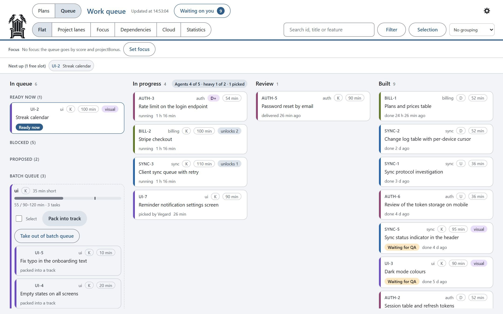
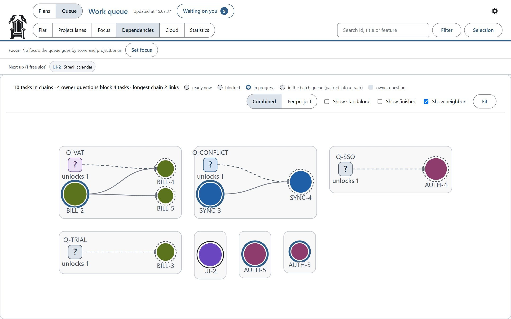
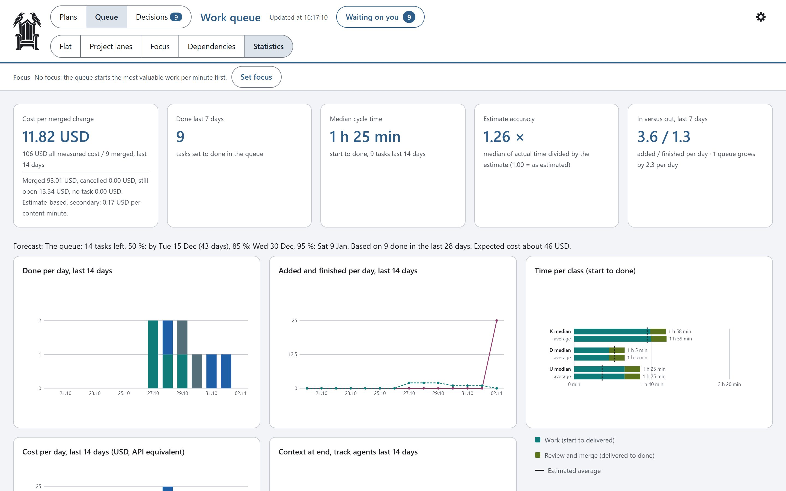
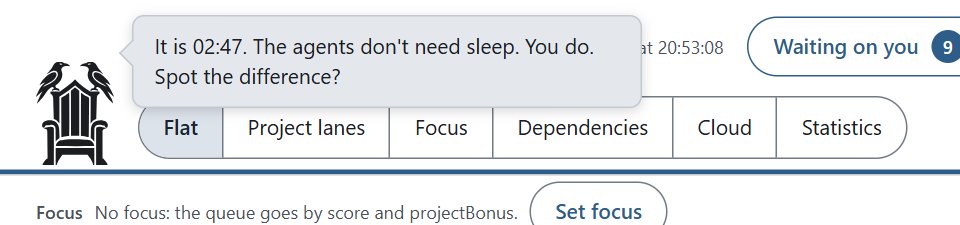

<p align="center">
  <picture>
    <source media="(prefers-color-scheme: dark)" srcset="assets/logo/ravenseat-dark.svg">
    
  </picture>
</p>

<h1 align="center">Ravenseat</h1>
<p align="center"><b>A work queue and kanban board for Claude Code. Agents do the work; you make the decisions.</b></p>

<p align="center"></p>
<p align="center"><sub>The board with a made-up demo project ("Pebble", a habit tracker). More in <a href="#a-tour-of-the-board">A tour of the board</a>.</sub></p>

- **Parallel work without collisions.** Every task runs as a fresh agent with a small, fresh context, in its own git
  worktree and branch, and owns its files exclusively while it runs.
- **You only make the decisions.** Agents code, the checks gate, the orchestrator merges. A task that needs you parks
  in `/cq:decide` with a recommendation, and the rest of the queue keeps going.
- **Built to last the week.** Tracks are cut at about 300k tokens of context, fix rounds start a fresh agent, and the
  orchestrator stays light, so the queue runs for days on one subscription.

There are no workflows or pipelines to write first: the process is built in, and plans and tasks live on disk, so
nothing is lost when a chat ends or gets compacted. It works purely from Claude Code (every board action has a
command behind it); the board is optional, for the overview.

By Vegard Cowie Jørgensen.

## Quick start (lite)

New here? Start in lite mode: the core loop only, nothing to learn first. You need Node.js 20 or newer, git and
Claude Code.

1. **Install** (in Claude Code): `/plugin marketplace add vegardjorg/ravenseat`, then
   `/plugin install cq@ravenseat`.
2. **Create the queue** in your project: `cq init --lite` (a fresh `cq init` is lite too). It writes
   `"mode": "lite"` to `queue.config.json` and an empty queue in `scripts/.queue/` (add that folder to `.gitignore`).
3. **Add work with just a title:** `cq add "Fix the login bug"`, or say "add to the queue: fix the login bug". Add a
   mission when the title is not enough: `cq add "Fix the login bug" --mission "Users with a + in the email cannot log in; add a test"`.
   `--priority 1-10` moves a task up (5 is normal); otherwise tasks run in the order you added them.
4. **Run it:** `/cq:queue`. The chat becomes the orchestrator: it shows the state, asks you first, then starts one
   agent per task in its own git worktree (`cq fill`), takes in what they deliver (`cq receive`) and merges it
   (`cq merge`). It never pushes unless you say so.
5. **Answer questions:** when an agent needs your decision, that task waits and the rest go on. `cq question` lists
   them, `cq resolve <id> --answer "..."` answers one, or use "Waiting on you" on the board (`/cq:board`). A question
   can come with 2-4 answer options (`cq question <id> --text "..." --choice "Yes" --choice "No"`): pick one with
   `cq resolve <id> --choice 1`, or with one click on the board.

> **That's all you need.** Add tasks, run `/cq:queue`, answer what it asks. `cq help` shows only these commands in
> lite mode.
>
> **Going further:** `cq mode full` switches to full mode (`cq mode lite` goes back), and `/cq:setup` sets up your
> checks, areas and settings. Full mode adds what lite leaves out: risk classes, value and size estimates, the
> small-task guard and batch queue, focus, the plan register and helper agents. See
> [Graduating to full mode](#graduating-to-full-mode).

Installed it as claude-code-queue before? See [Install](plugin/docs/guide.md#install) for the one extra step.

## Why I built it

**The problem.** In a small project, working with Claude Code was easy. Most of the work showed up on a screen I
could look at, and I could keep the whole picture in my head. As the project grew, that stopped working:

- **Progress became invisible.** Days of backend work could pass without a single screen changing, so there was
  nothing to look at that told me where the project stood.
- **The work was scattered across chats.** Size and complexity meant 50 to 100 chat windows, each holding part of
  the picture. Half the findings of a security review could be forgotten in one of them.
- **Parallel chats collided.** With several chats open on different parts of the project, they edited the same files
  and pushed on top of each other. The result was push conflicts, merge conflicts and work overwritten by a chat that
  did not know another one had the file open.
- **Features were left half-built.** I lost track of features halfway through the implementation, because nothing
  held on to what was started and what was left.
- **The workaround burned tokens.** Running everything in one long chat kept the overview, but every turn carried the
  whole history, and the token use grew far faster than the work did.

**The answer.** To get an overview back and work systematically, I built the queue step by step inside that project:
a plan register for what is not ready yet, a work queue with dependencies and a focus, a board that shows it all, and
an orchestrator that hands each task to a fresh agent with a small context. Each agent works in its own git worktree
and branch, a task owns its files exclusively while it runs, and one orchestrator merges and pushes, so parallel work
no longer collides. The parts that are not tied to one project were then extracted into this plugin. What stayed
behind is what has to be project specific: the CI/CD pipeline and the domain-specific checks
([not included](plugin/docs/guide.md#not-included)).

**What it gives me now.** I wanted a project that keeps moving without me sitting at it. With the queue, Claude Code
runs a large project on its own for long stretches, often overnight or for days. It picks the next task, starts track
agents, reviews and merges what they deliver, and starts the next tasks. When a task needs my decision, the queue
does not stop: it parks that task and carries on with everything else that can be done. The decisions wait for me on
the board, or the orchestrator lists them in the chat, each with context and a recommendation.

Most of the time I work from my phone. Remote Control connects me to the orchestrator chat in Claude Code, so I only
deal with a single chat. The work itself happens in fresh, small contexts for each task. The orchestrator keeps its
state in the queue and in a handover note, and the chat is compacted automatically at 300k tokens of context, so it
can keep going for days. From the phone I ask what is next, what is blocked or what a plan contains, and I answer the
open questions. The tasks that waited on them then move on.

On the desktop I use the board to keep track of the project. I go through the open questions, manage the
dependencies between tasks, and choose the focus. With focus, I pick which areas of the project to work on now. The
queue finishes those before it moves on to the next feature or step I want. The queue also helps Claude Code keep
order: it keeps track of the plans, the tasks, what depends on what and what is running right now, so nothing gets
lost between sessions.

Splitting the work into right-sized tasks, each in a fresh small context, cut my usage a lot compared with the long
chat. On a Claude Max (20x) plan, the queue now keeps running for about five days of a week before the weekly limit
runs out. That is one project and one developer; see [What it costs in tokens](#what-it-costs-in-tokens) for what was
measured and what was not.

## A tour of the board

**Start it:** in Claude Code, run `/cq:board` (or say "start the board"). Claude starts it in the background and
gives you a link like `http://127.0.0.1:2000/#key=…`. It runs while that Claude Code session runs. To keep it
running on its own, start it from your own terminal in the project folder:
`node "<plugin folder>/scripts/orchestrator/cq.mjs" board` (`/cq:board` tells you the exact path). The plain `cq`
command only exists inside Claude Code.

The board only listens on 127.0.0.1, and the key in the link changes on every start. It follows your system's light
or dark mode; the gear lets you pick one. The screenshots use a made-up demo project.

### The queue

The main view (top of this page) is a kanban: **In queue** (ready now, blocked, proposed by agents, and the batch
queue where small tasks wait to be packed into one track), **In progress** and **Review**. Each card shows the id,
domain, class (K, D, D+ or U), estimate and how many tasks it unlocks. **Next up** shows what the orchestrator starts
in the next free slot. Other views: **Project lanes** (one row per project), **Focus** (only what you have chosen to
push), **Decisions** and **Statistics** (**Cloud** is hidden until you turn it on in Settings). Click a card for its
mission, owned files, cost and the actions for its status (see [task detail](plugin/docs/guide.md#task-detail)).

### Waiting on you and Decisions

<p align="center"></p>

Everything only you can decide lands here: questions from agents (with their recommendation), owner tasks and
conditions. Each shows which tasks it blocks. Answer on the board, and the orchestrator picks up the answer and
unblocks the tasks.

The **Decisions** tab is the same list as `/cq:decide`, sorted by what each answer unlocks and grouped as Decide,
Check, Approve and Unstick. The board opens on it when anything waits. The recommendation is the main button, an
answer can be undone for 5 seconds, and j/k, Enter, 1-4 and u work from the keyboard.

### Dependencies

<p align="center"></p>

The chains as a graph: circles are tasks (solid ring = in progress, dashed = blocked), squares are open questions.
It shows at a glance which single answer unlocks the most work.

### Statistics and cost

<p align="center"></p>

Done per day, cycle time, how good the estimates are, cost per day (API-equivalent), time per class, and how large
the agents' contexts got. This is where you see whether the queue earns its keep.

The plan register, the priority map, dark mode and the settings panel are shown in the
[full-mode guide](plugin/docs/guide.md#the-board-in-detail); every tab is described in [board](plugin/docs/board.md).

<p align="center"></p>

Ken sent me.

## Graduating to full mode

Lite is the loop. Full mode is the same loop plus answers to the problems that show up once a project and its queue
grow. Switch with `cq mode full`, and run `/cq:setup` to fill in your checks and areas
([first run in full mode](plugin/docs/guide.md#first-run-in-full-mode)).

### The pieces

The name says how it works: you sit in the Ravenseat, and the ravens (your agents) fly out into their worktrees and
come back with the work.

- **Plan register:** a list of ideas, plans and investigations, each with a priority and a maturity (idea,
  investigated, planned, ready, then in the queue, built and verified). It points to your documents instead of
  copying them. See [plan register](plugin/docs/plan-register.md).
- **Work queue:** concrete tasks. Each has a class (risk level), an estimate, a value, dependencies, the files it
  owns, and any open questions for you. The queue picks the next task by value per minute.
- **Orchestrator:** one Claude Code chat that runs the loop. It starts tasks, reviews results, merges them and asks
  you what only a human can decide. It does not write the code itself.
- **Tracks:** each task runs as a subagent in its own git worktree, on its own branch. It gets a short mission file,
  does the work, runs your checks, commits on its branch and answers with one line. The long report goes to a file,
  not into the orchestrator's context.
- **Board:** a local web page (kanban, plans, dependencies, cost, and "Waiting on you"). It is optional: everything
  works from Claude Code, and `/cq:decide` is the main loop for what waits on you.

Worktrees do not reinstall your dependencies: `prepare-track.mjs` links the folders in `sharedLinks` (default
`["node_modules"]`) from the main tree into each worktree, as a junction on Windows and a symlink otherwise, and the
cleanup removes them as links.

How the loop runs step by step, the hooks, and the daily commands: [full-mode guide](plugin/docs/guide.md#how-it-works).

### "Agents skip security and edge cases"

Task classes decide size and review:

| Class | Meaning | Size of one task | Review |
|---|---|---|---|
| K | Ordinary code | 90 to 120 min of work | none |
| U | Investigation | about 60 min | the challenger (a helper agent) |
| D | Database or contract change | about 40 min | one reviewer agent |
| D+ | High-risk database or security | 25 to 30 min | two reviewer agents |

On top of that come **helper agents**: optional reviewers you switch on and off (`cq helpers`, or the Helper agents
tab in the board's settings). By default the challenger runs for U and `bug` tasks and the design reviewer for
`visual` tasks; the tests, gap and docs reviewers are off. The board shows what each one costs in minutes, tokens and
dollars, and how many findings it gives. See [orchestration](plugin/docs/orchestration.md#helper-agents).
You can add your own agent file as a **custom helper** (`cq helpers add <file.md>`, or "add this as a helper
agent"): it is copied, scanned, read by Claude and approved by you against its hash before it can be switched on,
and it turns off again if the file changes. See
[custom helper agents](plugin/docs/orchestration.md#custom-helper-agents).

`/cq:review <area> [<lens>]` reviews a path or feature (security, logic, ux, architecture) and turns its findings into
fix tasks, gate tasks and questions.

### "Half-done features everywhere"

- **Focus:** you choose the areas to work on now (`cq focus set`, or the Focus tab). The queue finishes the connected
  tasks in that focus, fixes and follow-ups included, before it picks up new feature work. When the focus is done,
  the queue pauses and asks whether to set a new focus or continue the regular queue (`focus.continueWhenEmpty`, off
  by default). `cq forecast` says when the rest of the focus is done.
- **Dependency graph:** each task says what it waits for, whether another task or a decision only you can make, so
  you see what is blocked and what can start right now.
- **Plan register:** what is not ready yet lives as plan entries (`cq plan show`, `/cq:plans`) and moves into the
  queue when it is ready.

### "Agents cheat on tests"

A track cannot grade its own work:
- **Gate evidence bound to the commit.** A track cannot report its own checks as green: `cq receive` needs a clean,
  green gate run on exactly the delivered commit, recorded by the orchestrator, and otherwise runs the gate itself. A
  push needs a green full gate on the commit being pushed.
- **Locked acceptance criteria.** `done_when` and the acceptance criteria are fixed once a task starts, and a gap
  reviewer answers MET or NOT MET per criterion.
- **Guards on the guards.** Test, lint and type configs are protected paths (`protectedPaths` in
  `queue.config.json`), and `cq receive` warns about deleted tests and added skip markers. The merge stops (exit 4)
  when a branch changes hooks, settings, agents, the orchestrator scripts or the queue config without owning them
  (`cq merge <ID> --allow-guard` overrides).
- **The queue-agent guard.** Tracks, reviewers and helpers cannot push in any form and may run only an allow-list of
  queue commands (no merge, set, edit, approve or resolve). They treat what they read as data, not instructions, and
  cannot run `curl`, `wget`, `iwr` or a pipe into a shell
  ([hardening against prompt injection](plugin/docs/orchestration.md#hardening-against-prompt-injection)).
- **Every repeatable mistake becomes a check.** After a defect, the orchestrator proposes a `Gate:` task that adds a
  check to your own CI, shown red on the original bug before the fix and green after.

### "My PC chokes on parallel builds"

With many parallel tracks the machine, not the token quota, is often the limit: gates slow down and go red from
memory and timeouts, and reruns eat the gain. So the **load guard** makes `cq fill` open fewer slots than
`maxConcurrent` while free memory is low (all slots from 40 % free, one at the hard limit of 10 %, linear in between;
CPU optional) and says why: `LOAD: 2 of 5 slots: free memory 18 % (all slots from 40 %)`. Below the hard limit no new
tracks start (exit 7). Settings: `loadGuard` in `queue.config.json`
([queue reference](plugin/docs/queue.md#limits-and-safety)).

**Cloud sessions** move ordinary code tasks to Claude Code's cloud sessions on claude.ai instead (off by default,
`"features": { "cloud": true }`). See [cloud sessions](plugin/docs/guide.md#cloud-sessions).

### "Something breaks and the queue stops"

The queue keeps working when something stops. A task that waits on you is parked, and everything else goes on. A red
check gives a fix round with a fresh agent, and a red base gets its own fix task while other merges wait. A gate that
fails once and passes on a rerun is recorded as flaky instead of freezing the base.
- **Fewer surprises at merge.** `cq conflicts` predicts which running tracks will conflict with each other or with
  the base (`git merge-tree`, nothing written) and suggests a merge order.
- **Optional CI watch after a push** (`push.ciWatch`, off by default). Local first is the rule: push only when the
  local checks are green. The watch is a second net that turns a red CI run into one fix task.
- **Ask an earlier track.** `cq ask <id> "why X?"` answers from the track's mission, report, commits and transcript
  tail, without resuming a large agent.

### Claude Code first: you only make the decisions

Ravenseat works as a backend for Claude Code. Every board action has a command behind it
([CLI parity](plugin/docs/cli-parity.md)), so you can work entirely from one chat (or from your phone over Remote
Control) and never open the board.

**The goal is that your only contact surface is a decision list.** Once your project has checks you trust (tests,
type check, lint, a database run before push), the routine needs no human: agents build, the gates check, the
orchestrator merges. What is left for you is what a machine should not decide alone:
- unclear product requirements, hard-to-reverse choices (data model, public API, new dependencies, deletions) and
  security or legal tradeoffs. Tracks fix technical failures themselves and ask you only about these; other
  assumptions are written down in the report;
- approving tasks agents propose, visual QA, and work that is stuck.

`/cq:decide` walks the list one decision at a time, the recommendation first, and tells you what each answer
unlocks. The board's Decisions tab shows the same list with one-click answers and undo. `cq cost` shows the flow
numbers behind this: right first time, defects after merge, and how many tasks were verified per owner intervention.

### The name and the logo

The logo is the Ravenseat: two ravens on a high seat, after Odin's seat Hliðskjálf, from which he saw every world while
his ravens brought him the news. It sits in the top-left corner of the board and follows light and dark mode.

## What it costs in tokens

Every turn in Claude Code sends the whole conversation again (most of it from the prompt cache, which is cheaper but
not free). So a turn costs more the larger the context is, and a session costs roughly **number of turns times
context size**. The system is built around that fact: many short contexts instead of one long one.

**Read these numbers with care.** They come from one project (mine), one developer and a few months of use, about
1,200 measured tasks. They are not a benchmark, and there is no controlled comparison with other ways of working.
- The cost per task is **measured**: the subagent logs record the tokens, and the dollar amounts are what those
  tokens would cost at API prices. On a subscription you pay a flat fee; the amounts only show relative use.
- The comparison with "one long chat" and "many small chats" below is **my estimate from experience**, not a
  measurement.
- Your numbers depend on your codebase, your tasks, your checks and the model, and will differ.

**Measured: median cost per finished task, including its review.**

| Class | Median USD (API-equivalent) | Average USD | Median tokens (mostly cache reads) | Median turns |
|---|---|---|---|---|
| K (code) | about 2.5 | about 3.1 | about 10M | about 60 |
| D (database) | about 5.1 | about 5.7 | about 25M | about 105 |
| D+ (high-risk) | about 7.5 | about 8.8 | about 36M | about 137 |
| U (investigation) | about 1.8 | about 2.1 | about 6.5M | about 42 |

The orchestrator added about 18 turns and about 0.75 USD per task. Its target is now 10 turns or fewer per task.

**Measured: where tokens were wasted, and what the plugin does about it.**
- Turns taken while a track's context was above about 300k tokens were about 61% of track cost. So a track stops at
  about 300k: it commits, writes a handover note, and a fresh agent continues. A track may compact once; at the second
  compaction it delivers PARTIAL. A SubagentStop gate (`hook-track-end.mjs`) sends a track back once if it stops with
  neither a commit nor a RESULT line.
- The orchestrator's handover note grew to thousands of lines that every takeover read in full. So it has a short
  "Now" part and a dated log; `cq handover archive` moves old log entries to a monthly archive, and only "Now" is read
  after compaction and at takeover. A status line (`cq setup --settings`) shows context, cost, quota and running
  tracks while you work.
- Prompt cache expiry while waiting was about 23% of all usage. So there are no sleep or polling loops, and
  subagents use a 1-hour cache.
- Fix rounds sent to an agent that already held 400k to 900k tokens of context were 35 to 38% of track cost. So fix
  rounds always start a new agent with a short mission.
- Fixed overhead per track (setup, reading, checks, report) was about 60% of a small K task and 30 to 40% of a D or
  D+ task. So task sizes are set per class, and small tasks are bundled.

**Estimated, not measured: the alternatives.**
- *One long chat.* Each new message pays for the whole history again. In my project, a message at over 500k
  context cost close to three times as much as the same message at 100k to 200k, and quality dropped as the context
  filled. I expect this to cost several times more per task than the queue, more the longer the session runs.
- *Many small chats by hand.* The context stays small, but every chat pays the start-up cost again (reading the
  project, finding files, running checks), and you do the coordination yourself: no shared queue, no file ownership,
  no review step, and merge conflicts when chats overlap.

Run `cq cost` in your own project to see where your tokens go.

## Reference and safety

### Key commands

All scripts share one entry point, `cq`. With the plugin, `cq` is on the PATH of Claude Code's Bash tool. In a
vendored install, write `node scripts/orchestrator/cq.mjs` instead of `cq` (the installer already does this in the
files it copies).

```
cq init --full               # once per project (a bare `cq init` starts in lite mode)
cq mode [lite|full]          # show or switch the mode
cq show                      # short queue view
cq add --file task.json      # add tasks
cq fill --scratchpad <dir>   # start what the limits allow
cq receive <ID>              # receive a finished track
cq merge <ID>                # merge it
cq cost                      # USD per merged change, cost per task (all runs), then per class
cq calibrate                 # how far minute and cost estimates are off, per class
cq decide                    # everything waiting on you, most impact first (/cq:decide walks it)
cq conflicts                 # predicted merge conflicts between running tracks and the base
cq ask <ID> "<question>"     # ask about an earlier track without resuming it (/cq:ask)
cq doctor                    # read-only health check: node, hooks, config, state, worktrees, safety baseline
cq helpers                   # helper agents: on/off and what they cost
cq helpers add <file.md>     # a custom helper: copied, scanned, off until approved
cq plan show                 # plan register
cq finding "<title>"         # a track notes something outside its scope (an idea, not a fix)
cq board                     # the board: prints a local link with a key
cq follow                    # follow-up entries
cq handover now              # the "Now" part of the handover note
cq help                      # all commands
```

Skills: `/cq:queue`, `/cq:decide`, `/cq:board`, `/cq:setup`, `/cq:add-to-queue`, `/cq:plans`, `/cq:pick`,
`/cq:review`, `/cq:ask`, `/cq:parallel-wave` and `/cq:start` ([daily use](plugin/docs/guide.md#daily-use)).

### Safety baseline

Agents write and merge a lot of code quickly, so the usual mistakes (a leaked key, a red build on the live site, lost
data) get cheaper to make. Run `cq doctor` (offline, read-only) to check your project: secret files in git, empty
gates, no CI config, a manifest without its lockfile, `productionBranch` equal to `baseBranch`, large tracked files
and CI workflows without cancel or a path filter. The push guard blocks force pushes and other branches than
`baseBranch`, scans a base-branch push for secrets and asks before your `deployCommands`. The eleven rules and what
each check covers: [safety baseline in full](plugin/docs/guide.md#safety-baseline-in-full).

**What the guards are not.** The guards are Claude Code hooks that check the commands an agent runs. They are guard
rails, not a sandbox. An agent runs with your user account: it can read the files and environment variables your
shell can, and reach the network, unless your Claude Code permissions or its sandbox settings say otherwise. A
blocked command can often be written another way. Keep production credentials off the machine the agents run on,
and use Claude Code's permission rules or sandbox when you need a real boundary.

### Deeper docs

- [Full-mode guide](plugin/docs/guide.md): install options, daily use, how the loop works, cloud sessions, the
  board in detail, the full safety baseline and what is not included.
- [Orchestration](plugin/docs/orchestration.md), [queue reference](plugin/docs/queue.md),
  [plan register](plugin/docs/plan-register.md), [board](plugin/docs/board.md),
  [mission template](plugin/docs/mission-template.md), [CLI parity](plugin/docs/cli-parity.md).
- [INSTALL.md](INSTALL.md) for a vendored install, and the [CHANGELOG](CHANGELOG.md) for changes per version.

### Development

```
npm install
npm test        # vitest; runs the unit tests under plugin/scripts/orchestrator
```

### License

MIT. See [LICENSE](LICENSE). The helper agents `reviewer-design`, `reviewer-tests`, `reviewer-gap` and
`reviewer-docs` are adapted from [testdouble/han](https://github.com/testdouble/han) (MIT, Copyright 2026 Test
Double, Inc.); the license text is in [NOTICE](NOTICE).
