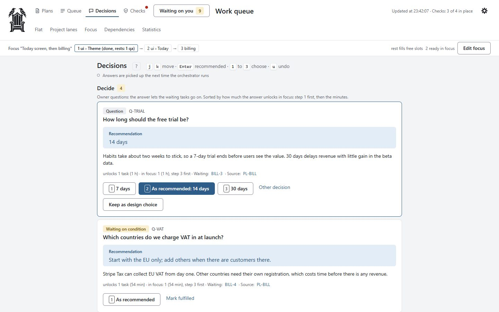
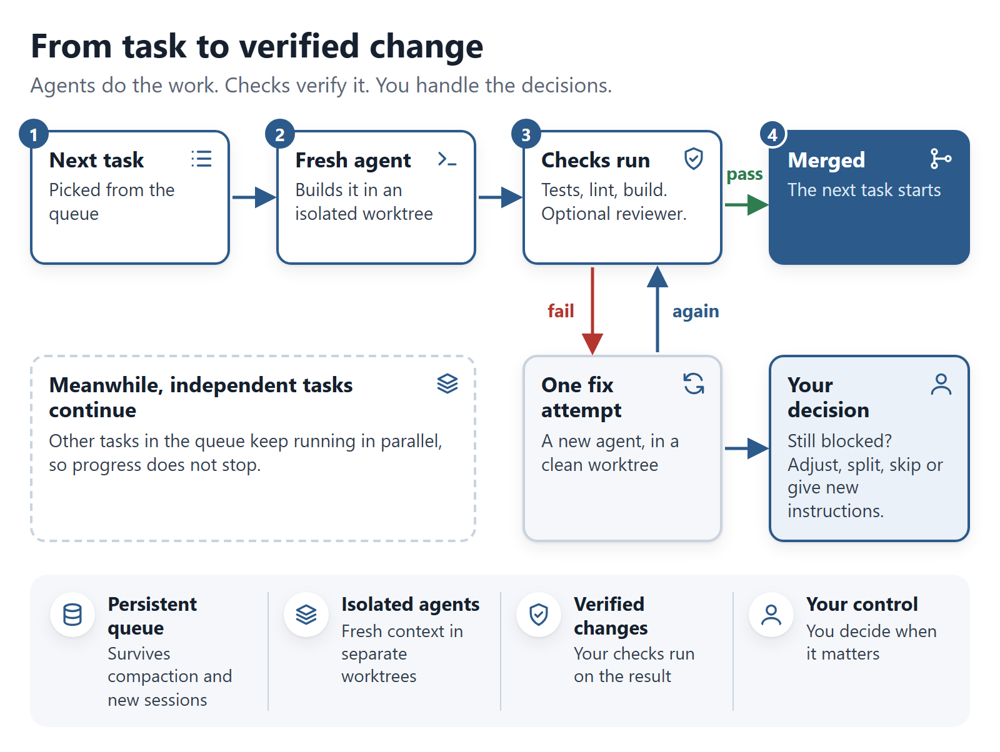

<p align="center">
  <picture>
    <source media="(prefers-color-scheme: dark)" srcset="assets/logo/ravenseat-dark.svg">
    
  </picture>
</p>

<h1 align="center">Ravenseat</h1>
<p align="center"><a href="https://github.com/vegardjorg/ravenseat/actions/workflows/ci.yml"></a></p>
<p align="center"><b>A work queue for Claude Code. Each task runs in a fresh agent in its own copy of the project, the plan lives in plain files, and only your checks decide what is merged.</b></p>
<p align="center"><sub>Open source · Runs on your machine · Built for Claude Code · Board optional</sub></p>

<p align="center"></p>

<p align="center">
  <picture>
    <source media="(prefers-color-scheme: dark)" srcset="assets/screenshots/dark-01-queue.jpg">
    
  </picture>
</p>

One chat can carry a feature. A project of weeks needs more, and without help you become the memory, the merge order
and the one who checks whether "done" is true.

| The pain | Without Ravenseat | With Ravenseat |
|---|---|---|
| The plan lives in a chat that ends | Close it or crash, and the plan is gone | The queue and the plans are **[plain files](#the-plan-lives-in-files-not-in-the-chat)** in your repo |
| Two chats, one checkout | They edit the same files and undo each other | Each task gets **[its own worktree](#several-agents-build-at-once-and-merges-stay-safe)**; merges go one at a time |
| "Tests passed," says the agent | You take its word, or check every run yourself | Ravenseat **[runs your checks](#guarantees-and-limits)** on the exact commit |
| Rules in `CLAUDE.md` hold most of the time | Now and then an agent pushes or skips a test | Key rules are **[enforced by code](#the-rules-that-matter-run-as-code)**, not by asking |
| You are asked about everything, or nothing | Small things interrupt you, big ones pass silently | Only what **[needs a person](#what-you-come-back-to)** reaches you, with a recommendation |
| The long chat is the memory | Every turn pays for all of it | Each task gets a **[fresh agent](#it-costs-about-the-same-and-the-setup-makes-every-turn-cheaper)** and a short mission |

Why outside the chat: a model forgets at compaction and a new chat starts empty. A file does not forget, and an agent
that reads a short task costs a fraction of one that reads the whole history. The full list is in the
[guide](plugin/docs/guide.md#what-it-solves).

The stage starts when a Claude Code project outgrows one chat. The long chat grows toward its 1M-token window, and
every turn pays for all of it. Findings, plans and half-built work spread over many chats, and two chats undo each
other's work. Rules in `CLAUDE.md` are followed most of the time, which is not the same as always.

Ravenseat is a Claude Code plugin for that stage. You tell one chat what to build. It writes the work down as tasks,
hands each task to a fresh agent in its own git worktree, runs your tests on exactly the commit the agent delivered,
merges what passes on your machine, and asks you only what a person has to decide.

> **You:** Add dark mode in settings, a weekly streak on the habit card, and a CSV export once the streak is done.
>
> **Claude:** Added T-001, T-002 and T-003. T-003 waits for T-002.

> **You:** How did dark mode go?
>
> **Claude:** Merged into main. Your check passed on main before and on the result; branch and worktree are gone.

> **You:** Push.
>
> **Claude:** 2 merged tasks, 5 commits, nothing from outside the queue. Pushed: main went from e2a029d to 3dc10b6.

It asks before it starts, merges only on your machine, and pushes nothing until you say "push".

## Is it for you?

**Yes** if you are one person or a small team with work that spans days or weeks, in a project that has automated
tests.

**No** for a single small change in one chat, or for a project without meaningful checks. There is little for it to
verify there, and the extra steps do not pay off.

**You need** Node.js 20 or newer, git 2.38 or newer, and Windows or Linux. macOS is not tested yet; if you try it
there, an issue with what you find is very welcome.

## Quick start

**1. Install the plugin.** In Claude Code:

```
/plugin marketplace add vegardjorg/ravenseat
/plugin install ravenseat@ravenseat
```

**2. Set up your project.** Ask Claude: *"Set up the queue."* (`/ravenseat:setup`). The guided setup finds your checks
and asks before it changes any setting. Not sure yet? Ask Claude to run `ravenseat doctor` first: it shows what it
finds and changes nothing.

**3. Add some work.** *"Add to the queue: fix the login bug and add a regression test."*

**4. Start the queue.** *"Start the queue."* (`/ravenseat:queue`). It picks tasks, hands them to agents, runs the
checks and merges what passes.

**5. Answer what waits on you.** *"What's waiting on me?"* (`/ravenseat:decide`). Each decision comes with a
recommendation and the work it blocks.

Plain words work, and the commands are there when you want explicit control ([all commands](plugin/docs/commands.md)).
More in the [guide](plugin/docs/guide.md).

### What it changes in your project

- `.claude/settings.json`: the recommended settings, after you say yes. One of them sets automatic compaction at 300k
  for every Claude Code session in the project. An existing value of your own is kept.
- `queue.config.json`, `CLAUDE.queue.md` and `docs/queue/` (the mission template and the project catalog), and the
  queue, the tasks and the plan register in `scripts/.queue/` (gitignored by default), as plain files you can read.
- One git worktree and one branch per running task, removed after the merge.

To remove it, run `claude plugin uninstall ravenseat@ravenseat` and delete the files above, the `@CLAUDE.queue.md`
line in `CLAUDE.md` if setup added it, and the settings you no longer want. Until then, the hooks do nothing in a
project without `queue.config.json`.

## What you come back to

> **You:** What happened while I was away?
>
> **Claude:** 6 tasks merged, all on green checks. 1 task is blocked after a fix attempt and waits on you, together
> with 2 other decisions. Nothing is pushed.

<p align="center"></p>

The goal is not to remove you from development. It is to stop interrupting you for what the system can handle itself.
Typical decisions that reach you: unclear requirements, security tradeoffs, hard-to-reverse changes, visual approval,
and tasks still blocked after a fix attempt.

**Your part.** Each delivery lists what the agent assumed. Read the assumptions before the merge, because passing
tests do not show that the agent understood you.

## Why it holds up

### Several agents build at once, and merges stay safe

Each task runs in its own git worktree, so agents never share files on disk. Merges happen one at a time, each only on
a green check run for that exact commit, and the base branch is checked again after every merge. About 1,200 tasks
were finished this way in three weeks of October 2026, in a larger private project.

### The rules that matter run as code

Instructions in `CLAUDE.md` are advice, and text an agent reads can argue against them. Ravenseat enforces its rules
on every action instead: an agent cannot push, cannot change the project's control files and cannot mark its own work
as tested. 244 red team tests run on real git and real processes (243 passed and 1 was skipped on 2026-11-19). Run
`npm run redteam` to check it yourself.

### The plan lives in files, not in the chat

The queue, each task's instructions, the plan register and your accepted design choices are plain files in your repo.
A crash, a compaction or a second chat loses nothing that matters. After a compaction the main chat was back to
starting agents after about 6 turns, against about 17 turns in a new chat that read a handover note.

### It costs about the same, and the setup makes every turn cheaper

Setup turns on compaction at 300k tokens. In the same project and on the same model, a main-chat turn then cost less
than half as much as before: 0.065 against 0.157 USD. The queue itself is about cost-neutral for building and
steering against one well-kept chat. Its value is the structure, the parallel work and the safety. Numbers are under [What it costs](#what-it-costs).

### Why not subagents and worktrees by hand?

You can, and for a few tasks it works well. What you carry yourself is the handover each time, the overview spread
over many chats, the merge order, and trusting an agent's own "checks passed". Ravenseat does that bookkeeping and
runs the checks itself.

## How a task flows

<p align="center"></p>

1. You describe the work. The main chat adds tasks with their dependencies.
2. The queue picks the next task that can start and gives it to a fresh agent in a new worktree, with a short
   instruction file.
3. The agent builds and commits on its own branch. Its long report goes to a file, not into the chat.
4. Ravenseat runs your quick checks on that exact commit and records the result.
5. Green work is merged, one merge at a time. Red work gets a fix round; if it is still blocked, it becomes a question
   to you while independent tasks continue. Work the agent itself called unfinished is merged only on your word.
6. Nothing is pushed until you say "push". The push asks you first when the base branch is red, and commits from
   outside the queue are listed before it.

More in [how it works](plugin/docs/guide.md#how-it-works) and [orchestration](plugin/docs/orchestration.md#the-loop).

## Guarantees and limits

Enforced by code, on every action:

- **Check results come from Ravenseat, not from the agent.** Each run is recorded with the commit sha, and merge and
  push read only that record.
- **Agents cannot push**, and cannot write `CLAUDE.md`, `.claude/`, git hooks, git config or the queue config.
- **A focused test stops the merge.** A new `.only`, `fit` or `fdescribe` blocks it. Deleted tests and new skip
  markers are flagged for review.
- **Protected paths stop the merge.** A change to CI config, lockfiles or Ravenseat's own scripts needs the task to
  own the file, or your yes. In lite mode, lockfiles and other dependency files only warn.
- **Overrides ask you.** An override opens Claude Code's permission dialog, so a line in an agent's report cannot
  approve it.
- **The finish line is fixed.** A task's completion criteria are locked when it starts.

Known limits:

- **Guard rails, not a sandbox.** Agents run as your OS user, and a script an agent writes and then runs is not read
  by the guards. Keep production credentials off the machine, and use Claude Code's permissions or sandbox when you
  need a real boundary.
- **Only as strong as your checks.** Without meaningful tests a green merge shows little. `ravenseat doctor` warns
  when a project has no checks.
- **Young.** Public since late October 2026 and released often. Developed on Windows, tested on Linux and Windows.

The full list, with the test behind each guarantee, is on the [red team page](plugin/docs/redteam.md) and in
[guarantees and limits](plugin/docs/guide.md#guarantees-and-limits).

## What it costs

Every turn in Claude Code sends the whole conversation again, so a large chat pays for its size on every turn. The
same project, on the same model, before and after setup:

| | Compacting near 1M | Compacting at 300k |
|---|---|---|
| Main chat: median context per turn | 464k | 183k |
| Main chat: cost per turn | 0.157 USD | 0.065 USD |
| Subagents: cost per turn | 0.109 USD | 0.056 USD |

Against one chat that already compacts at 300k, the queue came out about the same: about 12 USD per 1,000 inserted
lines for both in the last week measured, the queue's checks included. The checks cost what your tests cost. In the
measured repo they were about a third of the queue's spend, from a very heavy test suite and a reviewer on almost
every task.

This is one developer, two repos and a few weeks: not a controlled benchmark. All amounts are API-equivalent at list
price; on a subscription they are quota, not dollars. Run `ravenseat cost` to see the numbers in your own project, and
`ravenseat limit dailyBudget <usd>` to stop new tasks when the day's spend is used.
[The measurements and the method](plugin/docs/costs.md).

## Going further

- **Lite and full mode.** Setup recommends lite mode for a first run: a task needs only a title.
  [Full mode](plugin/docs/full-mode.md) adds file ownership per task, risk classes, focus areas and helper reviewers for
  larger projects.
- **The board.** An optional local web page with the same state: the queue as columns, decisions, checks, plans and
  cost. Open it with `/ravenseat:board` ([a tour](plugin/docs/board.md#a-tour)).
- **Machine load.** Fewer agents start as free memory drops, and heavy check runs take turns
  ([machine load](plugin/docs/full-mode.md#my-pc-chokes-on-parallel-builds)).
- **Learning from repeated failures.** A failure that comes back becomes a proposal for a new check, built only on
  your yes ([the Checks tab](plugin/docs/checks.md)).
- **From your phone.** Queue the work, step away, and follow along with Claude Code's Remote Control.

<p align="center"></p>

## Documentation

- [Guide](plugin/docs/guide.md): install, lite mode, daily use, how the loop works, guarantees and limits.
- [Full mode](plugin/docs/full-mode.md): risk classes, helper agents, focus, guards, load guard and recovery.
- [The board](plugin/docs/board.md) and [commands](plugin/docs/commands.md), with [CLI parity](plugin/docs/cli-parity.md).
- [The Checks tab](plugin/docs/checks.md): what the project has for checking its code, and what it lacks.
- [Orchestration and agent safeguards](plugin/docs/orchestration.md), [queue configuration and reference](plugin/docs/queue.md),
  [plan register](plugin/docs/plan-register.md), [catalog](plugin/docs/catalog.md).
- [Red team](plugin/docs/redteam.md) and the [FAQ](plugin/docs/faq.md): what can go wrong and the tests that check it.
- [What it costs in tokens](plugin/docs/costs.md) and [why I built it](plugin/docs/why-i-built-it.md).
- [INSTALL.md](INSTALL.md) for a vendored install, and the [CHANGELOG](CHANGELOG.md) for changes per version.

## Development

```
npm install
npm test                # the whole suite; run it before every push
npm run test:changed    # only the tests your change can reach; run it before each commit
```

- CI runs Ubuntu node 20 and 22 whole, and Windows node 22 in 3 shards; `shards complete` fails unless every test file ran.
- Windows node 20 runs weekly and on demand (`ci-weekly.yml`), not on every push.
- As this repo's quick gate, `node scripts/test-changed.mjs --gate` runs only the changed tests; the full gate and CI run all.

## License

MIT. See [LICENSE](LICENSE). The helper agents `reviewer-design`, `reviewer-tests`, `reviewer-gap` and
`reviewer-docs` are adapted from [testdouble/han](https://github.com/testdouble/han) (MIT, Copyright 2026 Test
Double, Inc.); the license text is in [NOTICE](NOTICE).

## The idea behind the name

Ravenseat is named after Odin's high seat, Hliðskjálf, from which he could see every world while his ravens brought
him the news. You sit in the seat. Your agents fly out, do the work and come back with the results.

Ravenseat is the reusable part of a queue I built inside a real Claude Code project that had outgrown its chats.
[The longer story](plugin/docs/why-i-built-it.md).

Created by Vegard Cowie Jørgensen.
