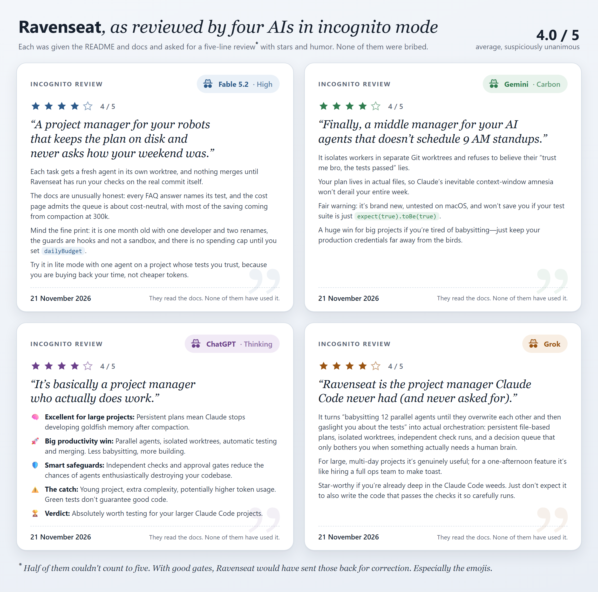
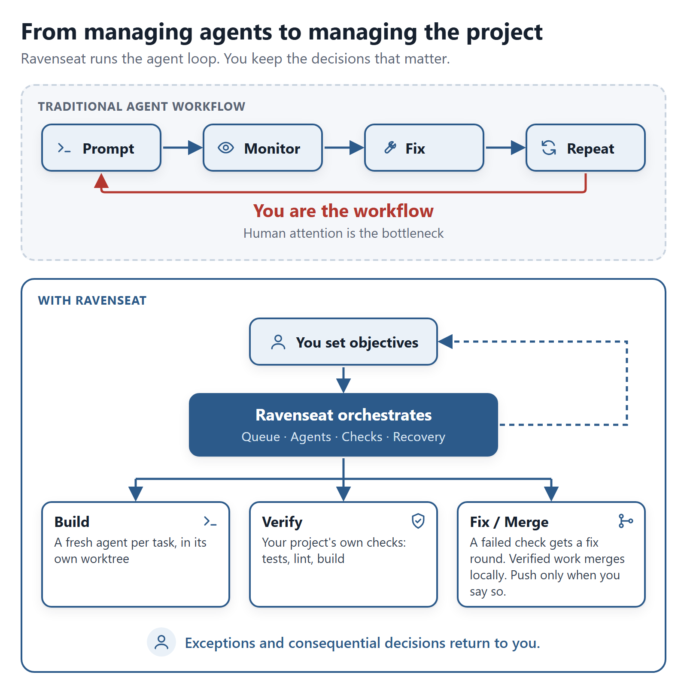

<p align="center">
  <picture>
    <source media="(prefers-color-scheme: dark)" srcset="assets/logo/ravenseat-dark.svg">
    
  </picture>
</p>

<h1 align="center">Ravenseat</h1>
<p align="center"><a href="https://github.com/vegardjorg/ravenseat/actions/workflows/ci.yml"></a></p>
<p align="center"><b>Run your whole project from one Claude Code conversation.</b></p>
<p align="center">Every task gets a fresh agent with fresh context.</p>
<p align="center">Ravenseat keeps your plan and task queue in files that survive compaction and restarts. Parallel agents work in separate Git worktrees, and Ravenseat runs your checks on each delivered commit before merging passing changes locally. When a task needs your judgment, only that task and its dependents wait. Everything else continues.</p>
<p align="center"><sub>Open source · Local-first · Runs inside Claude Code · Your Git repository</sub></p>

<p align="center"><picture><source media="(prefers-color-scheme: dark)" srcset="assets/media/explanation-dark.gif"></picture></p>

<p align="center"></p>

## Your project shouldn't depend on you babysitting agents

Claude Code can build a feature in one conversation. But a project spanning days or weeks is a different problem.

Tasks depend on other tasks. Agents need to work without overwriting each other. Tests fail. Fixes introduce
regressions. Conversations grow, compact, or end. Someone has to remember the plan, coordinate the work, verify the
results, and decide what happens next.

Without orchestration, **that someone is you.**

Ravenseat takes over that role: it keeps the plan, picks what runs next, and sends failed checks back for a fix round
before anything is merged.

<p align="center"><b>Stop managing agents. Start managing decisions.</b></p>

<p align="center"><picture><source media="(prefers-color-scheme: dark)" srcset="assets/infographics/workflow-shift-dark.webp"></picture></p>

## What changes?

| Without orchestration | With Ravenseat |
|---|---|
| You carry the plan from chat to chat | Plans, tasks, dependencies and decisions are [plain files](#why-the-architecture-matters) in your repo; the chat can compact or restart |
| You pick what runs next | The queue starts eligible tasks by dependencies and priority, with optional focus areas |
| Agents share one checkout | Each task runs in [its own Git worktree and branch](#why-the-architecture-matters); merges go one at a time |
| You trust the agent's "tests passed" | Ravenseat [runs your checks](#guarantees-and-limits) on the delivered commit, and only that record opens a merge |
| You chase every red run | A failed check starts a fix round; still blocked, it becomes one decision |
| Gaps in your checks go unnoticed | The [Checks system](#improving-your-projects-checks) suggests improvements and investigations |
| Rules in `CLAUDE.md` rely on model compliance | Hooks and the CLI block recognized pushes and control-file writes from queue agents, and the orchestrator writes the check record ([limits](#guarantees-and-limits)) |
| Small things interrupt you, big ones pass silently | [Decisions](#what-needs-your-attention) are collected, ranked by what they unblock, and come with a recommendation |
| The bill arrives at the end of the week | [`ravenseat cost`](#what-about-cost) per task, and an optional daily budget stops new starts |

Ravenseat doesn't replace Claude Code. It provides the persistent coordination layer around it.

## Quick start

**Requirements:** Node.js 20+, Git 2.38+ (older Git works, but without the trial merge and the conflict prediction,
so a conflicting merge can stop half done in your checkout), and Windows or Linux. macOS has not been tested yet. If
you try it, reports of what works and what doesn't are welcome.

**1. Install.** In Claude Code:

```
/plugin marketplace add vegardjorg/ravenseat
/plugin install ravenseat@ravenseat
```

**2. Set up your project.** *"Set up the queue."* or `/ravenseat:setup`. The guided setup fills in your project's
checks with you and asks before changing settings. Not sure yet? *"Run ravenseat doctor."* reports what it finds
without making changes.

**3. Add work.** *"Add to the queue: fix the login bug and add a regression test."* For larger features, describe the
objective and ask Claude to break it into tasks with dependencies.

**4. Start execution.** *"Start the queue."* or `/ravenseat:queue`. It reports and asks before starting, dispatches
eligible tasks, runs the configured checks, and merges passing work locally.

**5. Return to the decisions.** *"What's waiting on me?"* or `/ravenseat:decide`.

**Nothing is pushed until you explicitly ask for a push** (the default; a push threshold can be turned on).

Natural language works throughout. Commands are available when you want more explicit control.
[All commands](plugin/docs/commands.md) · [Full setup and usage guide](plugin/docs/guide.md)

### What setup changes

- `.claude/settings.json`: the recommended settings, after you approve them. One sets automatic compaction at 300k
  for every Claude Code session in the project. Existing values are preserved.
- `queue.config.json` and `CLAUDE.queue.md`.
- `docs/queue/`: the mission template, the project catalog and a copy of the Ravenseat docs.
- `scripts/.queue/`: tasks, queue state and the plan register.
- `.gitignore`: lines for the queue data, the agents' worktrees, personal settings and `.env` files.
- An `@CLAUDE.queue.md` reference in `CLAUDE.md`, if you approve it.

Running tasks create separate branches and worktrees, removed after a successful merge.

To uninstall, run `claude plugin uninstall ravenseat@ravenseat`, then remove the project files, the `.gitignore` lines
and the settings above, including the `@CLAUDE.queue.md` reference. The hooks remain inactive in projects without
`queue.config.json`.

## How it works

1. **Define the work.** Tasks, optionally with dependencies, completion criteria and priorities.
2. **Dispatch agents.** Eligible tasks start in parallel, each with a focused brief in its own worktree.
3. **Build and commit.** Each agent commits on its own branch. Detailed reports are written to files rather than
   filling the main conversation.
4. **Verify independently.** Ravenseat runs your configured checks against the exact delivered commit.
5. **Recover or merge.** Passing work is merged locally. Failing work gets a fix round on the same branch and another
   check run, up to three rounds by default.
6. **Park blockers, keep working.** When a task needs your judgment, Ravenseat parks that task and its dependents.
   Eligible work elsewhere continues. Your answer clears that blocker; the work can resume once its remaining
   dependencies are satisfied. The queue waits only when nothing else can run.

The plan and execution state live outside the conversation. A compaction, restart, or new Claude Code session doesn't
require you to reconstruct the project from memory. [How the orchestration loop works](plugin/docs/orchestration.md#the-loop).

## What it feels like to use

You don't have to learn a new interface or manually manage a collection of agent conversations. Talk to Claude Code.

> **You:** Add dark mode in settings, a weekly streak on the habit card, and a CSV export once the streak is done.
>
> **Claude:** Added T-001, T-002 and T-003. T-003 depends on T-002. The independent work can start first.
>
> **You:** Start the queue.
>
> **Claude:** Starting eligible tasks. Each will run in its own worktree. I'll run the configured checks before merging
> completed work.

Then get on with something else. Later, from your computer or through Claude Code's Remote Control on your phone:

> **You:** What happened while I was away?
>
> **Claude:** 6 tasks merged with passing checks. One task is blocked after its fix rounds. There are 3 decisions
> waiting for you. Independent work is continuing. Nothing has been pushed.
>
> **You:** What's the most important decision?
>
> **Claude:** The CSV export format is blocking two downstream tasks. I recommend option B because it preserves the
> existing API contract. Here are the tradeoffs.

You decide. Ravenseat continues.

*Illustrative conversation. Exact responses depend on the project, configuration, and work being performed.*

**Built for unattended work.** Leave Claude Code running and step away: Ravenseat can keep dispatching, checking,
fixing and merging eligible tasks for hours. When no work is eligible, it waits without consuming tokens. You can
answer pending decisions later through Claude Code, Remote Control or the board. Local execution requires an awake machine.

## What needs your attention?

<p align="center"></p>

Decisions collect the things Ravenseat cannot or should not resolve on its own. These include:

- unclear product requirements;
- architecture and hard-to-reverse choices, such as the data model, a public API or file format, a new dependency, or
  deleting data;
- security or legal tradeoffs;
- visual or functional acceptance of a delivery;
- tasks that remain blocked after the fix rounds;
- tasks agents propose, and pushes or overrides that your settings route to you;
- work that looks stuck or runs long.

**A decision doesn't stop the queue.** Only the affected task and its downstream dependencies wait. Ravenseat continues
working through everything else that's eligible. You can answer later: your answer clears that blocker, and the work resumes once its remaining
dependencies are satisfied, without restarting the project.

Decisions come with context and a recommendation. Ravenseat shows which work is blocked and what your answer would
unlock, most impact first. You can answer through Claude Code (`/ravenseat:decide`) or the optional board.

**You remain responsible for the requirements, architecture, and delivered product.** Passing checks cannot prove that
an agent understood what you wanted. Each delivery lists what the agent assumed: review assumptions and consequential
changes before accepting them.

## The board is optional

<p align="center">
  <picture>
    <source media="(prefers-color-scheme: dark)" srcset="assets/screenshots/dark-01-queue.jpg">
    
  </picture>
</p>

Ravenseat works entirely through Claude Code. The optional local board is a wider view of the same orchestrator, not a
separate workflow or another system you need to keep synchronized. Open it with `/ravenseat:board`.

The board shows decisions, the queue, dependencies, focus areas, checks, statistics, plans and settings.

Board controls for tasks, priorities and decisions have matching `ravenseat` commands and use the same state and
guards. Weakening a guard requires deliberate confirmation and is logged.

[Take the board tour](plugin/docs/board.md#a-tour) · [CLI parity](plugin/docs/cli-parity.md)

## Why the architecture matters

Ravenseat coordinates work across sessions, failures and concurrent agents:

1. **Persistent state and recovery.** Tasks, plans and decisions live in files. Ravenseat can recover interrupted merges,
   detect abandoned agents and protect uncommitted changes during merges. [Guide](plugin/docs/guide.md#what-it-solves)
2. **Isolated execution and serialized merges.** Each task uses its own Git worktree and branch. Dependencies govern
   dispatch, and merges happen one at a time. Queue updates and merges are designed to survive interruptions without
   losing tasks or silently marking unfinished work complete. In one private project, roughly 1,200 tasks finished in
   three weeks; measured medians were about 60 agent turns for code tasks and 105 for database tasks.
   [Orchestration](plugin/docs/orchestration.md) · [Measurements](plugin/docs/costs.md#measured-median-cost-per-finished-task-subagents-only)
3. **Independent verification.** Ravenseat runs your configured checks on the delivered commit and records the result
   against its SHA. The delivering agent does not certify its own work. [Guarantees](#guarantees-and-limits)
4. **Failure recovery.** Failed checks trigger a fix round and another check run. Unresolved or stalled work becomes a
   decision. [Orchestration](plugin/docs/orchestration.md)
5. **Guards beyond prompts.** Claude Code hooks and Ravenseat's CLI check the commands queue agents run and block the pushes
   and control-file writes they recognize, while the orchestrator owns check records. These mechanisms are not a
   security sandbox. Red-team tests run with `npm test` in CI; you can also run `npm run redteam`. [Red team](plugin/docs/redteam.md)

## Guarantees and limits

### Enforced safeguards

- **Independent check records.** Each run is recorded by Ravenseat with the commit SHA, and merge and push read only
  that record (the default; letting CI or the agent's own run count is a logged, weakened setting).
- **Queue-agent push protection.** Claude Code hooks block recognized push commands from queue agents. By default
  the main session pushes only when you ask. Hooks inspect commands, not every possible effect of executed code.
- **Protected control files.** Hooks block recognized queue-agent writes to `CLAUDE*.md`, `.claude/`, Git hooks,
  Git config and queue configuration. A direct write from the main session asks you first.
- **Focused-test protection.** A new `.only`, `fit` or `fdescribe` stops the merge. Deleted tests and new skip
  markers are flagged for review.
- **Protected paths.** A change to CI config, lockfiles or Ravenseat's own scripts stops the merge unless the task
  owns the file or you approve it. In lite mode (the default), lockfiles and other dependency files only warn.
- **Explicit overrides.** An override opens Claude Code's permission dialog, so an agent cannot approve one by writing
  an approval into its report.
- **A fixed finish line.** A task's completion criteria are locked when execution begins.

### What Ravenseat does not guarantee

- **It is not a security sandbox.** Queue agents run as your OS user. Hooks inspect commands, but do not inspect
  the contents of scripts those commands execute; a blocked action may be expressed another way. Hooks fail open if
  they crash. Keep production credentials off the machine and use Claude Code permissions or sandboxing for stronger isolation.
- **Green checks do not guarantee correct software.** Without meaningful tests a green merge shows little;
  `ravenseat doctor` warns when a project has no checks.
- **It cannot replace architectural judgment.** That stays with you.
- **It is a young project.** Public since late October 2026 and released often. Developed on Windows, tested on
  Windows and Linux.

The full list, with the test behind each guarantee: [red team](plugin/docs/redteam.md) ·
[guarantees and limits](plugin/docs/guide.md#guarantees-and-limits)

## What about cost?

Ravenseat aims to reduce supervision, not promise cheaper code generation. Smaller conversations reduce repeated
context costs; setup offers automatic compaction at 300k tokens. In one before-and-after measurement on the same model:

| Metric | Compaction near 1M | Compaction at 300k |
|---|---|---|
| Main chat: median context per turn | 464k | 183k |
| Main chat: cost per turn | $0.157 | $0.065 |
| Subagents: cost per turn | $0.109 | $0.056 |

### What orchestration costs

Against a well-kept chat also compacting at 300k, both cost about $12 per 1,000 inserted lines in the last measured
week, the queue's checks included. Across all 19 days, the plain chat was cheaper per line. Checks and review were
about a third of queue spending; with them taken out of both, the two approaches were about cost-neutral in this
sample.

Starting a new chat with handover notes cost approximately the same as compaction at a comparable context size.
After compaction, dispatching resumed in about 6 turns, versus about 17 after a new-chat handover. These observations come
from one developer, two repositories and a few weeks, not a controlled benchmark.

Amounts are API-equivalent list prices; subscription users consume quota rather than pay those dollar amounts.
`ravenseat cost` tracks spending and can flag unusual token use and inefficient file reads;
`ravenseat limit dailyBudget <usd>` limits new starts. [Measurements and methodology](plugin/docs/costs.md)

## Is Ravenseat for you?

**Yes, if:**
- your project spans multiple sessions, days, or weeks;
- you want agents to work independently without managing every handoff;
- your project has meaningful automated checks;
- you want parallel execution without manually coordinating Git worktrees and merges;
- you want to return to progress reports and decisions rather than unfinished conversations.

**Probably not, if:**
- your change is small and fits in one session;
- you have no meaningful way to validate generated changes;
- you don't need persistent planning, dependencies, or concurrent execution.

## Why not just use subagents and worktrees manually?

You can. For a handful of independent tasks, Claude Code's existing capabilities may be all you need. Ravenseat
becomes useful when the coordination itself starts taking significant time.

Without an orchestrator, you still need to maintain the plan, track dependencies, select work, manage handoffs,
reconcile branches, verify delivered commits, recover from failures, and preserve state between sessions.

Ravenseat handles the coordination between agent sessions so you can return to results and decisions.

## Going further

- **Lite and full mode.** Start with a simple queue. [Full mode](plugin/docs/full-mode.md) adds focus-driven
  execution, file ownership, risk classes and specialist reviewers. Security-sensitive changes can trigger additional
  review even in ordinary tasks, and serious findings can block merges.
- **Planning and priorities.** Areas, plans and features in a plan register, with a roadmap of Waiting on you, Now,
  Next and Later. [Plan register](plugin/docs/plan-register.md)
- **Machine-aware concurrency.** Fewer agents start as free memory drops, and heavy check runs take turns.
  [Machine load](plugin/docs/full-mode.md#my-pc-chokes-on-parallel-builds)
- **Work from your phone.** Queue the work, step away, and follow along with Claude Code's Remote Control (a Claude
  Code feature, not part of Ravenseat).
- **Optional cloud execution.** Eligible tasks can run in Claude Code cloud sessions while your local machine is off.
  Returned changes are verified locally before merging. Disabled by default and requires additional security setup.
  [FAQ](plugin/docs/faq.md#are-cloud-sessions-safe-to-turn-on)

<p align="center"></p>

### Improving your project's checks

The Checks system inspects your project's tests, CI, linting, security tools, and validation configuration to identify
gaps and opportunities. Repeated failures can reveal weaknesses worth turning into permanent regression checks.

Suggestions are prioritized. You can dismiss them, enable existing tools, or send an investigation to an agent. The
agent proposes an implementation plan, and you decide what gets built.

Over time, recurring failures can become stronger validation rather than recurring manual work.

[Explore the Checks system](plugin/docs/checks.md)

## Documentation

**Getting started:** [Guide](plugin/docs/guide.md) · [Commands](plugin/docs/commands.md) · [FAQ](plugin/docs/faq.md) ·
[INSTALL.md](INSTALL.md) (vendored install)

**Using Ravenseat:** [Board tour](plugin/docs/board.md#a-tour) · [CLI parity](plugin/docs/cli-parity.md) ·
[Full mode](plugin/docs/full-mode.md) · [Plan register](plugin/docs/plan-register.md) · [The Checks tab](plugin/docs/checks.md)

**Architecture and evidence:** [Orchestration](plugin/docs/orchestration.md) ·
[Queue reference](plugin/docs/queue.md) · [Catalog](plugin/docs/catalog.md) · [Red team](plugin/docs/redteam.md) ·
[Costs](plugin/docs/costs.md) · [Why I built it](plugin/docs/why-i-built-it.md) · [Changelog](CHANGELOG.md)

## Development

```
npm install
npm test                # the whole suite; run it before every push
npm run test:changed    # only the tests your change can reach; run it before each commit
```

- CI runs the full suite on Ubuntu with Node 20 and 22, and on Windows with Node 22 in three shards; a
  `shards complete` check fails unless every test file ran.
- Windows with Node 20 runs weekly and on demand (`ci-weekly.yml`).
- This repo uses `node scripts/test-changed.mjs --gate` as its quick gate; the full gate and CI run the complete suite.

## License

MIT. See [LICENSE](LICENSE). The helper agents `reviewer-design`, `reviewer-tests`, `reviewer-gap` and
`reviewer-docs` are adapted from [testdouble/han](https://github.com/testdouble/han) (MIT, Copyright 2026 Test
Double, Inc.); the license text is in [NOTICE](NOTICE).

## The idea behind the name

Ravenseat is named after Odin's high seat, Hliðskjálf, from which Odin could see every world while the ravens brought
news. You sit in the seat. Your agents fly out, do the work, and return with the results.

Ravenseat grew out of a queue built inside a real Claude Code project that had become too large to manage through
individual conversations. [The longer story](plugin/docs/why-i-built-it.md)

Created by Vegard Cowie Jørgensen.
