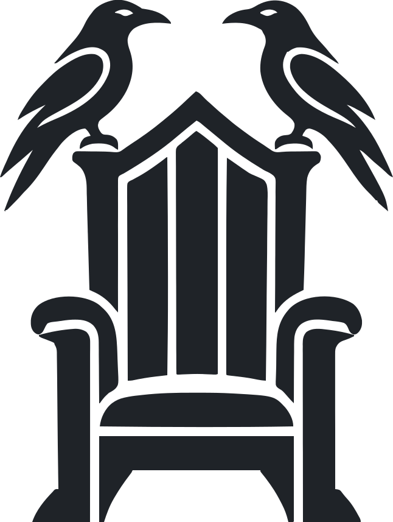
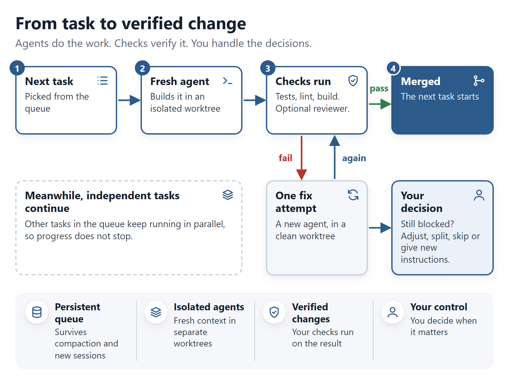
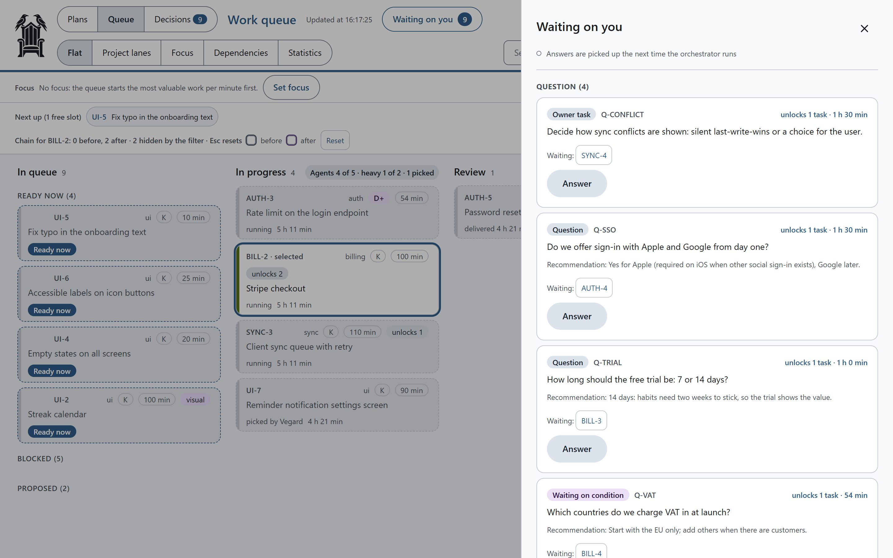

<p align="center">
  <picture>
    <source media="(prefers-color-scheme: dark)" srcset="assets/logo/ravenseat-dark.svg">
    
  </picture>
</p>

<h1 align="center">Ravenseat</h1>
<p align="center"><a href="https://github.com/vegardjorg/ravenseat/actions/workflows/ci.yml"></a></p>
<p align="center"><b>A work queue for Claude Code, so multi-day work doesn't depend on one chat: agents build, your tests decide, you answer what needs you.</b></p>
<p align="center"><sub>Open source · Runs on your machine · Built for Claude Code · Board optional</sub></p>

When a Claude Code project outgrows one chat, the signs are familiar:

- Findings, research and half-built features are spread across dozens of chats.
- A feature that takes several days loses its thread every time a chat ends.
- Two chats change the same files and undo each other's work.
- The one long chat that keeps the overview gets more expensive every turn.
- You spend more time keeping agents on track than deciding what to build.

Ravenseat keeps the project's plan and task list (the queue) in files, outside the chat. One Claude Code chat acts as
the manager: you tell it what to build, and it hands each task to a fresh agent in its own copy of the project, runs
your tests on the result, merges what passes on your machine, and asks you only about decisions a human should make.
Work that spans days gets finished across many chats, and you can follow along and answer from your phone with Claude
Code's Remote Control.

> **You:** Add dark mode in settings, a weekly streak on the habit card, and a CSV export once the streak is done.
>
> **Claude:** Added T-001, T-002 and T-003. T-003 waits for T-002.

> **You:** How did dark mode go?
>
> **Claude:** Merged into main. Your check passed on main before and on the result; branch and worktree are gone.

> **You:** Push.
>
> **Claude:** 2 merged tasks, 5 commits, nothing from outside the queue. Pushed: main went from e2a029d to 3dc10b6.

**What it will not do on its own.** It asks before it starts, merges only on your machine, and pushes nothing until
you say "push". **Your part.** Each delivery lists what the agent assumed (its Assumptions); read them before the
merge, because passing tests do not show that the agent understood you.

**Is it for you?** If you are building something that takes weeks, like a SaaS with several features, a backend and
a database, the work no longer fits in one chat, and that is where Ravenseat helps most. For a small demo or a tool for
your own use, plain Claude Code is probably enough. It works best with automated tests; without meaningful checks
there is little for it to verify.

**Status.** Young: public since late October 2026, built over several months inside the author's own project, released
often. Developed on Windows; the tests run on Linux and Windows, macOS is not tested yet. The [FAQ](plugin/docs/faq.md)
answers the usual worries, each with the tests behind the answer.

## Quick start

Start in lite mode, the core loop only; [full mode](plugin/docs/full-mode.md) adds structure for larger projects.

**1. Install the plugin.** In Claude Code:

```
/plugin marketplace add vegardjorg/ravenseat
/plugin install ravenseat@ravenseat
```

You need Node.js 20 or newer and git.

**2. Set up your project.** Ask Claude: *"Set up the queue."* (`/ravenseat:setup`, the guided setup that also finds your
checks). Not sure yet? Ask Claude to run `ravenseat kickstart` or `ravenseat doctor` first: they show what they find
and change nothing. For a minimal setup without the guide, see [lite mode in more detail](plugin/docs/guide.md#lite-mode-in-more-detail)
(`ravenseat init`).

**3. Add some work.** Tell Claude what needs doing: *"Add to the queue: fix the login bug and add a regression
test."*

**4. Start the queue.** *"Start the queue."* (`/ravenseat:queue`). Ravenseat asks before it starts, then picks tasks, hands
them to agents, runs the checks and merges what passes. It never pushes unless you tell it to.

**5. Answer what waits on you.** *"What's waiting on me?"* (`/ravenseat:decide`). Each decision comes with a recommendation
and the work it blocks.

That is the basic workflow. Plain words work, and the commands are there when you want explicit control
([all commands](plugin/docs/commands.md)). More in the [guide](plugin/docs/guide.md).

## From task to verified change

<p align="center"></p>

Each task runs in its own copy of the project (a git worktree), and your checks run on the result. Passing work is
merged; a failure gets another try by a fresh agent, and when the system cannot safely go on, it asks you while the
independent tasks keep moving. Ravenseat does not replace your tests, review standards or judgment, and it is only as
strong as the checks your project has (`/ravenseat:setup` helps you set them up).

## Your decisions, in one place

The goal is not to remove you from development. It is to stop interrupting you for what the system can handle itself.

<p align="center"></p>

Each decision has context, a recommendation and the work it blocks. Answer in Claude Code with `/ravenseat:decide`, or with
one click on the board. Typical decisions: unclear requirements, security tradeoffs, hard-to-reverse changes, visual
approval, and tasks still blocked after a fix attempt. The board is optional: a local page with the same project state,
opened with `/ravenseat:board` ([a tour of the board](plugin/docs/board.md#a-tour)).

## Agents don't grade their own homework

An agent that writes the code and then reports that it works is not proof that a change is ready. Ravenseat keeps
those two jobs apart.

- **Checks belong to the delivered commit.** The checks are run and recorded on exactly the delivered commit, not
  reported by the agent.
- **Acceptance criteria stay fixed.** A task's completion criteria are locked when it starts, and an optional
  reviewer checks the work against them.
- **Protected files get extra scrutiny.** Changes to test config, hooks, queue settings and other guarded paths stop
  the merge unless you allow them, and deleted tests and new skip markers are flagged.

These are guard rails, not a sandbox: agents run with your user account, so keep production credentials off the
machine and use Claude Code's permissions or sandbox when you need a real boundary. Without meaningful checks, no
automated merge can show that a change is correct; `ravenseat doctor` warns when your project has none. More in
[full mode](plugin/docs/full-mode.md#agents-cheat-on-tests), [guarantees and limits](plugin/docs/guide.md#guarantees-and-limits)
and [orchestration](plugin/docs/orchestration.md).

Each answer in the [FAQ](plugin/docs/faq.md) names the tests behind it, and the tests behind the main
guarantees have been shown to fail with their guard turned off. The [red team page](plugin/docs/redteam.md) lists what was found and what the tests cannot
show. Run `npm run redteam` to check it yourself.

## What does it cost?

More agents do not automatically mean cheaper development. Long contexts, repeated setup and fix rounds in bloated
agents eat tokens, so Ravenseat uses short agent contexts, keeps state outside the conversation, shares installed
dependencies between worktrees and never polls in a loop. Each task's cost is measured from its own sessions,
fix rounds and reviews included, and the estimates are calibrated against what was measured. Parallel agents can
choke a PC before they use up a quota, so a load guard starts fewer agents while free memory is low, and
`ravenseat machine` suggests how many your machine can take.

In one project, about 1,200 measured tasks gave a median of about 2.5 USD (API-equivalent) per ordinary code task
including its review. In the same week, with the same model and settings, I compared that project with a second one
built in a single Claude Code session from a plain roadmap file, with no queue. Per turn and per 1,000 inserted lines
the cost was about the same (about 0.07 USD per turn, about 12 USD per 1,000 lines), and steering the work took about
15 % in both. The queue did not make turns more expensive: it ran more of them and delivered more. The extra cost was
the checks. Tests and review took about 31 % of the queue project's spend against 11 %, because it has a heavier test
suite and a reviewer on every task. What does get expensive is a large context: a turn at over 500k tokens cost about
2.7 times a turn at 100k to 200k. With automatic compaction at 300k, one long chat is not much more costly than
starting new chats: in 10 sessions with about 6,000 turns, a compaction cost about as much as a new chat that reads a
handover note in again, and work was back on track after about 6 turns instead of 17. Two different projects, one
developer: not a controlled benchmark. Run `ravenseat cost` to see the numbers in your own project.
There is no spending limit by default: `ravenseat limit dailyBudget <usd>` stops new tasks when the day's spend is used.
[The measurements in detail](plugin/docs/costs.md).

## Why I built it

Ravenseat is the reusable part of a queue I built inside a real Claude Code project that had outgrown its chats.
[The longer story, and how I use it day to day](plugin/docs/why-i-built-it.md).

## Documentation

- [Guide](plugin/docs/guide.md): install, lite mode, daily use, how the loop works, safety baseline, guarantees
  and limits.
- [Full mode](plugin/docs/full-mode.md): lite and full side by side, risk classes, helper agents, focus, guards, load
  guard and recovery.
- [The board](plugin/docs/board.md) and [commands](plugin/docs/commands.md), with [CLI parity](plugin/docs/cli-parity.md).
- [Orchestration and agent safeguards](plugin/docs/orchestration.md), [queue configuration and reference](plugin/docs/queue.md),
  [plan register](plugin/docs/plan-register.md), [mission template](plugin/docs/mission-template.md).
- [Red team](plugin/docs/redteam.md) and the [FAQ](plugin/docs/faq.md): what can go wrong, the tests that check it, and the
  limits.
- [What it costs in tokens](plugin/docs/costs.md) and [why I built it](plugin/docs/why-i-built-it.md).
- [INSTALL.md](INSTALL.md) for a vendored install, and the [CHANGELOG](CHANGELOG.md) for changes per version.

## Development

```
npm install
npm test        # vitest; runs the unit tests under plugin/scripts/orchestrator
```

## License

MIT. See [LICENSE](LICENSE). The helper agents `reviewer-design`, `reviewer-tests`, `reviewer-gap` and
`reviewer-docs` are adapted from [testdouble/han](https://github.com/testdouble/han) (MIT, Copyright 2026 Test
Double, Inc.); the license text is in [NOTICE](NOTICE).

## The idea behind the name

Ravenseat is named after Odin's high seat, Hliðskjálf, from which he could see every world while his ravens brought
him the news. You sit in the seat. Your agents fly out, do the work and come back with the results.

Created by Vegard Cowie Jørgensen.
