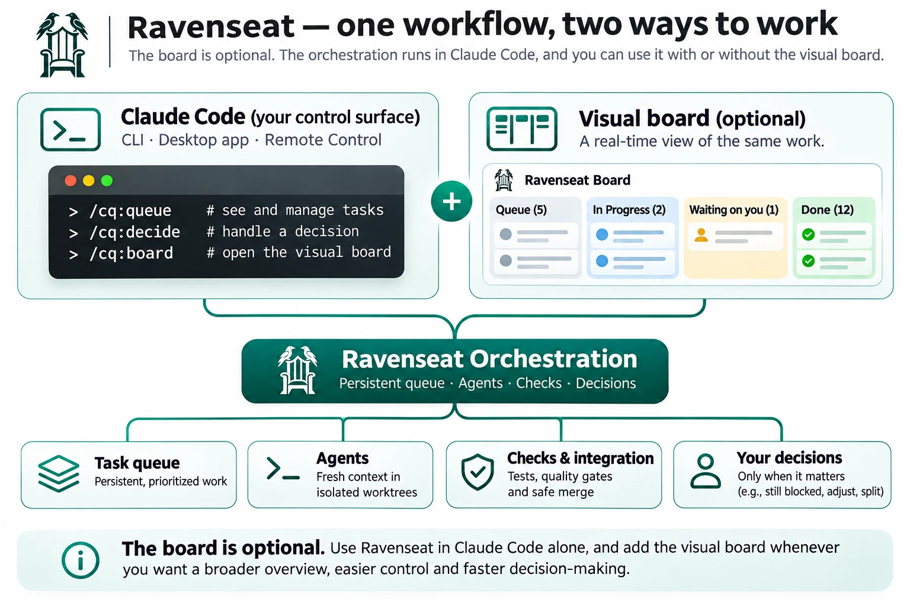
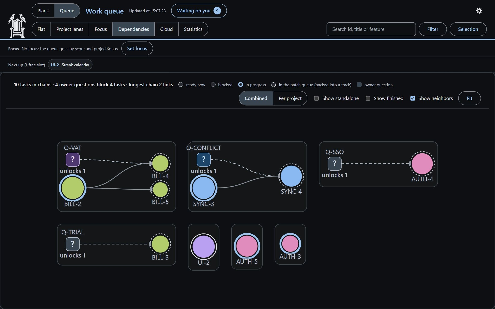

<p align="center">
  <picture>
    <source media="(prefers-color-scheme: dark)" srcset="assets/logo/ravenseat-dark.svg">
    
  </picture>
</p>

<h1 align="center">Ravenseat</h1>
<p align="center"><a href="https://github.com/vegardjorg/ravenseat/actions/workflows/ci.yml"></a></p>
<p align="center"><b>Your agents keep building. You make the decisions.</b></p>
<p align="center">Run your Claude Code project from one conversation. Ravenseat coordinates parallel coding agents,
tracks what needs to happen next, verifies their work with your project's checks and brings you the decisions that
matter. One conversation, independent verification, and human decisions that don't stop the rest of the work.</p>
<p align="center"><sub>Open source · Local-first · Built for Claude Code · Visual board optional</sub></p>
<p align="center"><sub>Works with Claude Code in your terminal or desktop app. You can also follow the conversation from
your phone with Claude Code's Remote Control, while Claude Code runs on your computer.</sub></p>

<p align="center"></p>
<p align="center"><sub>The optional board, with a made-up demo project ("Pebble", a habit tracker).</sub></p>

## Stop managing agents. Start directing the project.

Running several coding agents is easy. Keeping their work coordinated, verified and moving forward is the hard part.
Ravenseat handles the coordination:

- **One conversation, many agents.** Describe what needs doing. Ravenseat keeps the queue and hands each task to a
  fresh agent in its own git worktree, which owns its files while it runs.
- **Agents don't grade their own homework.** Your project's checks run on exactly the delivered commit, recorded by
  the orchestrator, not reported by the agent. Changes to tests and other protected files are flagged or stopped.
- **Decisions without a standstill.** When a task needs you, it waits in one list with a recommendation, while
  independent work goes on.
- **A red check starts a fix, not an interruption.** When the checks fail, a fresh agent tries a fix before anything
  needs your attention.
- **Work survives context resets.** Tasks, plans, dependencies and decisions live in files outside the conversation,
  so nothing is lost when a chat is compacted or a new session starts.

You stay responsible for the direction. Ravenseat handles the mechanics of getting there.

## Quick start

Start in lite mode: the core loop only. You can add the advanced features later.

**1. Install the plugin.** In Claude Code:

```
/plugin marketplace add vegardjorg/ravenseat
/plugin install cq@ravenseat
```

You need Node.js 20 or newer and git.

**2. Set up your project.** Ask Claude: *"Set up the queue."* (`/cq:setup`, the guided setup that also finds your
checks). Or run `cq init` for a minimal lite setup: it keeps the queue in `scripts/.queue/` and adds that folder to
`.gitignore`.

**3. Add some work.** Tell Claude what needs doing: *"Add to the queue: fix the login bug and add a regression
test."*

**4. Start the queue.** *"Start the queue."* (`/cq:queue`). Ravenseat asks before it starts, then picks tasks, hands
them to agents, runs the checks and merges what passes. It never pushes unless you tell it to.

**5. Answer what waits on you.** *"What's waiting on me?"* (`/cq:decide`). Each decision comes with a recommendation
and the work it blocks.

That is the basic workflow. Plain words work, and the commands are there when you want explicit control
([all commands](plugin/docs/commands.md)). More in the [guide](plugin/docs/guide.md#lite-mode-in-more-detail).
Installed it as claude-code-queue before? See [install](plugin/docs/guide.md#install) for the one extra step.

## From task to verified change

<p align="center"></p>

An agent gets a bounded task in its own worktree. Your configured checks run against the result. Passing work is
merged; a failure gets another attempt with a fresh context. When the system cannot safely go on, it asks you, and
the independent tasks keep moving.

Ravenseat does not replace your tests, review standards or judgment. It makes them part of a repeatable workflow, and
it is only as strong as the checks your project has (`/cq:setup` helps you set them up).

## Your decisions, in one place

The goal is not to remove you from development. It is to stop interrupting you for what the system can handle itself.
Technical failures get retried, routine work goes on, and the questions that need your judgment are collected in one
list.

<p align="center"></p>

Each decision has context, a recommendation and the work it blocks. Answer in Claude Code with `/cq:decide`, or with
one click on the board. Typical decisions: unclear requirements, security tradeoffs, hard-to-reverse changes, visual
approval, and tasks still blocked after a fix attempt.

## Claude Code first. Board optional.

The orchestration runs inside Claude Code. The board is a companion, not a requirement.

- **Claude Code CLI or desktop app:** manage everything from one conversation.
- **Remote Control:** follow and answer from your phone, using Claude Code's own Remote Control feature.
- **The board:** a local web page with tasks, dependencies, decisions, plans and statistics, in light and dark mode.

<p align="center"></p>

The board shows the same project state from a wider angle; it does not run a separate engine, and every change it
makes to the queue has a command behind it. Open it with `/cq:board`, or ask Claude to open the board.

<p align="center"></p>

[A tour of the board](plugin/docs/board.md#a-tour)

## Built for work that lasts longer than a chat

Long-running AI development brings problems you don't see one task at a time:

- **Context grows.** Agents spend more and more of each turn carrying history instead of doing focused work.
- **Parallel sessions collide.** Agents change the same files without knowing about each other.
- **Work gets forgotten.** Findings, half-done features and dependencies end up scattered across conversations.
- **Quality gets hard to track.** An agent saying "done" is not a tested, merged change.

Ravenseat answers with a persistent queue, isolated worktrees, bounded missions, dependency tracking and explicit
checks. The orchestration conversation keeps the direction, fresh agents do the individual tasks, and the project
state lives outside the chat, so you can resume without rebuilding the plan from chat history.

### Why I built it

Ravenseat grew out of a real project I built with Claude Code. As it grew, I was juggling dozens of conversations:
features were half-finished, agents collided over files, findings disappeared into old chats, and running everything
in one huge conversation kept the context but got expensive. I wanted the advantages of coding agents without becoming
their full-time project manager. So I built a persistent work queue with isolated agents, checks, recovery and one
place for decisions. Ravenseat is the reusable part of that system.
[The longer story, and how I use it day to day](plugin/docs/why-i-built-it.md).

## Agents don't grade their own homework

An agent that writes the code and then reports that it works is not proof that a change is ready. Ravenseat keeps
those two jobs apart.

- **Checks belong to the delivered commit.** The orchestrator records the gate run on exactly the delivered commit;
  an agent cannot report its own work as passing.
- **Acceptance criteria stay fixed.** A task's completion criteria are locked when it starts, and an optional
  reviewer checks the work against them.
- **Protected files get extra scrutiny.** Changes to test config, hooks, queue settings and other guarded paths stop
  the merge unless explicitly allowed, and deleted tests or new skip markers are flagged.
- **Recovery uses a fresh context.** A fix attempt starts a new agent with a short mission, not the previous agent's
  whole conversation.
- **Merging is controlled.** One orchestrator merges, one merge at a time, and `cq conflicts` predicts conflicts
  between running worktrees.

These guards reduce common failure modes. They are guard rails, not a sandbox: agents run with your user account, so
keep production credentials off the machine and use Claude Code's permissions or sandbox when you need a real
boundary. Without meaningful checks, no automated merge can show that a change is correct; `cq doctor` warns when
your project has none. More in [full mode](plugin/docs/full-mode.md#agents-cheat-on-tests),
[guarantees and limits](plugin/docs/guide.md#guarantees-and-limits) and
[orchestration](plugin/docs/orchestration.md).

## Start simple. Scale when you need to.

| | Lite mode | Full mode |
|---|---|---|
| Persistent task queue | Yes | Yes |
| Agents in isolated worktrees | Yes | Yes |
| Checks and fix rounds | Yes | Yes |
| Decisions, `/cq:decide` and the board | Yes | Yes |
| Risk classes and task sizing | No | Yes |
| Focus and value-based priority | No | Yes |
| Plan register | No | Yes |
| Helper agents and deeper review | No | Yes |

Lite gets work moving with minimal setup. Full adds structure for larger projects. Switch with `cq mode full` when you
need it: [what full mode adds](plugin/docs/full-mode.md).

## What does it cost?

More agents do not automatically mean cheaper development. Long contexts, repeated setup and fix rounds in bloated
agents eat tokens, so Ravenseat uses short agent contexts, keeps state outside the conversation, shares installed
dependencies between worktrees and never polls in a loop.

In one project, about 1,200 measured tasks gave a median of about 2.5 USD (API-equivalent) per ordinary code task
including its review. That is one project and one developer, not a controlled benchmark, and it does not show a
saving over plain Claude Code or other tools. Run `cq cost` to see the numbers in your own project.
[The measurements in detail](plugin/docs/costs.md).

## Is Ravenseat right for your project?

- **A good fit:** a growing codebase with several tasks, dependencies and useful automated checks, where you want to
  hand off implementation without coordinating every agent, review and merge yourself.
- **Probably not needed:** a small script, one short task, or a project without meaningful checks and no plan to add
  them.

Ravenseat adds structure. It helps when coordination has become the problem, not when one Claude Code conversation
already does everything you need.

## Documentation

- [Guide](plugin/docs/guide.md): install, lite mode, daily use, how the loop works, safety baseline, guarantees
  and limits.
- [Full mode](plugin/docs/full-mode.md): risk classes, helper agents, focus, guards, load guard and recovery.
- [The board](plugin/docs/board.md) and [commands](plugin/docs/commands.md), with [CLI parity](plugin/docs/cli-parity.md).
- [Orchestration and agent safeguards](plugin/docs/orchestration.md), [queue configuration and reference](plugin/docs/queue.md),
  [plan register](plugin/docs/plan-register.md), [mission template](plugin/docs/mission-template.md).
- [What it costs in tokens](plugin/docs/costs.md) and [why I built it](plugin/docs/why-i-built-it.md).
- [INSTALL.md](INSTALL.md) for a vendored install, and the [CHANGELOG](CHANGELOG.md) for changes per version.

## Development

```
npm install
npm test        # vitest; runs the unit tests under plugin/scripts/orchestrator
```

## License

MIT. See [LICENSE](LICENSE). The helper agents `reviewer-design`, `reviewer-tests`, `reviewer-gap` and
`reviewer-docs` are adapted from [testdouble/han](https://github.com/testdouble/han) (MIT, Copyright 2026 Test
Double, Inc.); the license text is in [NOTICE](NOTICE).

## The idea behind the name

Ravenseat is named after Odin's high seat, Hliðskjálf, from which he could see every world while his ravens brought
him the news. You sit in the seat. Your agents fly out, do the work and come back with the results.

Created by Vegard Cowie Jørgensen.
