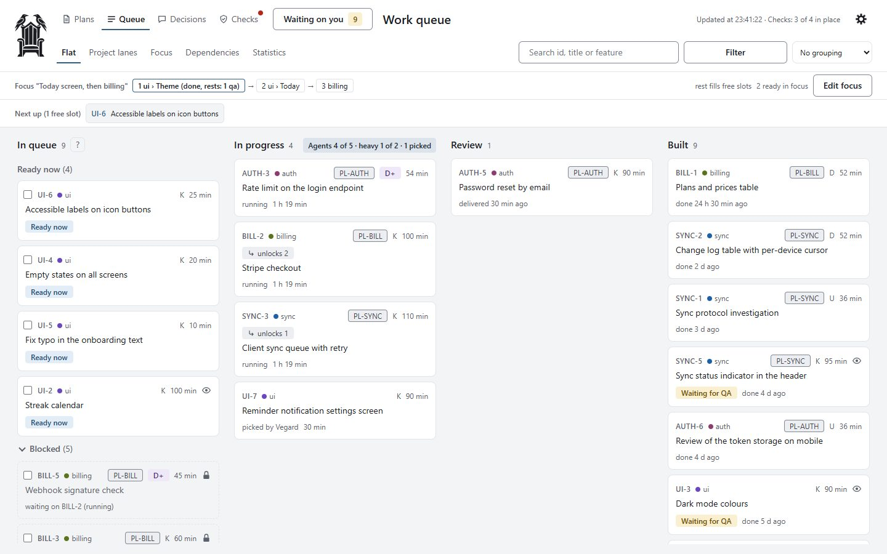

<p align="center">
  <picture>
    <source media="(prefers-color-scheme: dark)" srcset="assets/logo/ravenseat-dark.svg">
    
  </picture>
</p>

<h1 align="center">Ravenseat</h1>
<p align="center"><a href="https://github.com/vegardjorg/ravenseat/actions/workflows/ci.yml"></a></p>
<p align="center"><b>A work queue for Claude Code, so multi-day work doesn't depend on one chat: agents build, your tests decide, you answer what needs you.</b></p>
<p align="center"><sub>Open source · Runs on your machine · Built for Claude Code · Board optional</sub></p>

<p align="center"></p>

When a Claude Code project outgrows one chat, the signs are familiar:

- Findings, research and half-built features are spread across dozens of chats.
- A feature that takes several days loses its thread every time a chat ends.
- Two chats change the same files and undo each other's work.
- The one long chat that keeps the overview grows toward its full context window (up to 1M tokens) before Claude
  Code compacts it, and every turn reads all of it again, so each turn costs more than the last.
- You spend more time keeping agents on track than deciding what to build.

Ravenseat keeps the project's plan and task list (the queue) in plain files outside the chat, so it survives a crash,
a compaction and two chats at once. One Claude Code chat acts as
the manager: you tell it what to build, and it hands each task to a fresh agent in its own copy of the project, runs
your tests on the result, merges what passes on your machine, and asks you only about decisions a human should make.
Work that spans days gets finished across many chats, and you can follow along and answer from your phone with Claude
Code's Remote Control. A turn costs no more than doing the work yourself in one chat; the checks you choose come on top.
The difference is that you do not have to sit there: queue the work, go do something else, and come back to the
decisions only you can make.

> **You:** Add dark mode in settings, a weekly streak on the habit card, and a CSV export once the streak is done.
>
> **Claude:** Added T-001, T-002 and T-003. T-003 waits for T-002.

> **You:** How did dark mode go?
>
> **Claude:** Merged into main. Your check passed on main before and on the result; branch and worktree are gone.

> **You:** Push.
>
> **Claude:** 2 merged tasks, 5 commits, nothing from outside the queue. Pushed: main went from e2a029d to 3dc10b6.

**What it will not do on its own.** It asks before it starts, merges only on your machine, and pushes nothing until
you say "push". **Your part.** Each delivery lists what the agent assumed (its Assumptions); read them before the
merge, because passing tests do not show that the agent understood you.

## What Ravenseat does

**In two sentences.** Ravenseat is a Claude Code plugin and a local command-line tool (`ravenseat`) that keeps a
project's plan and tasks in plain files and lets one Claude Code chat act as the orchestrator. The orchestrator hands
each task to a fresh subagent (a track) in its own git worktree, runs your checks on the delivered commit itself,
merges what passes on your machine, and collects what needs a person into one list of decisions.

**Who it is for.** One person or a small team on Windows or Linux, with work that spans days or weeks and a project
that has automated tests. **Who it is not for:** a single small change in one chat, or a project without meaningful
checks, where there is little for it to verify and the extra steps do not pay off.

### How a task flows

1. You describe the work. The orchestrator adds tasks with their dependencies and, in full mode, the files each task
   owns.
2. The queue picks the next task that can start (dependencies done, no ownership conflict, enough free memory) and
   starts a track in a new worktree with a short mission file.
3. The track builds, commits on its branch and answers with one line; its long report goes to a file.
4. `receive` runs your quick checks in the track's worktree, records the result for that exact commit, and builds a
   review package (the diff, the changed files, test-weakening and scope notes) for the reviewers the task calls for.
5. `merge` merges only when the recorded checks for that commit are green, one merge at a time, and checks the base
   branch again after the merge. A red result gets a fix round; if it is still blocked, it becomes a question to you
   while independent tasks continue. A delivery the track itself called unfinished (PARTIAL) is merged only on your
   word, and the task then stays in review until the rest is done.
6. By default nothing is pushed until you say "push". The push check reports what is in the push and blocks it when
   the base branch is red, when commits from outside the queue are in it, or, when full checks are set up, without a
   green full-check run on that exact commit.

More in [how it works](plugin/docs/guide.md#how-it-works) and [the loop](plugin/docs/orchestration.md#the-loop).

### Guarantees enforced by code

- **Check results come from Ravenseat, not from the agent.** A track's own "checks passed" line is never used as
  evidence. Each run Ravenseat makes is recorded with the commit sha, whether the tree was clean, and a hash of the
  configured check commands, and merge and push read only that record. It guards against false claims, not against a
  hostile process: the record is a local file under your user account.
  ([Gate evidence](plugin/docs/orchestration.md#the-gate-evidence-what-a-push-and-a-merge-trust))
- **A focused test stops the merge.** A new `.only`, `fit` or `fdescribe` in a test file stops the merge until it is
  removed or you override it.
- **Other test weakening is flagged.** Deleted test files, new skip markers (`.skip`, `xit`, `@pytest.mark.skip`,
  `#[ignore]` and others) and a test file that lost all its assertions are listed in the review package and logged.
  They do not stop the merge by themselves.
- **Protected paths stop the merge.** A change to `.claude/`, `CLAUDE.md`, git hook folders, CI config, package
  manifests and lockfiles, the queue config or Ravenseat's own scripts stops the merge unless the task owns the file
  or you allow it (in lite mode, dependency files only warn). A minimum set always applies, whatever the config says.
- **Agents cannot write the main tree's control files.** A track's Write or Edit, and a shell line that writes there
  (a redirection, `cp`, `sed -i`, also inside `bash -c` or `eval`), is denied for `queue.config.json`, `.claude/`,
  `CLAUDE*.md`, `.git/hooks/`, `.git/config` and Ravenseat's scripts. Git hooks and git config values that run a
  program are compared before and after each check run.
- **Agents cannot push.** A command guard and a pre-push hook in each track's worktree stop it.
- **Overrides ask you.** When the orchestrator itself runs `merge` with an `--allow-*` or `--force*` flag, confirms a
  weakened setting or acts "as the owner", Claude Code's permission dialog asks you first, so a line in an agent's
  report cannot approve it.
- **The finish line is fixed.** A task's completion criteria are locked when it starts.

These are guard rails against a misled agent, not a sandbox: agents run as your OS user, and a script an agent writes
and then runs is not read by the guards. See [guarantees and limits](plugin/docs/guide.md#guarantees-and-limits) and
the [red team page](plugin/docs/redteam.md).

### Parallel work without collisions

- In full mode, each task lists the files it owns (`owned_files`) and may list files it only reads (`reads`). Two
  tasks that own the same file never run at the same time, and by default a task that reads a file another running
  task changes waits.
- Shared blocks that many tasks need to touch (routes, registries, translations) can be listed as `hotspots`. No task
  owns one. One task at a time can have a change agreed; otherwise the track writes `WIRE` lines in its report, and the
  task cannot be set done until each one is closed with a commit or a reason. Off until you list hotspots.
- Merges run one at a time, and a red base branch stops further merges until a fix task makes it green.

More in [a task](plugin/docs/queue.md#a-task) and [the wiring spec](plugin/docs/orchestration.md#the-wiring-spec-stops-done).

### Machine load and token cost

- **Load guard.** Fewer new tracks start as free memory drops below 40 %, and none below 10 %; running tracks are not
  stopped. `ravenseat machine` suggests how many your machine can take.
- **Heavy checks take turns.** A check run that took two minutes or more last time waits for a slot shared by all
  projects of your user on the machine. Runs in the main checkout go first, then the orchestrator's runs on a track,
  then a track's own.
- **No processes left behind.** A command over its time budget is ended with its whole process tree (`taskkill /T` on
  Windows, the process group elsewhere), also when the process that started it dies.
- **Cache-aware waiting.** Long calls return within 280 seconds with one line and the command to keep waiting, so the
  orchestrator's 5-minute prompt cache does not expire while it waits. Subagents are set to a 1-hour cache.
- **Small contexts.** Each mission starts with the files to read in the first turn; a track hands over at about 280k
  tokens or at its second compaction; `ravenseat doctor` warns when the instructions Claude loads at start pass 200
  lines in a file or 40,000 characters in total. Spend and the daily budget are under
  [What does it cost in tokens?](#what-does-it-cost-in-tokens)

More in [machine load](plugin/docs/full-mode.md#my-pc-chokes-on-parallel-builds),
[the queue for heavy gates](plugin/docs/queue.md#the-queue-for-heavy-gates) and [costs](plugin/docs/costs.md).

### Learning from repeated failures

- Findings from reviews, check runs, CI, the secret scan and the test-weakening check go into one append-only finding
  log, each with a class (such as `access-control`, `contract-drift` or `null-undefined`) and the area of the code. A
  red check run or CI job also gets a normalized signature, so the same failure is counted as one thing.
- The same signature in two incidents within 30 days becomes one proposal to add a guard. A class that keeps coming
  back in one area shows on the Checks tab, with a button to build a check for it; proposals made from the finding log
  by themselves are opt-in. At most three proposals wait at a time, and nothing is built without your yes.
- A check recipe you keep declining (under 30 % accepted after five decisions) is no longer offered; you can bring it
  back.
- The project catalog (`docs/queue/catalog/`) holds the libraries you prefer, building blocks meant for reuse and the
  design choices you accepted. The parts that touch a task's files go into its mission and its review package.

More in [the Checks tab](plugin/docs/checks.md),
[repeated failures](plugin/docs/orchestration.md#repeated-failures-and-the-guard-registry) and
[the catalog](plugin/docs/catalog.md).

### Modes, board and client

- **Lite mode** is what `ravenseat init` sets up: a task needs only a title, and several stops are warnings while you
  try it. **Full mode** adds risk classes (K, D, D+, U) and task sizing, a value per task, focus steps and helper
  reviewers. By default tasks outside a new focus still fill free slots (`focus.restDefault`, `fill` or `wait`).
  Settings come in the same sixteen groups in both.
  ([Lite and full](plugin/docs/full-mode.md#lite-and-full-side-by-side))
- **The board** is an optional local web page with the same state: the queue as columns, decisions, dependencies,
  focus, the Checks tab, plans and statistics with cost. ([A tour](plugin/docs/board.md#a-tour))
- **One client adapter.** Claude Code's transcript rows, hook payloads and agent calls are read in one place. A format
  check on your latest transcript reports in `ravenseat doctor` and on the Checks tab when rows read differently than
  expected, so a change in Claude Code shows up instead of miscounting quietly. Claude Code is the only client today.

### Known limits

- It is only as strong as your checks. Without meaningful tests, a green merge shows little; `ravenseat doctor` warns
  when your project has no checks, and a push then asks you first.
- Guard rails, not a sandbox: keep production credentials off the machine, and use Claude Code's permissions or
  sandbox when you need a real boundary.
- Developed on Windows; the tests run on Linux and Windows; macOS is not tested yet.
- Young: public since late October 2026 and released often. The [FAQ](plugin/docs/faq.md) names the tests behind each
  answer.

<p align="center"></p>

## Quick start

Start in lite mode, the core loop only; [full mode](plugin/docs/full-mode.md) adds structure for larger projects.

**1. Install the plugin.** In Claude Code:

```
/plugin marketplace add vegardjorg/ravenseat
/plugin install ravenseat@ravenseat
```

You need Node.js 20 or newer and git.

**2. Set up your project.** Ask Claude: *"Set up the queue."* (`/ravenseat:setup`, the guided setup that also finds your
checks). Not sure yet? Ask Claude to run `ravenseat kickstart` or `ravenseat doctor` first: they show what they find
and change nothing. For a minimal setup without the guide, see [lite mode in more detail](plugin/docs/guide.md#lite-mode-in-more-detail)
(`ravenseat init`).

**3. Add some work.** Tell Claude what needs doing: *"Add to the queue: fix the login bug and add a regression
test."*

**4. Start the queue.** *"Start the queue."* (`/ravenseat:queue`). Ravenseat asks before it starts, then picks tasks, hands
them to agents, runs the checks and merges what passes. It never pushes unless you tell it to.

**5. Answer what waits on you.** *"What's waiting on me?"* (`/ravenseat:decide`). Each decision comes with a recommendation
and the work it blocks.

That is the basic workflow. Plain words work, and the commands are there when you want explicit control
([all commands](plugin/docs/commands.md)). More in the [guide](plugin/docs/guide.md).

## From task to verified change

<p align="center"></p>

The steps are in [How a task flows](#how-a-task-flows). Ravenseat does not replace your tests, review standards or
judgment (`/ravenseat:setup` helps you set up checks).

## Your decisions, in one place

The goal is not to remove you from development. It is to stop interrupting you for what the system can handle itself.

<p align="center"></p>

Each decision has context, a recommendation and the work it blocks. Answer in Claude Code with `/ravenseat:decide`, or with
one click on the board. Typical decisions: unclear requirements, security tradeoffs, hard-to-reverse changes, visual
approval, and tasks still blocked after a fix attempt. The board is optional: a local page with the same project state,
opened with `/ravenseat:board` ([a tour of the board](plugin/docs/board.md#a-tour)).

## Agents don't grade their own homework

An agent that writes the code and then reports that it works is not proof that a change is ready. Ravenseat treats
every agent as an untrusted worker and keeps those two jobs apart: what the code enforces is listed under
[Guarantees enforced by code](#guarantees-enforced-by-code), and what it does not under [Known limits](#known-limits).
Ravenseat amplifies a strong test suite; it cannot make up for a missing one. More in
[full mode](plugin/docs/full-mode.md#agents-cheat-on-tests) and [orchestration](plugin/docs/orchestration.md).

Each answer in the [FAQ](plugin/docs/faq.md) names the tests behind it. The tests run on real git repositories and
real processes, and for the main guarantees each guard was removed in turn to show that its test then fails. The [red team page](plugin/docs/redteam.md) lists what was found and what the tests cannot
show. Run `npm run redteam` to check it yourself.

## What does it cost in tokens?

A queue turn costs no more than a turn in one chat. The checks come on top, and they cost what your checks cost:
your tests, plus a reviewer on the tasks that need one. In the measured repo they were about a third of the queue's
spend, because it has a very heavy test suite (over a thousand database security probes and many check scripts) and
a reviewer on almost every task. A lighter suite costs less. The same suite run by hand in one chat would cost about
the same; the queue adds the reviewers, and makes sure every task runs the checks before it is merged. Leaving the
checks out is cheaper, and it is how insecure code gets merged.

The fairest week to compare is the last one measured (10 to 14 November, 4.6 days, both projects busy every day). The
weeks before it are left out of the headline: this repo was young and small then, and much of the work was splitting
and moving large files, which gives many cheap commits and lines.

| | By hand in one chat | With the queue |
|---|---|---|
| Cost per turn | about 0.07 USD | about 0.06 USD |
| Cost per commit, checks included | about 4.8 USD | about 3.3 USD |
| Cost per 1,000 inserted lines | about 12 USD | about 12 USD |
| Spent on checks (tests and review) | about 6 % in tests, plus a few assessment agents | about 30 %, from a very heavy test suite and a reviewer on almost every task |
| While you are away | the chat waits for your next message | agents keep building, checking and merging |
| What you come back to | the chat where you left it | merged work that passed your checks, and the questions only you can answer |

The chat column is this repo, built in one long chat that I followed closely. The queue column is a large repo where
the queue ran on its own, with a heavy test suite and a reviewer on almost every task. Over about 1,200 measured
tasks in October, an ordinary code task cost a median of about 2.5 USD (API-equivalent); code tasks were rarely
reviewed then, and the latest window and the other classes are on the [costs](plugin/docs/costs.md) page.

Both columns are set to compact automatically at 300k (in practice at about 270k). Claude Code's default lets a chat grow toward its full window before
it compacts, and that is what gets expensive: a turn at over 500k tokens cost about 2.7 times a turn at 100k to 200k.
That is why tracks hand over early and state lives in files ([machine load and token cost](#machine-load-and-token-cost)).

One week, two different repos, one developer, same model and settings: not a controlled benchmark. Over all 19 days the
chat came out cheaper per commit, from those early weeks. Run `ravenseat cost` to see the numbers in your own project.
There is no spending limit by default: `/ravenseat:setup` asks for one, and `ravenseat limit dailyBudget <usd>` stops new
tasks when the day's spend is used.
[The measurements in detail](plugin/docs/costs.md).

## Why I built it

Ravenseat is the reusable part of a queue I built inside a real Claude Code project that had outgrown its chats.
[The longer story, and how I use it day to day](plugin/docs/why-i-built-it.md).

## Documentation

- [Guide](plugin/docs/guide.md): install, lite mode, daily use, how the loop works, safety baseline, guarantees
  and limits.
- [Full mode](plugin/docs/full-mode.md): lite and full side by side, risk classes, helper agents, focus, guards, load
  guard and recovery.
- [The board](plugin/docs/board.md) and [commands](plugin/docs/commands.md), with [CLI parity](plugin/docs/cli-parity.md).
- [The Checks tab](plugin/docs/checks.md): what the project has for checking its code, every suggestion card, the red
  dot, the thresholds for repeats and how to write your own cards.
- [Orchestration and agent safeguards](plugin/docs/orchestration.md), [queue configuration and reference](plugin/docs/queue.md),
  [plan register](plugin/docs/plan-register.md), [mission template](plugin/docs/mission-template.md).
- [Red team](plugin/docs/redteam.md) and the [FAQ](plugin/docs/faq.md): what can go wrong, the tests that check it, and the
  limits.
- [What it costs in tokens](plugin/docs/costs.md) and [why I built it](plugin/docs/why-i-built-it.md).
- [INSTALL.md](INSTALL.md) for a vendored install, and the [CHANGELOG](CHANGELOG.md) for changes per version.

## Development

```
npm install
npm test        # vitest; runs the unit tests under plugin/scripts/orchestrator
```

Before each commit (also on a track branch), run only the tests your change can reach:

```
npm run test:changed            # against origin/main; or: npm run test:changed -- <ref>
npm run test:changed -- --list  # show the pick and why, run nothing
node scripts/test-changed.mjs --stats  # the local run log: how often FULL, the picked share, run times
```

It follows imports, the scripts the tests start as processes (queue.mjs commands, hooks, gates.mjs) and the files the
tests read, and runs the whole suite instead whenever it cannot tell (it prints the reason). Run the whole suite
(`npm test`) before every push. This is a working rule, not a git hook. Each run, and each plain `npm test`, is one
row in the gitignored `scripts/.queue/test-runs.jsonl` (setting `testRuns.log`).

## License

MIT. See [LICENSE](LICENSE). The helper agents `reviewer-design`, `reviewer-tests`, `reviewer-gap` and
`reviewer-docs` are adapted from [testdouble/han](https://github.com/testdouble/han) (MIT, Copyright 2026 Test
Double, Inc.); the license text is in [NOTICE](NOTICE).

## The idea behind the name

Ravenseat is named after Odin's high seat, Hliðskjálf, from which he could see every world while his ravens brought
him the news. You sit in the seat. Your agents fly out, do the work and come back with the results.

Created by Vegard Cowie Jørgensen.
