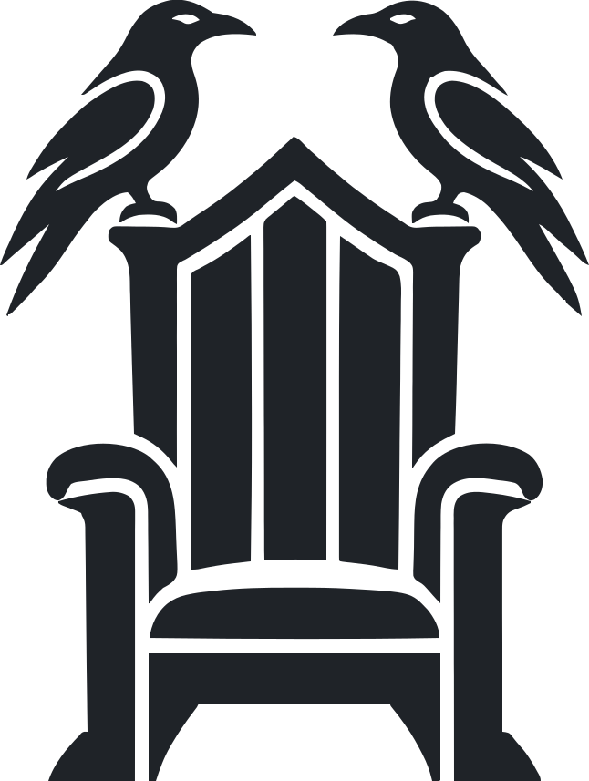
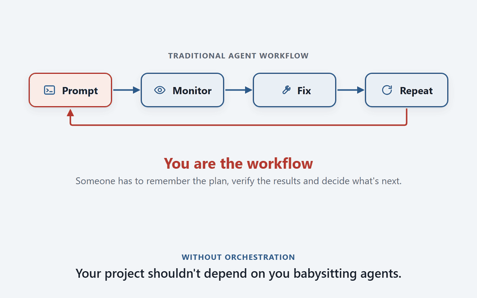
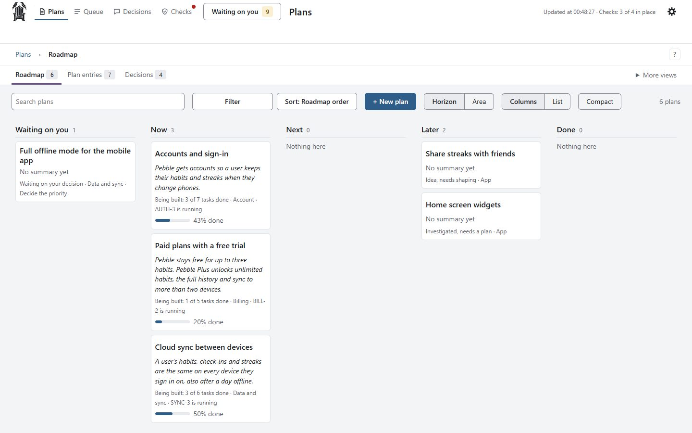

<p align="center">
  <picture>
    <source media="(prefers-color-scheme: dark)" srcset="assets/logo/ravenseat-dark.svg">
    
  </picture>
</p>

<h1 align="center">Ravenseat</h1>
<p align="center"><a href="https://github.com/vegardjorg/ravenseat/actions/workflows/ci.yml"></a></p>
<p align="center"><b>Stop managing agents. Start managing decisions.</b></p>
<p align="center">Ravenseat is a control center for autonomous development with Claude Code. You supervise the exceptions while Ravenseat handles the routine work: the plan, parallel agents, checks, fixes and merges.</p>
<p align="center">You control: <b>decisions</b> · <b>dependencies</b> · <b>quality gates</b> · <b>cost</b> · <b>what agents may do</b>. From Claude Code, or from the local board.</p>
<p align="center"><sub>Open source · Local-first · Runs inside Claude Code · Your Git repository</sub></p>

<p align="center"></p>

## Your project shouldn't depend on you babysitting agents

Claude Code can build a feature in one conversation. But a project spanning days or weeks is a different problem.

Tasks depend on other tasks. Agents need to work without overwriting each other. Tests fail. Fixes introduce
regressions. Conversations grow, compact, or end. Someone has to remember the plan, coordinate the work, verify the
results, and decide what happens next.

Without orchestration, **that someone is you.**

Ravenseat is a persistent orchestrator for Claude Code. It plans and coordinates parallel agents, verifies their work,
recovers from failures, and merges passing changes. When something needs your judgment, it pauses that branch of work,
not the project. Independent work keeps moving.

**You manage the project. Ravenseat manages the workflow.**

<p align="center"><picture><source media="(prefers-color-scheme: dark)" srcset="assets/infographics/workflow-shift-dark.webp"></picture></p>

## What changes?

| Without orchestration | With Ravenseat |
|---|---|
| You carry the plan from chat to chat | Plans, tasks, dependencies and decisions are [plain files](#why-the-architecture-matters) in your repo; the chat can compact or restart |
| You pick what runs next | The queue starts eligible tasks by dependency, focus and priority |
| Agents share one checkout | Each track gets [its own Git worktree and branch](#why-the-architecture-matters); merges go one at a time |
| You trust the agent's "tests passed" | Ravenseat [runs your checks](#guarantees-and-limits) on the delivered commit, and only that record opens a merge |
| You chase every red run | A failed check starts a fix round; still blocked, it becomes one decision |
| Rules in `CLAUDE.md` hold most of the time | Agents cannot push, write control files or mark their own work tested; [weakening a guard is logged](#guarantees-and-limits) |
| Small things interrupt you, big ones pass silently | [Decisions](#what-needs-your-attention) are collected, ranked by what they unblock, and come with a recommendation |
| The bill arrives at the end of the week | [`ravenseat cost`](#what-about-cost) per task, and an optional daily budget stops new starts |

Ravenseat doesn't replace Claude Code. It provides the persistent coordination layer around it.

## How it works

1. **Define the work.** Tasks, optionally with dependencies, completion criteria and priorities.
2. **Dispatch agents.** Eligible tasks start in parallel, each with a focused mission in its own worktree.
3. **Build and commit.** Each agent commits on its own branch. Detailed reports are written to files rather than
   filling the main conversation.
4. **Verify independently.** Ravenseat runs your configured checks against the exact delivered commit.
5. **Recover or merge.** Passing work is merged locally. Failing work gets a fix round on the same branch and another
   check run, up to three rounds by default.
6. **Park blockers, keep working.** When a task needs your judgment, Ravenseat parks that task and anything depending
   on it. Unrelated tasks continue running, and the queue keeps dispatching eligible work. Your answer unlocks the
   blocked branch.
7. **Keep going.** Completed tasks unlock their dependents. The queue only waits when no independent work remains.
   Answer a decision, and its dependent tasks become eligible again.

The plan and execution state live outside the conversation. A compaction, restart, or new Claude Code session doesn't
require you to reconstruct the project from memory. [How the orchestration loop works](plugin/docs/orchestration.md#the-loop).

## What it feels like to use

You don't have to learn a new interface or manually manage a collection of agent conversations. Talk to Claude Code.

> **You:** Add dark mode in settings, a weekly streak on the habit card, and a CSV export once the streak is done.
>
> **Claude:** Added T-001, T-002 and T-003. T-003 depends on T-002. The independent work can start first.
>
> **You:** Start the queue.
>
> **Claude:** Starting eligible tasks. Each will run in its own worktree. I'll run the configured checks before merging
> completed work.

Then get on with something else. Later, from your computer or through Claude Code's Remote Control on your phone:

> **You:** What happened while I was away?
>
> **Claude:** 6 tasks merged with passing checks. One task is blocked after its fix rounds. There are 3 decisions
> waiting for you. Independent work is continuing. Nothing has been pushed.
>
> **You:** What's the most important decision?
>
> **Claude:** The CSV export format is blocking two downstream tasks. I recommend option B because it preserves the
> existing API contract. Here are the tradeoffs.

You decide. Ravenseat continues.

*Illustrative conversation. Exact responses depend on the project, configuration, and work being performed.*

The point isn't that AI never needs you. **It's that you shouldn't need to be present for every transition between
tasks.**

**Built for unattended work.** Leave Claude Code running and Ravenseat can keep dispatching, checking, fixing and
merging eligible tasks for hours. When a task needs your input, only that task and the work depending on it are parked; other eligible
work keeps going. If nothing independent is left, it waits without consuming tokens. Answer through Claude Code,
Remote Control or the board, and the parked work continues. Your machine must remain awake for local execution.

## What needs your attention?

<p align="center"></p>

Decisions collect the things Ravenseat cannot or should not resolve on its own. These include:

- unclear product requirements;
- architecture and hard-to-reverse choices, such as the data model, a public API or file format, a new dependency, or
  deleting data;
- security or legal tradeoffs;
- visual or functional acceptance of a delivery;
- tasks that remain blocked after the fix rounds;
- tasks agents propose, and pushes or overrides that your settings route to you;
- work that looks stuck or runs long.

**A decision doesn't stop the queue.** Only the affected task and its downstream dependencies wait. Ravenseat continues
working through everything else that's eligible. You can answer later, and the blocked work becomes eligible again
without restarting the project.

Decisions come with context and a recommendation. Ravenseat shows which work is blocked and what your answer would
unlock, most impact first. You can answer through Claude Code (`/ravenseat:decide`) or the optional board.

The goal is to concentrate your attention where it has the greatest value, rather than asking you to supervise routine
execution.

**You remain responsible for the requirements, architecture, and delivered product.** Passing checks cannot prove that
an agent understood what you wanted. Each delivery lists what the agent assumed: review assumptions and consequential
changes before accepting them.

## The board is optional

<p align="center">
  <picture>
    <source media="(prefers-color-scheme: dark)" srcset="assets/screenshots/dark-01-queue.jpg">
    
  </picture>
</p>

Ravenseat works entirely through Claude Code. The optional local board is a wider view of the same orchestrator, not a
separate workflow or another system you need to keep synchronized. Open it with `/ravenseat:board`.

| View | What it tells you |
|---|---|
| Decisions | What needs my attention, and what will my answer unblock? |
| Queue | What's waiting, running, under review, or finished? |
| Dependencies | What's holding up progress? |
| Focus | Which areas and features should receive attention next? |
| Checks | What validation is configured, and where might coverage be missing? |
| Statistics | How much work is completing, at what cost, and with how much intervention? |
| Plans | How does today's work fit the larger project? |
| Settings | What are agents allowed to do, and which guards are weaker than their defaults? |

The board also provides controls for managing tasks, priorities, and decisions. Every board action has a matching
`ravenseat` command and goes through the same code, lock and undo, on the same state. Weakening a guard from the board
needs a deliberate confirmation, and is logged.

[Take the board tour](plugin/docs/board.md#a-tour) · [CLI parity](plugin/docs/cli-parity.md)

## Is Ravenseat for you?

**Yes, if:**
- your project spans multiple sessions, days, or weeks;
- you want agents to work independently without managing every handoff;
- your project has meaningful automated checks;
- you want parallel execution without manually coordinating Git worktrees and merges;
- you want to return to progress reports and decisions rather than unfinished conversations.

**Probably not, if:**
- your change is small and fits in one session;
- you have no meaningful way to validate generated changes;
- you don't need persistent planning, dependencies, or concurrent execution.

**Requirements:** Node.js 20+, Git 2.38+ (older Git works, but without the trial merge and the conflict prediction,
so a conflicting merge can stop half done in your checkout), and Windows or Linux. macOS has not been tested yet. If
you try it, reports of what works and what doesn't are welcome.

## Quick start

**1. Install.** In Claude Code:

```
/plugin marketplace add vegardjorg/ravenseat
/plugin install ravenseat@ravenseat
```

**2. Set up your project.** *"Set up the queue."* or `/ravenseat:setup`. The guided setup fills in your project's
checks with you and asks before changing settings. Not sure yet? *"Run ravenseat doctor."* reports what it finds
without making changes.

**3. Add work.** *"Add to the queue: fix the login bug and add a regression test."* For larger features, describe the
objective and ask Claude to break it into tasks with dependencies.

**4. Start execution.** *"Start the queue."* or `/ravenseat:queue`. It reports and asks before starting, dispatches
eligible tasks, runs the configured checks, and merges passing work locally.

**5. Return to the decisions.** *"What's waiting on me?"* or `/ravenseat:decide`.

**Nothing is pushed until you explicitly ask for a push** (the default; a push threshold can be turned on).

Natural language works throughout. Commands are available when you want more explicit control.
[All commands](plugin/docs/commands.md) · [Full setup and usage guide](plugin/docs/guide.md)

### What setup changes

- `.claude/settings.json`: the recommended settings, after you approve them. One sets automatic compaction at 300k
  for every Claude Code session in the project. Existing values are preserved.
- `queue.config.json` and `CLAUDE.queue.md`.
- `docs/queue/`: the mission template, the project catalog and a copy of the Ravenseat docs.
- `scripts/.queue/`: tasks, queue state and the plan register.
- `.gitignore`: lines for the queue data, the agents' worktrees, personal settings and `.env` files.
- An `@CLAUDE.queue.md` reference in `CLAUDE.md`, if you approve it.

Running tasks create separate branches and worktrees, removed after a successful merge.

To uninstall, run `claude plugin uninstall ravenseat@ravenseat`, then remove the project files, the `.gitignore` lines
and the settings above, including the `@CLAUDE.queue.md` reference. The hooks remain inactive in projects without
`queue.config.json`.

## Why the architecture matters

Ravenseat is not just a wrapper that launches multiple Claude Code agents. The difficult part of sustained agentic
development is coordinating their work, maintaining state, validating results, and recovering safely when things go
wrong.

1. **The project survives interruptions, not just conversations.** Plans, tasks and decisions persist in plain files.
   Ravenseat can recover interrupted merges, detect abandoned agents and resume unfinished work after a restart, while
   protecting your uncommitted changes during merges. After compaction, the main chat resumed starting agents in about
   6 turns, compared with about 17 for a new chat reading a handover note.
   [What it solves](plugin/docs/guide.md#what-it-solves)
2. **Agents work independently.** Each track has its own worktree and branch, dependencies decide what starts, and
   merges go one at a time: about 1,200 tasks were finished this way during three weeks of October 2026, in a larger
   private project. Queue updates and merges are designed to survive concurrent operations and interruptions without
   losing tasks, merging the same work twice, or silently marking unfinished work as complete.
   [Orchestration](plugin/docs/orchestration.md)
3. **Agents don't certify their own work.** Checks run on the exact delivered commit and are recorded with its SHA by
   the orchestrator, not by the agent being evaluated. [Guarantees and limits](#guarantees-and-limits)
4. **Failures become work, not dead ends.** A failed check sends the findings back to a fix agent on the same branch
   (the agent that delivered, when it stopped recently, otherwise a new one), and the checks run again. A task still
   blocked after the fix rounds, or one that stops making progress, becomes a decision, while independent tasks keep
   running.
5. **Important rules are enforced by code.** `CLAUDE.md` holds instructions a model interprets; pushing, protected
   files, check records and completion criteria are enforced on every action. 266 red team tests on real git and real
   processes (266 of 266 passed on 2026-11-21); run `npm run redteam` to check it yourself.
   [Red team](plugin/docs/redteam.md)

## Guarantees and limits

### Enforced safeguards

- **Independent check records.** Each run is recorded by Ravenseat with the commit SHA, and merge and push read only
  that record (the default; letting CI or the agent's own run count is a logged, weakened setting).
- **Agents cannot push.**
- **Protected control files.** Agents cannot write `CLAUDE*.md`, `.claude/`, git hooks, git config or the queue
  config; a direct write from the main session asks you first.
- **Focused-test protection.** A new `.only`, `fit` or `fdescribe` stops the merge. Deleted tests and new skip
  markers are flagged for review.
- **Protected paths.** A change to CI config, lockfiles or Ravenseat's own scripts stops the merge unless the task
  owns the file or you approve it. In lite mode, lockfiles and other dependency files only warn.
- **Explicit overrides.** An override opens Claude Code's permission dialog, so an agent cannot approve one by writing
  an approval into its report.
- **A fixed finish line.** A task's completion criteria are locked when execution begins.

### What Ravenseat does not guarantee

- **It is not a security sandbox.** Agents run as your OS user, the guards do not read the contents of a script an
  agent writes and then runs, and the guards let an action through if they themselves crash. Keep production
  credentials off the machine, and use Claude Code's permissions or sandbox when you need a real boundary.
- **Green checks do not guarantee correct software.** Without meaningful tests a green merge shows little;
  `ravenseat doctor` warns when a project has no checks.
- **It cannot replace architectural judgment.** That stays with you.
- **It is a young project.** Public since late October 2026 and released often. Developed on Windows, tested on
  Windows and Linux.

The full list, with the test behind each guarantee: [red team](plugin/docs/redteam.md) ·
[guarantees and limits](plugin/docs/guide.md#guarantees-and-limits)

## What about cost?

Ravenseat is designed to reduce coordination work, not to promise cheaper code generation. Two questions matter.

### Smaller conversations reduce repeated context

Every turn sends the whole conversation again, so a large chat pays for its size on every turn. Setup offers automatic
compaction at 300k. The same project, on the same model, before and after:

| Metric | Compaction near 1M | Compaction at 300k |
|---|---|---|
| Main chat: median context per turn | 464k | 183k |
| Main chat: cost per turn | $0.157 | $0.065 |
| Subagents: cost per turn | $0.109 | $0.056 |

Main-chat cost per turn fell by more than half, and subagent cost per turn by about half.

### Orchestration itself is approximately cost-neutral

Against one well-kept chat that also compacts at 300k, the queue came out about the same: about $12 per 1,000
inserted lines for both in the last measured week, the queue's checks included. Over all 19 days measured the plain
chat was cheaper per line; with checks and review taken out of both, the two were about cost-neutral. The checks cost
what your tests cost: in the measured repo they were about a third of the queue's spending, from a very heavy test
suite and a reviewer on almost every task.

This is one developer, two repositories and a few weeks: not a controlled benchmark. Amounts are API-equivalent at
list prices; on a subscription they are quota, not dollars. Run `ravenseat cost` to see the numbers in your own
project, and `ravenseat limit dailyBudget <usd>` to stop new tasks once the day's spend is reached.

Ravenseat also tracks where the tokens go: building, reviewing, fixing failures, and coordinating work. Its cost
diagnostics can flag unusual token consumption, inefficient tool use, and repeatedly read files, helping you identify
waste rather than simply reporting a total.

### Why not just start a new chat?

Starting fresh chats with handover notes is a common way to manage growing context.

In testing, starting a new chat with a handover cost approximately the same as compacting an existing conversation at a
comparable context size.

The difference was recovery: after compaction, Ravenseat resumed starting agents in about 6 turns, compared with about
17 turns after a fresh chat and handover.

The important cost factor is how large the context grows, not whether it is reset through compaction or a new
conversation.

Ravenseat combines shorter contexts with persistent project state, so the orchestrator can resume work without
reconstructing the plan each time.

[Measurements and methodology](plugin/docs/costs.md#measured-compacting-the-orchestrator-against-starting-a-new-chat)

**The primary benefit is not lower token cost. It's less manual coordination, safer parallel work, persistent
execution, and fewer interruptions.** [The measurements and the method](plugin/docs/costs.md)

## Why not just use subagents and worktrees manually?

You can. For a handful of independent tasks, Claude Code's existing capabilities may be all you need. Ravenseat
becomes useful when the coordination itself starts taking significant time.

Without an orchestrator, you still need to maintain the plan, track dependencies, select work, manage handoffs,
reconcile branches, verify delivered commits, recover from failures, and preserve state between sessions.

**The distinction isn't how many agents you can launch. It's how much of the workflow can continue without you
managing each step.**

## Going further

- **Lite and full mode.** Start with a simple queue. [Full mode](plugin/docs/full-mode.md) adds focus-driven
  execution, file ownership, risk classes and specialist reviewers. Security-sensitive changes can trigger additional
  review even in ordinary tasks, and serious findings can block merges.
- **Planning and priorities.** Areas, plans and features in a plan register, with a roadmap of Waiting on you, Now,
  Next and Later. [Plan register](plugin/docs/plan-register.md)
- **Machine-aware concurrency.** Fewer agents start as free memory drops, and heavy check runs take turns.
  [Machine load](plugin/docs/full-mode.md#my-pc-chokes-on-parallel-builds)
- **Work from your phone.** Queue the work, step away, and follow along with Claude Code's Remote Control (a Claude
  Code feature, not part of Ravenseat).
- **Optional cloud execution.** Eligible tasks can run in Claude Code cloud sessions while your local machine is off.
  Returned changes are verified locally before merging. Disabled by default and requires additional security setup.
  [FAQ](plugin/docs/faq.md#are-cloud-sessions-safe-to-turn-on)

<p align="center"></p>

### Improving your project's checks

Ravenseat doesn't just run your existing checks. It helps you improve them.

The Checks system inspects your project's tests, CI, linting, security tools, and validation configuration to identify
gaps and opportunities. Repeated failures can reveal weaknesses worth turning into permanent regression checks.

Suggestions are prioritized. You can dismiss them, enable existing tools, or send an investigation to an agent. The
agent proposes an implementation plan, and you decide what gets built.

The goal is a project that becomes better at catching its own mistakes over time.

[Explore the Checks system](plugin/docs/checks.md)

## Documentation

**Getting started:** [Guide](plugin/docs/guide.md) · [Commands](plugin/docs/commands.md) · [FAQ](plugin/docs/faq.md) ·
[INSTALL.md](INSTALL.md) (vendored install)

**Using Ravenseat:** [Board tour](plugin/docs/board.md#a-tour) · [CLI parity](plugin/docs/cli-parity.md) ·
[Full mode](plugin/docs/full-mode.md) · [Plan register](plugin/docs/plan-register.md) · [The Checks tab](plugin/docs/checks.md)

**Architecture and evidence:** [Orchestration](plugin/docs/orchestration.md) ·
[Queue reference](plugin/docs/queue.md) · [Catalog](plugin/docs/catalog.md) · [Red team](plugin/docs/redteam.md) ·
[Costs](plugin/docs/costs.md) · [Why I built it](plugin/docs/why-i-built-it.md) · [Changelog](CHANGELOG.md)

## Development

```
npm install
npm test                # the whole suite; run it before every push
npm run test:changed    # only the tests your change can reach; run it before each commit
```

- CI runs the full suite on Ubuntu with Node 20 and 22, and on Windows with Node 22 in three shards; a
  `shards complete` check fails unless every test file ran.
- Windows with Node 20 runs weekly and on demand (`ci-weekly.yml`).
- This repo uses `node scripts/test-changed.mjs --gate` as its quick gate; the full gate and CI run the complete suite.

## License

MIT. See [LICENSE](LICENSE). The helper agents `reviewer-design`, `reviewer-tests`, `reviewer-gap` and
`reviewer-docs` are adapted from [testdouble/han](https://github.com/testdouble/han) (MIT, Copyright 2026 Test
Double, Inc.); the license text is in [NOTICE](NOTICE).

## The idea behind the name

Ravenseat is named after Odin's high seat, Hliðskjálf, from which Odin could see every world while the ravens brought
news. You sit in the seat. Your agents fly out, do the work, and return with the results.

Ravenseat grew out of a queue built inside a real Claude Code project that had become too large to manage through
individual conversations. [The longer story](plugin/docs/why-i-built-it.md)

Created by Vegard Cowie Jørgensen.
