# The board (`queue-board.mjs`)

A local web board for the queue and the plan register. It reads the same JSON files as `ravenseat` and writes through
the same functions (same lock, same validation, same undo), so the board and the chat never disagree.

The orchestration runs inside Claude Code, in the terminal or the desktop app, and you can follow and answer from your
phone with Claude Code's Remote Control. The board is a companion, not a requirement: it shows the same project state
from a wider angle, does not run a separate engine, and every change it makes to the queue has a command behind it.

<p align="center">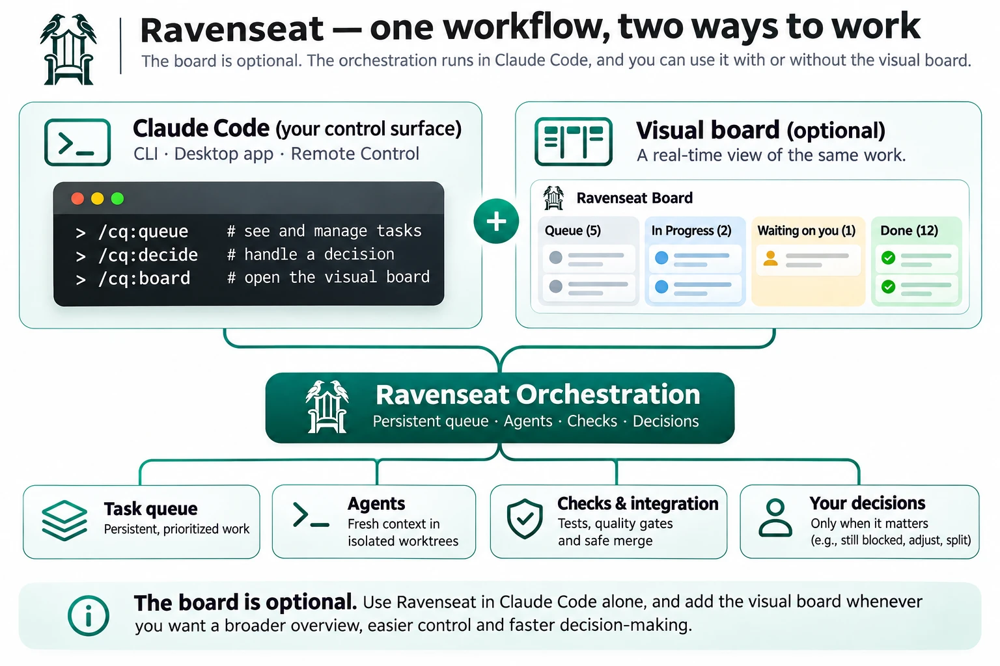</p>

```
ravenseat board            # opens the board in your browser (port: board.port)
ravenseat board open       # opens the running board again (--follow: the follow-up page)
```

How to start it:
- **In Claude Code:** `/ravenseat:board`, or ask Claude to start the board. It runs `ravenseat board` in the background (never in
  the foreground: it is a server and would block the chat), and the board opens itself in your browser. It stops with
  the session.
- **From your own terminal** (keeps running on its own): in the project folder,
  `node "<plugin folder>/scripts/orchestrator/ravenseat.mjs" board`. `ravenseat` itself is only on the PATH inside Claude Code;
  `/ravenseat:board` prints the full path. In a vendored install: `node scripts/orchestrator/ravenseat.mjs board`.

It listens on 127.0.0.1 only. There is no user login, but every request needs the key, and the key changes on every
restart (an old tab then shows the key banner: run `ravenseat board open`, or paste the new link). Do not expose the port.

**The key stays out of Claude's view** (`board.hideKey`, on). The key gives every owner action on the board, and the
start line is what Claude reads when it starts the board for you. So the board opens your browser itself with the
key in the `#` part of the link (never sent to a server), and prints the link without it. `ravenseat board open`
asks the running board to open it again; it needs no key and never gets one. A write without the board's Origin (a
script, not your browser) is refused even with the key. No browser on the machine: the start line says so; set
`board.hideKey` false to print the link with the key, as before (a weakened guard). Scripts and tests can pass
`--key-file <path>` to get the link in a file instead of a browser; when Claude passes it, the approval guard asks you
first (`approvals.ask`). Limits: a model with a browser tool on the same browser, or one that reads the process list
while the browser starts, can still see the key; this closes the plain way (the start line, then curl).

## A tour

The screenshots use a made-up demo project ("Pebble", a habit tracker). The board follows your system's light or
dark mode; the gear lets you pick one.

<p align="center">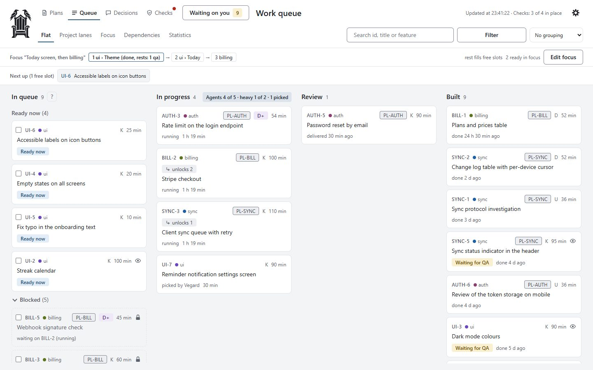</p>

**The queue.** A kanban: **In queue** (ready now, blocked, proposed by agents, and the batch queue where small tasks
wait to be packed into one track), **In progress** and **Review**. Each card shows the id, domain, class (the risk
level K, D, D+ or U, see [task classes](full-mode.md#agents-skip-security-and-edge-cases)), estimate and how many tasks
it unlocks. **Next up** shows what the orchestrator starts in the next free slot; a task with an open blocker that needs
action (the Blocked column) is not in it until `ravenseat unblock`. While you search, Next up shows only the tasks the
search keeps and says how many it hides ("1 hidden by the search"). Click a card for its mission, owned
files, cost and the actions for its status (see [task detail](guide.md#task-detail)).

<p align="center">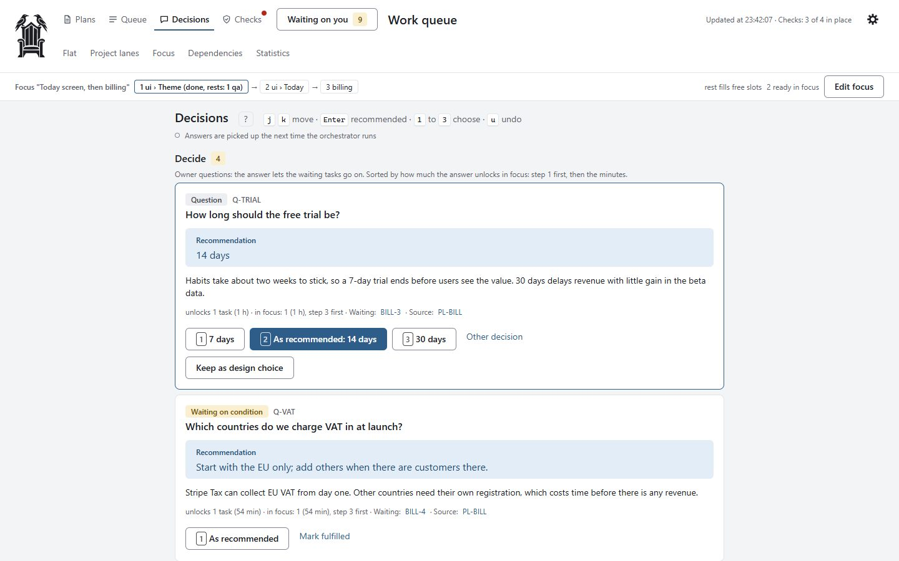</p>

**Waiting on you.** The button at the top opens **Decisions**, where everything only you can decide is answered:
questions from agents (with their recommendation), owner tasks and conditions. It carries the board's only count of
what waits. Each question reads like a question in a chat: the question first, the recommendation in its own
highlighted block right under it, then why it is asked and one muted line with what the answer unlocks, the waiting
tasks and the source, and last the answers: **As recommended** (one click) or **Other decision** (a text field). An
owner task is done, not answered: **Mark done**, with an optional note. Answer on the board, and the orchestrator picks
up the answer and unblocks the tasks.

<p align="center">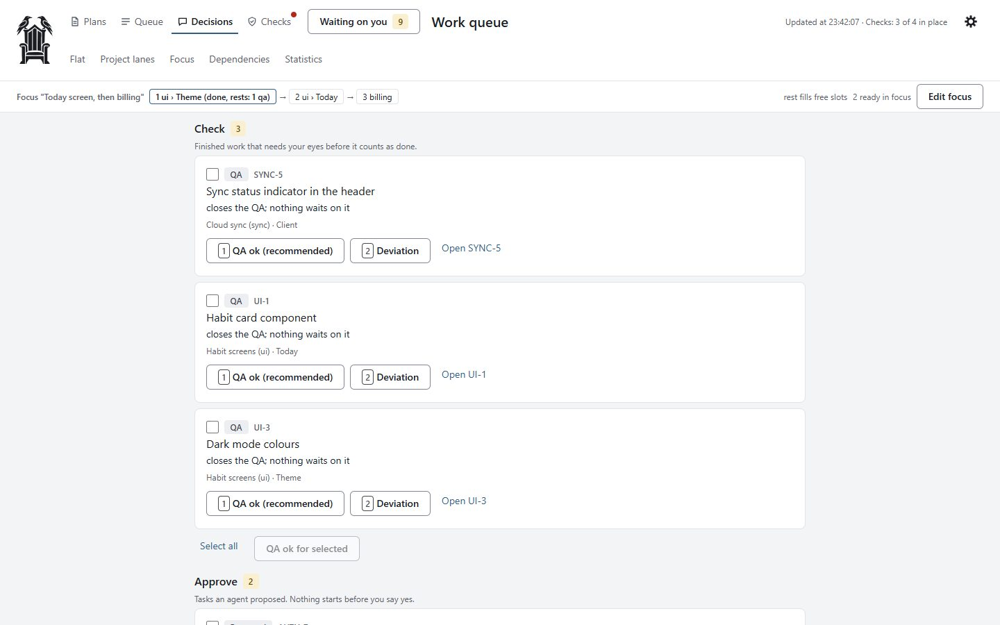</p>

**Decisions.** The same list as `/ravenseat:decide`,
sorted by what each answer unlocks and grouped as Decide, Check, Approve and Unstick. The board opens on it when
anything waits. The recommendation is the main button, an answer can be undone for 5 seconds, and j/k, Enter, 1-4 and
u work from the keyboard.

<p align="center">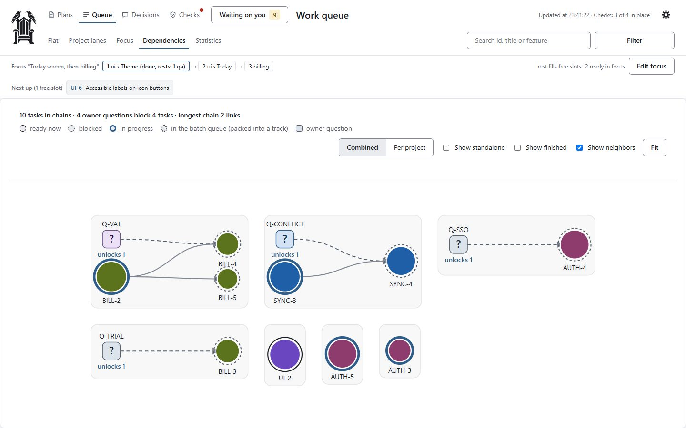</p>

**Dependencies.** The chains as a graph: circles are tasks (solid ring = in progress, dashed = blocked), squares are
open questions. It shows at a glance which single answer unlocks the most work. Each id sits below its ring, never
inside it, and stays between 12 and 14 px on screen at any zoom; every legend sample has an edge in the color of the
ring it explains. The legend also explains why a node looks dimmed, with only the entries that apply right now:
"faded: outside the selected chain" (while a chain is selected), "small gray: hidden by your filter or search" (a
predecessor or successor the filter or search hides, drawn because **Show neighbors** is on) and "pale: done" (a done
predecessor, with **Show finished**). A neighbor's tooltip and screen reader name say "<id> <title>: hidden by the
filter or search", and a click still opens it; a done node says "done". Selecting a task fills the status line at the
bottom of the top area, "Showing the chain of <id> (<n> tasks) · Clear selection", with any chain members the view
hides and their actions in between. The line always keeps its height, so the graph never moves; it is a polite live
region, and **Clear selection** or Esc (after Esc has closed the panel) clears the chain.

<p align="center">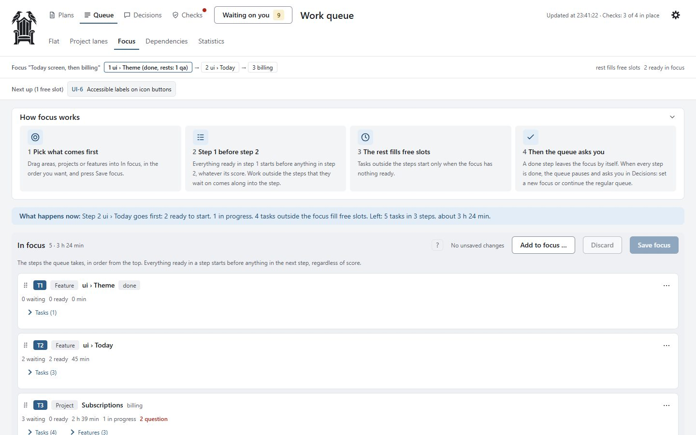</p>

**Focus.** The order the queue takes work in: one ordered list, In focus, where each step opens to show its tasks, and
under it Not in focus and On pause. Drag areas, projects and features between them. The name, the rest and the other
choices sit in Focus settings, a fold below the lists.
"How focus works" at the top explains it in four steps that follow your focus's own settings, and you can close it.
"What happens now" says in plain words what the queue does because of the focus (which step goes first, why nothing
starts, what is left) with buttons that settle it. The forecast under the In focus list says when the remaining tasks
are done.

<p align="center">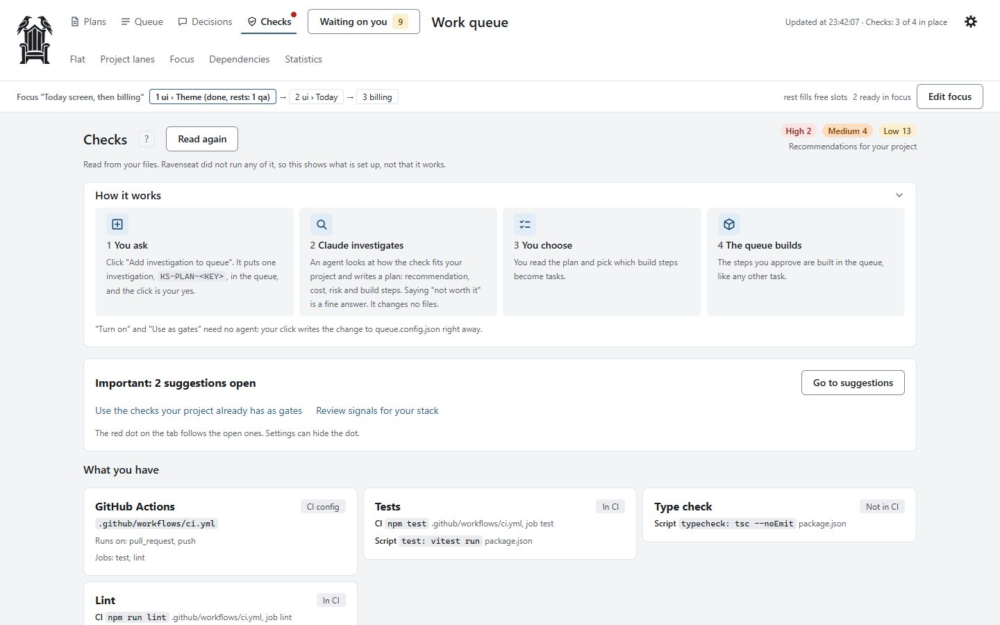</p>

**Checks.** Cards for what your project already has for checking its code, and suggestions for what to add, grouped
by category with the most important first in each group. It is read from your files, so it shows what is set up, not
that it works. "How it works" at the top shows the four steps: a suggestion's button adds an investigation to the queue
(the click is your yes), the investigation ends in a plan and changes no files, you choose which steps become tasks,
and nothing is built before you approve it; some need no agent and turn a check on with one click. A tally under the
header counts the open suggestions per level (High, Medium, Low; a zero count is muted), and each card's level is a
pill in the same color: red for high, orange for medium, yellow for low. The Important box leads to its cards, and placeholders hold the cards' place while the tab reads the project. A small red dot on the tab shows while an important suggestion is open, and "Set aside" keeps a card away
until you bring it back. The guard registry and the failures that repeat are on the same tab. Every card and rule:
[The Checks tab](checks.md).

<p align="center">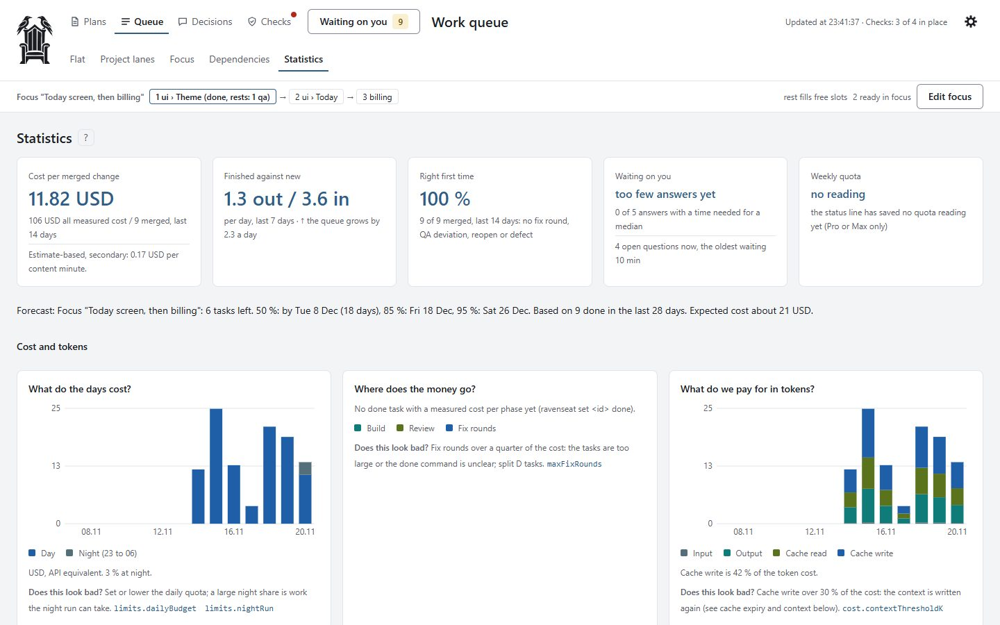</p>

**Statistics and cost.** Five numbers on top (cost per merged change, finished against new, right first time, waiting
on you, weekly quota), then four folds: Cost and tokens, Flow, Quality and Machine. Each chart asks one question and
has a "Does this look bad?" line that opens the matching setting. This is where you see whether the queue earns its keep.

The plan register, the priority map, dark mode and the settings panel are shown in
[the board in detail](guide.md#the-board-in-detail).

<p align="center">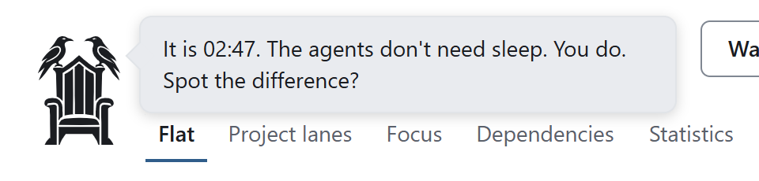</p>

## What it shows

The switch at the top left changes between two workspaces, **Queue** and **Plans**.

**The top bar** has two rows of fixed height (40 px each) and looks the same in every room, so nothing in it moves
when you switch rooms or views. The Ravenseat logo sits in the left corner of row 1, as tall as the row. Row 1 is
then the room tabs (Plans, Queue, Decisions, Checks, each with an icon), then **Waiting on you**,
the project title, the status ("Updated at ...", the checks count or an error) and the gear. The status comes last
and is cut short with an ellipsis when it is long; hover it for the full text. Row 2 starts at the left edge with the view tabs, then the search,
Filter and the grouping; in Plans it stays empty. Nothing in row 2 appears or changes width with a search or a
filter: the Filter button has a fixed width and its label is cut with an ellipsis. Below about 1200 px (a half-screen window) the top turns
compact: the room tabs drop their icons, the search starts narrower and the view tabs scroll sideways in their row
instead of wrapping, and the columns narrow to 220 px so four fit at 1000 px. From 1200 px a column is 280 px
(240 px in Project lanes) when there is room and otherwise gives way to its share of the board, down to 120 px, so
five columns or the panel beside the board never make the columns scroll sideways. On a phone (720 px and below) the rows
wrap as before. The focus line and the "Next up" strip keep their height: choosing a card puts its chain into the
"Next up" row instead of adding a row, so the board does not move down.

**The focus line is always one row.** Each step is cut with an ellipsis when its name is long (hover it for the full
name, the type and its counts), and the steps that do not fit go into **+N more** right after the last one shown.
**+N more** opens every step in a popover, in order, with Now or Next, what waits, what is ready and the time left,
and the line's counts under them; the arrow keys, Home and End move between the steps, and Esc or a click outside
closes it with focus back on the button. The first step (the current one) is always shown. **Edit focus** stays at
the right end. What fits is measured again when the window or the line changes width.

**Filter only changes what you see.** The Filter menu starts with **Quick filters**: the built-in ones (Focus now,
Ready in focus, Outside focus ready, On hold, Sort, New since last visit), each with a short explanation under its
name. A quick filter resets the search and the checked filters. Under them, **Saved** holds your own filters (the
search, the checked filters, the grouping and the view), saved in this browser with **Save current as…** and removed
with **Delete**; picking one brings all of that back. (They lived in a separate Selection menu before; the storage is
the same, so filters saved there are still under Saved.) Then come the sections Show, Projects and Plan entry; a
section with nothing to choose (Plan entry before any task has one) is left out. When anything narrows the board, the
first row of the menu has **Select all N matches** (it selects every shown card that can be changed together, for the
selection menu; **All N matches selected** when they are) and **Show all**, which clears the quick or saved filter,
the checked filters and the search. The Filter button says what is in use: **Filter**, **Filter · 2** (two boxes
checked) or **Filter · Ready in focus** (the name of a quick or saved filter, cut with an ellipsis, with the full text
in its tooltip and the count in its accessible name). Pausing a project changes the queue for
everyone, so it is not in Filter: **Pause** and **Continue** sit in each project's lane header (Project lanes), with
the same warning as before when something is in progress, and the line under Projects in Filter has **Show project
lanes**, which switches the view and puts focus on the first Pause. A paused project still says "paused" in Filter.
Arrow up and down move between the quick filters, the saved filters and the checkboxes, Esc closes the menu with
focus back on Filter (Esc in the name field closes only the field). What waits on you is the **Waiting on you**
button at the top, not a filter. The word "selection" on the board means the ticked cards only.

<p align="center">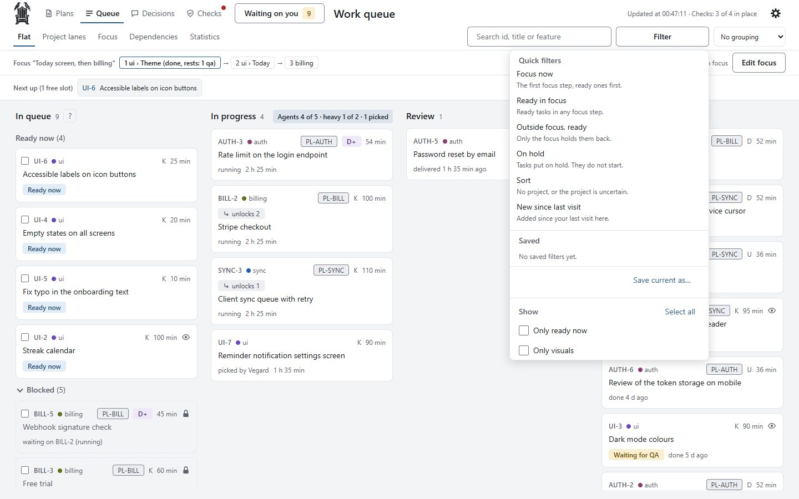</p>

The Queue workspace has these tabs:
- **Flat:** the columns **In queue** (ready now, blocked, proposed by agents and the batch queue), **In progress**,
  **Review** and **Built**. Each card shows class, estimate, value, blockers and owner questions. Click a card for
  its details and actions (to the top of the queue, pick, put on hold, add to the batch queue, edit, cancel task,
  and decline for a proposal). Drag cards to reorder them. Under **Ready now**, **Blocked** (called **Waiting** when
  the Blocked column is on), **Proposed** and **Batch queue** are folds: a button with an arrow before the name and
  the count ("Blocked (5)"), opened and closed with a click, Enter or Space. Blocked is open from the start when it
  has 20 cards or fewer and closed above that (its cards are then built only when you open it), Proposed is closed,
  and the batch queue is open; your own choice holds for the rest of the visit. Clicking a card with a chain
  highlights the tasks before and after it and fades the rest. The chain line above the columns says so ("Showing
  the chain of <id> (<n> tasks): 2 before, 1 after · the rest is faded", with **Clear selection**) and why any of them are not
  visible, with a button where one helps: "2 in the closed Blocked group" (Show), "hidden by the search" (Clear
  search), "hidden by the filter" (Remove filter), "outside the filter" (Show all), "older than 7 days in Built"
  (Show more), or "not shown in this view". Column and group headings are in sentence case; the In progress header
  keeps its name on one line, and the agents badge ends in an ellipsis in a narrow column (the full text is in its
  tooltip). An empty column says in one line what goes there ("Nothing to review. Delivered tasks wait here for review
  and merge."). A search that matches nothing shows one message above the columns, "Nothing matches" with **Clear
  search**, and the columns show 0; a column the search empties while others still match says "No matches here." The
  chosen card keeps its shape: its ring shows it, and "selected" is read by a screen reader only.
- **Blocked** (off by default): with **Blocked as its own column** on in the gear (Board tab), a column right after
  **In queue** holds every open task with an open blocker that needs action: the blocker codes `owner-question`,
  `merge-conflict`, `merge-guard`, `merge-stopped`, `gate-red`, `silent`, `no-agent`, `context`, `quota` and `other`
  (the same `blocks` entries `ravenseat blockers` counts). The task leaves its own column, so it is never shown twice.
  The card shows the code and how long it has stood, with the same text as `ravenseat blockers`; the ones that hold back
  the most (unlocks) come first, then the oldest blocker. What waits as normal (`depends_on`, an ownership conflict with
  an active task, a task on hold) stays in In queue, muted with its reason, under **Waiting**. "Waiting on you" is not
  changed: it still shows only what needs you. Saved in queue.json as `board.blockedColumn`
  (`ravenseat board-setting blocked on|off`).
- **Project lanes:** the same cards with one row per project; drag a lane to change the project's priority. With the
  Blocked column on, each lane has a Blocked cell too. A card keeps its project short name and color dot here, and in
  Flat grouped by area or feature, so a card looks the same in every view.

<p align="center">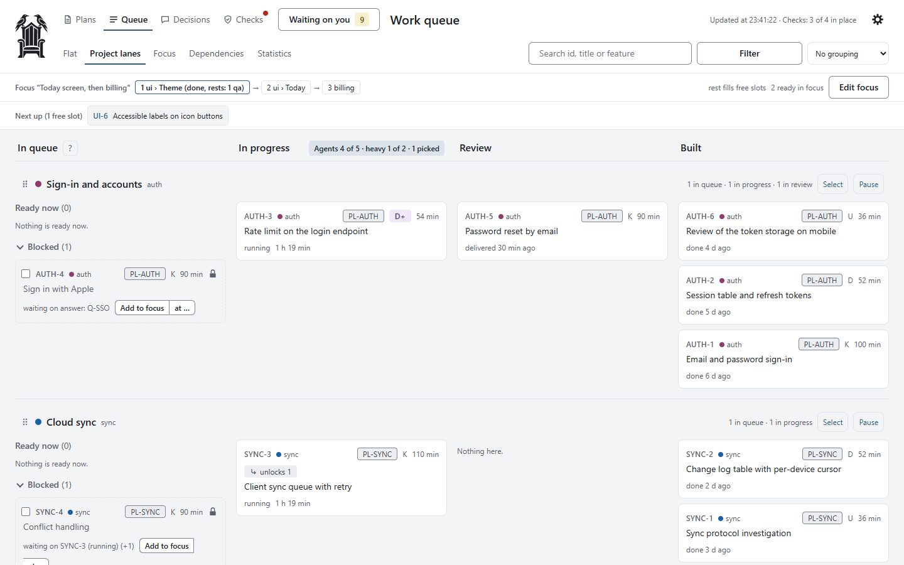</p>

- **Focus:** the order the queue takes work in, as one ordered list **In focus** (step 1 first; each step row has a
  **Tasks** fold that lists the step's tasks with a status per task: ready, blocked, waits on an answer, QA waiting on
  you and so on; a done step keeps its "done" badge), then **Not in focus** (the rest) and **On pause** (projects on
  pause). Drag areas, projects and features between them, or lift one with Space and move it with the arrow keys (up
  and down in In focus, left and right between the sections). While you drag in In focus, a thin gray bar shows the
  exact spot the step will land; there is no bar where the drop would leave the step where it is. With the keyboard
  the lifted row itself moves, so it needs no bar. The saved `now_count` (the old split into Now and Next)
  stays in the data and is sent back unchanged, but the board no longer draws it. Below the lists, **Focus settings**
  is a fold, closed by default, with the name, the rest (waits or fills free slots), the end date, dragging
  dependencies along, what happens when the focus is done, **Clear focus** and **Areas …** (creates and names the
  areas). The draft state, **Add to focus …**, **Discard** and **Save focus** stay beside the In focus heading. **Add
  to focus …** opens a picker (kind: task, feature, project or area; what; and the position) that puts the step into
  the draft, as a drag does; nothing is saved before Save focus and its preview. **What** is a search field over the
  list: type any part of the id or the title (every word must match), the arrow keys and Page Up/Down move the choice,
  the number of matches is read out, and Esc clears the search first and closes the dialog only on an empty field.
  **Position** is **First**, **After a step** or **Last** (the default); After a step opens a searchable list of the
  steps by their label (T3, the task id and title, or the step's name). A task step
  taken out of In focus in the draft stands in Not in focus until the draft is saved or discarded, so it can be dragged
  back. With more than 12 steps, In focus draws compact one-line rows, and every step row has a small **⋯** menu with
  **Move to top** and **Move to bottom** (into the draft; Home and End do the same for a step lifted with Space). A
  step whose task list holds more than 12 tasks shows about 12 at a time in its own scroll area, which is a tab stop
  with a label and a hint under it. On the cards, a task outside every step has **Add to focus** in the detail panel,
  on its card right after the reason (which then leaves out the `ravenseat focus` hint) and, for several ticked cards,
  in the selection menu: each goes in as its own `task:<id>` step, last in the list, in one change. Beside each one,
  **Add to focus at …** (on the card the **at …** half of the button) opens the same picker with the task or tasks
  already chosen, so only the position is picked; it sends the same change with `at` (First is 1, after step k is
  k+1, Last leaves it out). A task that is its own step has **Remove from focus**, which
  takes that step out. A task that a feature, project or area step holds gets a note naming that step and no button
  (it cannot leave the focus alone, and its own step would only move it to the end); a task dragged along says which
  task waits on it. These actions show the same preview as Save focus (before, after, the steps, Next up) and save on
  confirm (`POST /api/focus { change }`, the same code as `ravenseat focus add` / `focus remove`, so `undo` takes it
  back); taking out the only step is refused with a pointer to **Clear focus**. Below 600 px the order is
  What happens now, In focus, Not in focus, On pause and the settings fold, one under another. At the top, **How focus works** is a box in four steps
  (pick what comes first, step 1 before step 2, what the rest does, what happens when the focus is done) whose text
  follows this focus's rest and continue-when-empty values; it is open until you close it, and the choice is
  remembered in this browser only (no setting). Under it, **What happens now** is one sentence from the server
  (`focusNow`, built from the focus status and the step evaluation) with the buttons that settle the state: **QA
  <id>**, **Answer <question>** or **Review <proposal>** open that card in Decisions when the focus stands still on a
  rest, **Pack the batch queue** opens the pack dialog, and when the focus is done **Continue the regular queue**
  answers the owner question and **Set a new focus** opens the Focus tab. A copyable command shows only where the board
  has no button. When the focus line warns, the red band on the other tabs shows the same line and buttons instead of
  CLI advice. A **Forecast** box says when the remaining tasks in the focus are done at 50, 85 and 95 % (the same as
  `ravenseat forecast`; the saved focus counts). In Decisions, the answer **Set a new focus** to the "focus ended"
  question opens the Focus tab.
- **Dependencies:** a graph of which tasks wait on which.
- **Checks:** what the project has for checking its code, and prioritized suggestions for what to add, as cards in
  one group per category, under a "How it works" box you can close. A suggestion's button adds its investigation and
  planning to the queue; building needs your approval afterwards. The stack
  pack suggestion needs no agent and writes `review.packs` on your click. A red dot on the tab while an important
  suggestion is open (`checksPanel.marker`). Read from files, nothing is run. Off with the link on the tab, in Settings or with `ravenseat checks off`
  (see [the Checks tab](checks.md)).
- **Cloud:** tasks that can run in a cloud session, and the cloud sessions (off by default, see [Modules](#modules)).
- **Statistics:** first a row of five numbers: **Cost per merged change** (the last 14 days, with this week against the week before;
  the estimate-based cost per content minute is its detail, see
  [Cost estimates and calibration](queue.md#cost-estimates-and-calibration)), **Finished against new** (it warns when
  more came in than was finished two weeks running), **Right first time**, **Waiting on you** (the median answer time
  of owner questions and the oldest open one; with too few answers it says so) and **Weekly quota** (the
  share of the 7-day limit used against the share of the week gone, from the status line's reading). Then the forecast
  line and four folds, each with a heading (open on a wide screen; on a narrow one only Cost and tokens is open, and
  the board remembers what you open or close):
  - **Cost and tokens:** cost per day, the token mix per day in USD (input, output, cache read, cache write, priced
    per model and per cache write type, so it adds up to the measured cost), the cost per phase and class with the fix
    share, the cache expiry per day with its extra cost in USD (the cache write, minus the read it replaced, of the
    turns that came after a
    pause longer than the cache lifetime), the five most expensive tasks, context at the end of tracks as one point per
    track against the compaction cap (it follows `autoCompactWindow` in the Claude Code settings, 300k when unset), the
    usage today and the section **Agents last 14 days: models, tools and errors** (only tools with an error rate over
    5 %, the same numbers as `ravenseat cost`).
  - **Flow:** done per day (day and night; night is a muted blue, purple is only for D+), added versus finished, time
    per class against the estimate, the table **Blockers last 7 days** (the same numbers as `ravenseat blockers`)
    and **How much runs without you?** (owner interventions per 10 merged, verified tasks per intervention, the longest
    stretch without the owner, failures corrected without the owner, pushes per week).
  - **Quality:** **Is it right the first time?** (first pass, fix rounds, merge conflicts, base red, triage, right
    first time, post-merge defects, inflow, the reviewer hit rate table and the hints; see
    [Flow and quality](queue.md#cost-estimates-and-calibration)), the gate health per command (runs, red, flaky, p50
    and p95; the gates that never went red), and the findings log per source and severity with the deferred findings
    and how many of them were fixed.
  - **Machine:** free memory and limited or stopped starts per day from the load rows, the gate queue wait per day
    (p50 and p95), the gate time against how many tracks ran at once, and at the bottom the guard decisions. With
    `metrics.machineSampleMin` above 0 (default `0`, off) the board also writes a machine sample (free memory, CPU,
    running tracks) every that many minutes while it runs, and the lowest free memory per day counts those too.
  Every chart has a caption that is a question and a line **Does this look bad?** with a button per setting that
  changes it; the button opens the gear on that setting.
- A running card gets the badge **silent** when the track has an agent worktree but no sign of life for
  `limits.silentMin` minutes (the same rule as `SILENT` in `ravenseat show`; the server measures it at most once a minute).
  After 60 minutes it also gets a card under Decisions. A track or a prepared round no agent took gets a card at once.
- A card in Review gets the badge **reviews k/n**: how many of the reviewers `receive` chose have a FINDINGS report
  after that receive (the light review never counts). It warns while one is missing or the newest report has a HIGH
  (`reviews 2/2 H=1`), since `merge` stops on both; the tooltip names the reviewers. Off with
  `review.requireFindings`, like the gate.
- A built card gets the badge **Merged, not verified** when no gates, done command or agent review ran, and **Audited**
  when only an agent review ran ([When a project has no checks](queue.md#when-a-project-has-no-checks)).

<p align="center">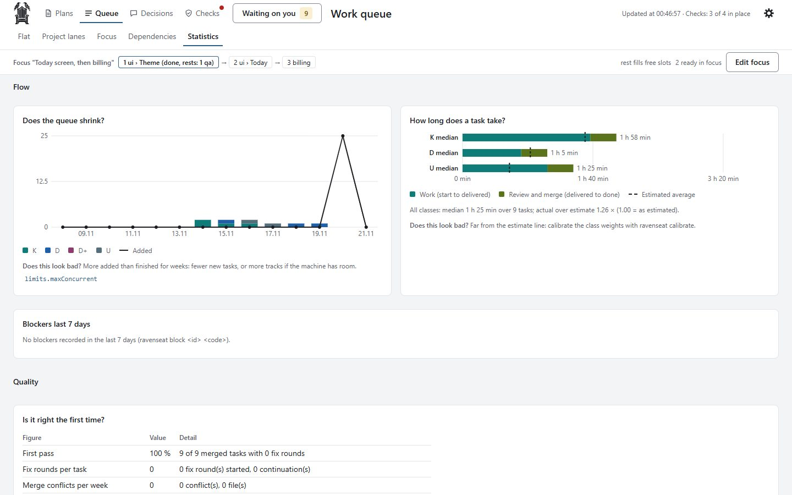</p>

<p align="center">
  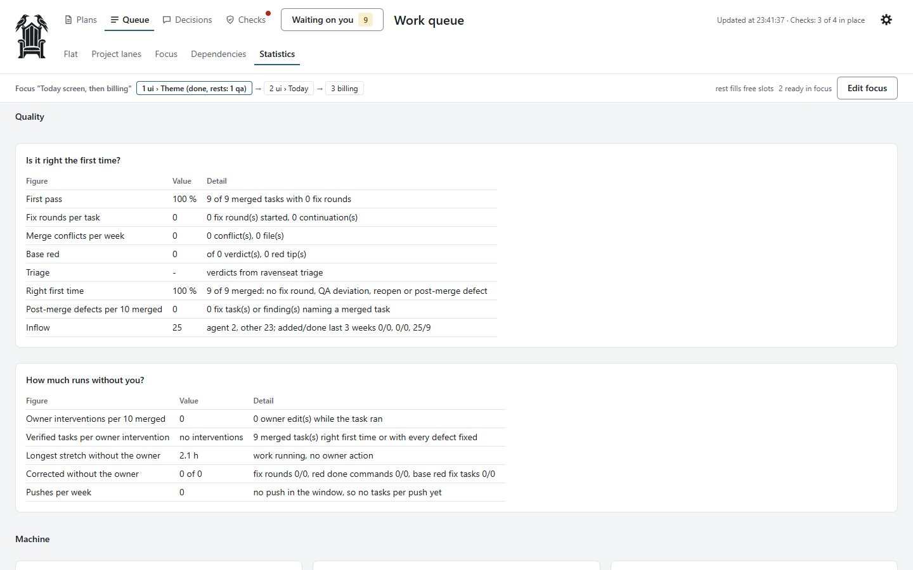
  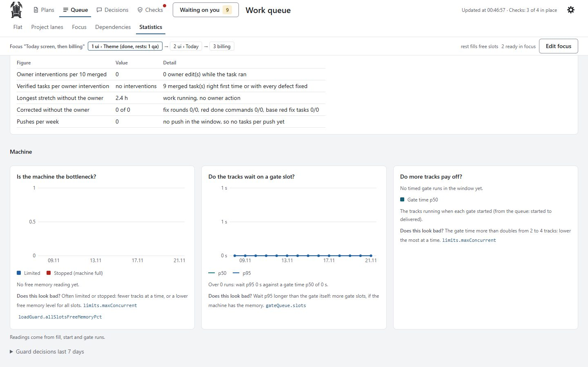
</p>

**The task panel.** A click on a card (or Enter on its title) opens its panel. It reads top down: the title, a short
line on what the task is about, the actions, the full mission, and last the technical facts (status, project, class,
placement and score, dependencies, owner files, branch, cloud, migrations, QA, verification, source and remarks) under
**Details**. Details is closed from the start and shows the status on its row; whether you keep it open is remembered
in this browser. The short line is the first paragraph under a heading such as "What and why", "Why", "Goal",
"Purpose", "Background" or "Summary" (or a bold `**Goal:**` label) in the mission; without one it is the first plain
paragraph, skipping generated lines such as the `=====ID=====` marker, `TITLE:` and `BRANCH:` lines, headings and
`**Ownership in the queue:**` blocks, and last the first list item. It is clipped at about 320 characters.

<p align="center">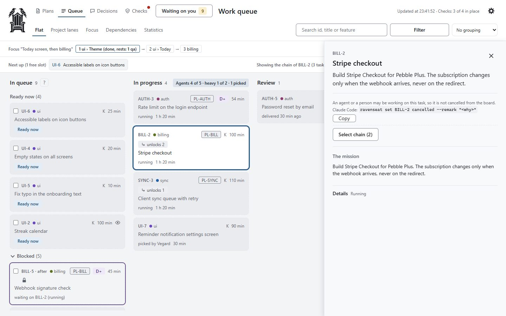</p>

**Where the side panel sits.** The task panel, Settings and the help share one side panel. From about 1200 px wide it
is not modal (no scrim, nothing on the board is made inert, Tab can leave it) and starts below the top bar, which
keeps its full width. How it sits is `board.panelMode` in queue.config.json (Settings, Board, **Side panel**):

- `float` (the default): the panel floats over the right side of the board with a soft shadow. The board never
  changes size, so nothing reflows when it opens or closes: the focus line stays on one row and the Dependencies
  view's top row does not rewrap. A pointer click anywhere outside the panel closes it, with these exceptions: a click
  on another card or graph node shows that card instead; a click in a menu or dialog (one opened from the panel, such
  as a confirm or the focus picker) is not outside; a press that starts in the panel, or a drag such as panning the
  graph, does not count; and while a new-task form or an edit form with unsaved changes (a changed field in Edit, a
  typed reason in Cancel or Decline) is open, the panel stays and a short message says why. A keyboard activation
  outside (Enter or Space on a board control) leaves the panel open; Esc closes it.
- `beside`: the panel docked as before: the board makes room for it (and narrows and rewraps while it is open), and
  a click outside leaves it open.

In both, a click on another card shows that card in the panel, Esc and Close close it, and focus goes back to the
card (unless the closing click put focus somewhere else, which is kept). On a narrower screen it is a modal sheet over
a scrim in both modes, as before; a click on the scrim closes it, except while a form in it has unsaved changes. A new
value in the gear reaches an open board on its next refresh, also while the panel is open.

**Cancel, decline and edit.** For a waiting task (also on hold or in the batch queue) the detail panel has **Edit**
(value 1-10, content minutes and class, checked like `ravenseat add` / `ravenseat edit`) and **Cancel task**; for a proposal it has
**Edit** and **Decline**. Cancel and decline ask first, with an optional one-line reason, and run `ravenseat cancel <id>
--remark "cancelled: …"` or `"declined: …"` (the same result as `ravenseat set <id> cancelled --remark …`, but logged).
Edit runs `ravenseat edit <id> --json '{…}'`. All three go through `/api/task-edit` and give **Undo** for 30 seconds. A
running, picked or review task is never cancelled from the board, since an agent or a person may be working on it:
the panel shows `ravenseat set <id> cancelled --remark "<why>"` instead. In **Decisions** each proposal has
**Decline** next to **Approve**; it asks for an optional reason first.

**Select several cards.** Every card in In queue, proposed and the batch queue has a checkbox at its top left.
Select with the box, x on the card, Ctrl/Cmd-click, Shift-click (everything from the previous selected), Ctrl/Cmd+A
or **Select all N matches** at the top of the Filter menu, or a whole group from its header. On a wide screen with a mouse the **selection menu** opens
next to the box you checked last, like a context menu: the count and the summed estimate on top (and how many are
hidden by the filter), then **Move to project**, **Feature**, **Put on hold**, **Take off hold** (when one is on hold),
**Move as block**, **Add to batch queue** / **Take out of batch queue**, **Pack into track** (two or more, all in the
batch queue), **Label** and, below a line, **Clear selection**. It follows the next box you check, also in another
column, moves along when you scroll and stays inside the window. Arrow up and down, Home and End move between the
rows, Enter picks one, Esc closes the menu and puts focus back on the checkbox (Esc again clears the selection), and
Shift+F10 on a card opens it again. On a narrow screen (below 600 px) or a touch screen the same actions sit in a bar
at the bottom. Every action shows what changes before it is saved, and **Undo** stands for 30 seconds afterwards.

**Decisions** (the tab next to Plans and Queue; the count is on **Waiting on you**, which opens it) is the owner's main view: everything that waits on
the owner as one list, one card per decision, most impact first (minutes unlocked in focus step 1 first, then what
the answer unlocks), grouped as **Decide** (owner questions), **Check** (QA), **Approve** (proposals) and **Unstick**
(an old pick, or work running long). Each card has an impact line, the recommendation as the filled button, and the
other answers next to it. On an owner question the recommendation also stands in its own block under the question,
and the filled button reads **As recommended** ("As recommended: Vendor B" when it is one of the choices). A click does not write at once: the card leaves and an **Undo** toast stands for 5 seconds;
a new answer, leaving the page or the timer writes it. Keys: `j` / `k` move, `Enter` takes the recommendation, `1`-`4`
picks an answer (on a question's choices the number is its `--choice` number), `u` undoes. With nothing waiting it
shows the listening status; **Decided today** (closed) is at the bottom, with **Decided for you** (closed) under it:
proposals your rules approved and choices an agent made that receive spotted, each with how to undo it, never in the
count ([queue.md](queue.md#decided-for-you)). The board opens on Decisions only when a
decision is new since your last visit in this browser (it remembers what the room showed, `queue-board-decisions-seen`
in the browser's storage; without that storage every visit counts as the first); otherwise it opens the queue view you
used last.
With two or more cards in **Check** or **Approve**, each card has a checkbox and the group gets **Select all** and
**QA ok for selected** or **Approve selected**, one write for all of them (`ravenseat qa ok` / `approve` with the ids).
**Sort** under the groups lists tasks without a project, with an uncertain proposal or with a project that conflicts
with the files and the plan; **Accept proposal** (or a selection and **Accept all proposals for selected**) moves them,
with the change shown before it is saved. It is cleanup, so it is not counted. A line at the bottom names answers not
in the decision log yet (`ravenseat resolutions --unlogged`).
The cards are drawn by `board/question.js`, the one renderer for owner questions that Plans > Decisions and the Plans
overview use too: the same type names (Question, Waiting on condition, Waiting on lawyer, Owner task), the choices in
their written order with the recommended one filled, and the same button words. The rules are
`lib/queueDecisions.js`, the same file `ravenseat decide` and `/ravenseat:decide` use, so the writes are the same commands (see
[CLI parity](cli-parity.md)). "Flag for the orchestrator" on running work is `ravenseat block <id> other` with a fixed note.

**Waiting on you** (the button at the top, which opens Decisions) counts what needs the owner: owner questions, proposals to approve,
QA (done tasks with the label `visual` that wait for a manual check, `qa ok` / `qa deviation`) and what is stuck.
A track whose agent stands still on a permission prompt gets a **NEEDS APPROVAL** card with the tool's name: answer the
prompt in the Claude Code session that started the agent, and the card goes once the agent moves on. The Notification
hook (`hook-approval-wait.mjs`, matcher `permission_prompt`) finds the agent from the session's subagent transcripts and
keeps only its id, the tool name and the time in `<dataFolder>/approval-waits.json`, never the prompt text. In auto mode
the classifier answers most prompts itself, so the card is rare there.
A track that auto mode refuses, or that fails the same tool three times within half an hour, gets a **TOOL TROUBLE**
card with the tool's name and the count: look at what it tried in its session, then allow it, stop it or give it what it
lacks. The PermissionDenied and PostToolUseFailure hooks (`hook-tool-trouble.mjs`) keep only the agent id, the tool name
and the time in `<dataFolder>/tool-trouble.json`, never the reason, the tool input or the error text; an interrupt and
the main session are left out, and events older than half an hour drop off. A NEEDS APPROVAL card on the same task wins.
An owner question with `choices` shows one button per choice; the one equal to the recommendation is filled and reads
"As recommended: <choice>" (its screen reader name says what is answered, "Answer Q-SSO as recommended: …"). A click
answers it through the same `POST /api/action { type: 'resolve' }` with `{ choice: <n> }`. With the text field open,
**Choose with this note** under it sends a choice with the text as its note. The choices stay in the order they were
written, so the number on a button is the `--choice` number. A question whose recommendation is not one of its choices gets an **As recommended**
button that answers with the recommendation's text. **Other decision** opens the free text answer. With
`catalog.captureAnswers` on (`explicit`, the default), a plain question also has a **Keep as design choice** toggle
under its answers: pressed, the answer is sent with `keep: true` (`resolve --keep`) and also written as a proposed
design choice, which you accept yourself later (see [From an owner answer to a design
choice](catalog.md#from-an-owner-answer-to-a-design-choice)). With `suggest`, "Reads like a lasting rule" stands beside
it when the question reads that way; it never presses the toggle. A proposal has a **Keep as not building** toggle the
same way: pressed, a Decline also writes a proposed [not-building entry](catalog.md#not-building) with the reason as its
text (`cancel --keep`), and a Checks card has **Set aside, keep as not building**. **Not building (n)** at the bottom of
Decisions lists those entries, drafts first, with a search that filters as you type. **Project catalog (n)** above it
lists the other catalog entries grouped by kind (Design language, Stack, Design choices), each with its status, its
invariant and where it applies; display only (see [the catalog](catalog.md)). A question's
optional `context` (`ravenseat question <id> --context "…"`, why it is asked) shows under the recommendation, and its
`source` is a link when it names a task or a plan entry. A line under the title says
"Orchestrator listening" while `ravenseat wait` runs in the orchestrator session (its heartbeat is under 90 s old), so an
answer starts the next round at once; otherwise "Answers are picked up the next time the orchestrator runs".

The **Plans** workspace is the plan register. It opens on the **Roadmap** (`plans.startView`), which reads top to
bottom: one section per horizon, **Inbox** (plans captured with **+ New plan** and findings a track reported, that nobody has sorted), **Waiting on you**,
**Now** (in the queue, partly built or worked on), **Next**, **Later** and **Done**, each with its count. A plan is its
title, one plain sentence (the summary, or when there is none the lead of its plan document, in italics with "From the
plan document" as the tooltip) and a muted line with the status in words, the area and the next step ("Being built: 3
of 7 tasks done · Account · AUTH-3 is running"), and for a plan with tasks a small bar with the percent in words
("43% done"). On a wide screen (from 1200 px) the horizons sit side by side as
columns; below that they are one list, and below 700 px always a list. **Columns** and **List** override the width
for you, **Area** groups by area instead of horizon, and **Compact** gives one line per plan; the board remembers these
choices in your browser. A long section shows 8 plans and then **Show n more** (`plans.roadmapFoldAfter`), Done is
folded until you open it, and a search shows every match. `/` goes to the search and `j`/`k` move between the plans.

<p align="center">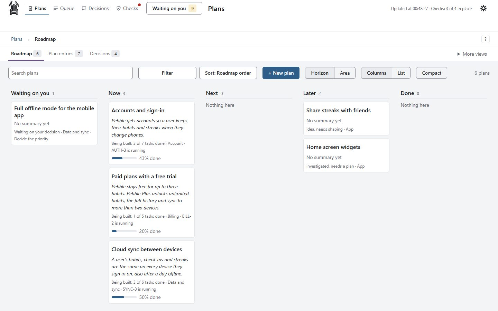</p>

<p align="center">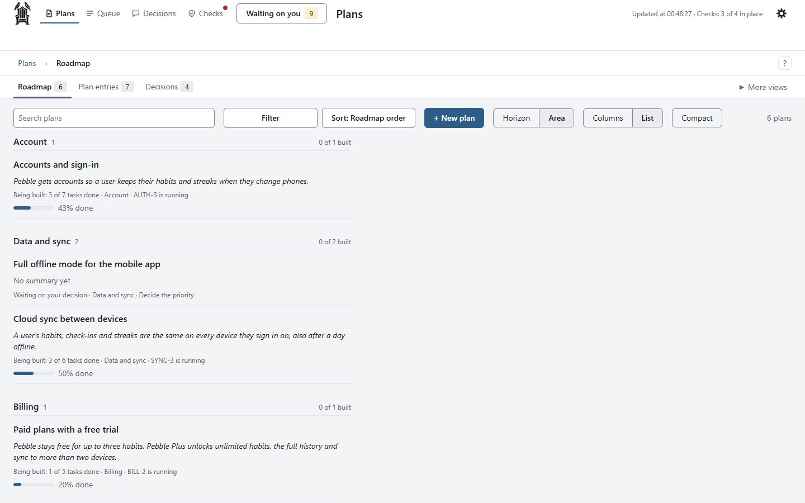</p>

The search (**Search plans**, on the Roadmap and on Plan entries) matches the id, title, summary, lead, project and
source paths at once. From three characters it also looks in each plan's own document (only the plan source in the
document folders, through the same guard as the reader, at most 512 KB, cached per file until the file changes):
plans found that way come after the ones whose own words match, with the matching sentence under the row, the match
marked and the heading it sits under. A line under the toolbar says how many the documents added.
`plans.searchDocuments` (on) turns this off for a very large document folder.

**+ New plan** (key `n`, on the Roadmap and on Plan entries; `features.plans.inbox`, on) opens a small form: **Title** (required, up to 160 characters) and **What and why, in your own words** (optional; a note past about 2000 characters, saved as written). **Add to inbox** saves at once, without a preview, and the toast offers **Undo**. Claude sorts the Inbox the next time plans are worked on. An empty register shows the same button.

<p align="center">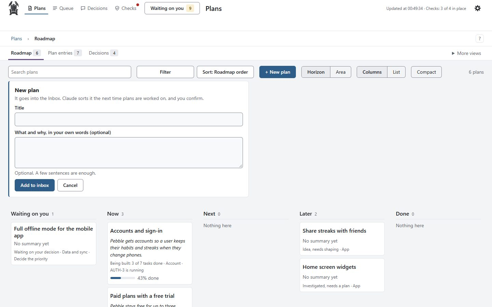</p>

**Inbox proposals** (`features.plans.inbox`): after `/plans inbox`, each Inbox row on the Roadmap and on its plan page says what Claude suggests ("Claude suggests: App · Now (important) · Investigated · size M"), why, the new summary, the plan it looks like and a folded **Suggested outline**. Nothing is applied until you choose: **Accept** (key `1`, saves at once), **Edit** (key `2`, a small form with the proposal's values, then Accept), **Decline** (key `3`, drops it with an optional reason, or merges it into any other plan) and **Merge into PL-…** (key `4`, when a duplicate was found). The keys work on the row with focus and on the open plan page. Each save goes through the board's write guard, a register changed since you looked answers in words (409), and the toast offers **Undo**. A row without a proposal offers Edit and Drop. `plans.inboxTriage` (`on-request`) and `plans.inboxAutoApply` (off) are in Settings.

The toolbar has the same **Filter** and **Sort** menus as the Tasks room, on the Roadmap and on Plan entries. The
Filter button says what is in use ("Filter", "Filter · 2", "Filter · Inbox"); its menu has **Show all**, **Quick
filters** (Waiting on you, Inbox, Being built, Ready to become tasks, Before prod, Security, Stale, Dropped by
Claude), **Saved** (your own filters, with **Delete** and **Save current as…**, kept in this browser; views saved in
the old left column carry over), then the sections with counts (Horizon, Area, Priority and the rest, Has tasks)
and **Reset**. **Sort** offers Roadmap order (the default), Recently changed, Recently added, Deadline, Title and
Most blocked; the choice is kept in your browser and a saved filter keeps its sort. Below 600 px the two become one
**Filter and sort** button with a tray that also holds Group by and Compact. `f` opens the Filter menu, Escape
closes it with focus back on its button, and the arrow keys move between its rows.

A click on a title opens the **plan page**: the title, the status with the next step ("Next: AUTH-3 is running"), the
progress in words with a small bar, the summary, **Open in Plan
entries** and **More** (the start line and the `/add-to-queue` line as CLI chips), the plan document itself (its plan
source at its anchor, other sources under "Also"), the tasks, and last **Details** with the priority, maturity, size,
id and history (closed by default, remembered). From 1200 px the document keeps a readable line length and the tasks
and Details sit in a column beside it. Escape or **Back to the roadmap** returns to the same card. "Also" lists only
the sources that are not open. A plan without a document says so in a short box, with what to do next.

<p align="center">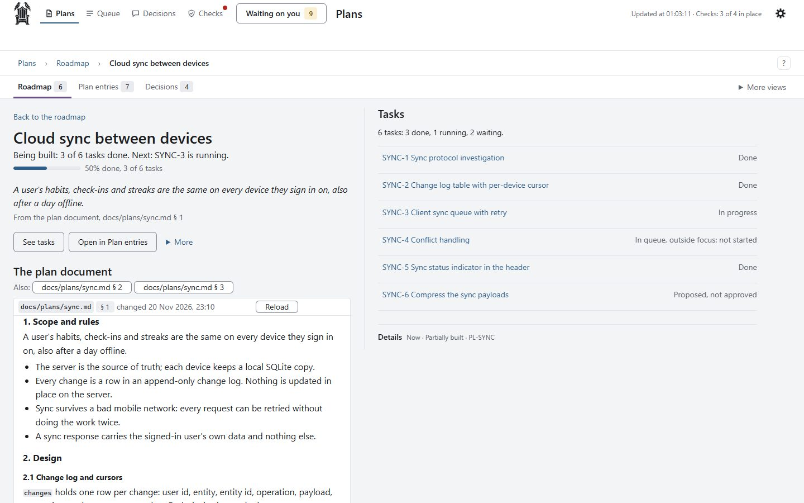</p>

Small things: the column headers of the Roadmap stay in view while you scroll the columns; a search or filter with
no match says what is in use and offers **Clear search** and **Clear filter**, and a screen reader hears the new
count. The start lines for the area, project and plan sit in one **Copy start line** menu at the end of the
breadcrumb. The deadline band shows only when a plan has a deadline. Below 700 px the room tabs
stay on one line and scroll sideways inside their row.

From plan to tasks: a plan with tasks has **See tasks**, which opens the Queue with `plan:<id>` in its search (the
search takes `plan:<id>` next to plain words; clear the search to see all cards again). A shaped plan (maturity
ready) without tasks has **Turn into tasks**: it adds nothing itself, but says that Claude splits the plan into queue
tasks and gives the `/add-to-queue` line to copy, with the checks before packing (open questions, legal points). A plan
that is not shaped yet says so under Tasks. When a task of the plan sits in a focus step, the tasks say **In focus
through step Tn**.

**More views**, at the end of the tab row, holds the **Overview** and the maps. **Overview** has one card per area,
what is being worked on now and what waits on you. An area card shows its entry count, a priority bar and a maturity bar, how much is built and the
warning counts that are over 0. Each bar segment carries a symbol and its count (the word is in the tooltip), and one
shared legend above the cards explains the symbols and colors: priority is primary for Now, the warn tone for Owner
and neutral for Later (never red, which means an error), the same colors as in the list, the tree map and the
dependencies of Plan entries. **Details** under each card lists every group with its word
and count; a click on the card opens Plan entries filtered on the area. **Plan entries** shows the entries as a list (the Priority map, Tree map and Dependencies
are under More views), with the toolbar's search, Filter and Sort (no left filter column) and the details of the selected entry, and **Open the plan page** for the reading
view of the same entry. **Documents and agreements**, **Legal**, **Decisions** and **Launch**
show the documents, the legal points, the owner decisions and what stands between the plan and launch.

<p align="center">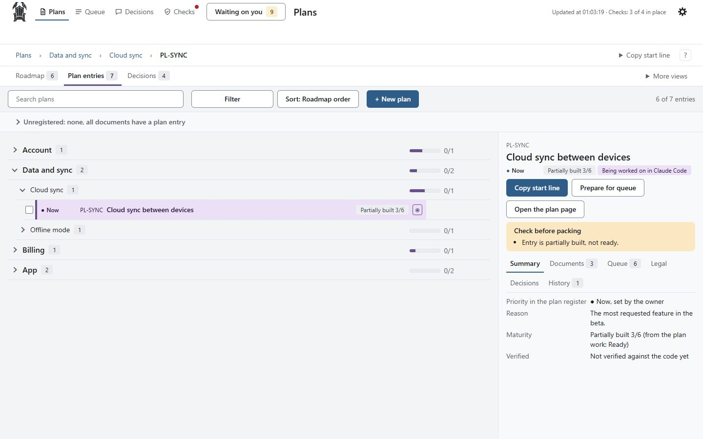</p>

<p align="center">
  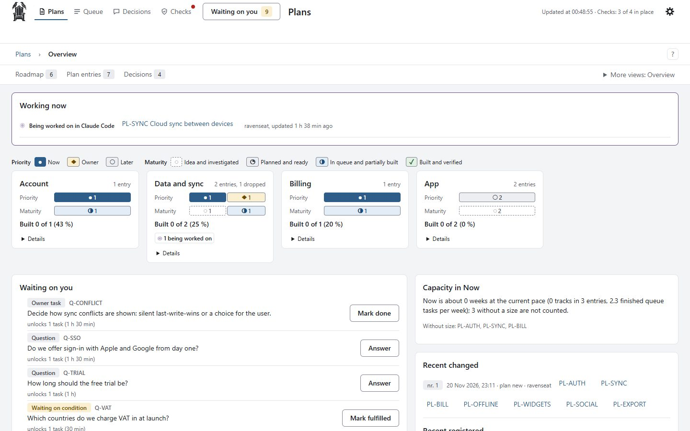
  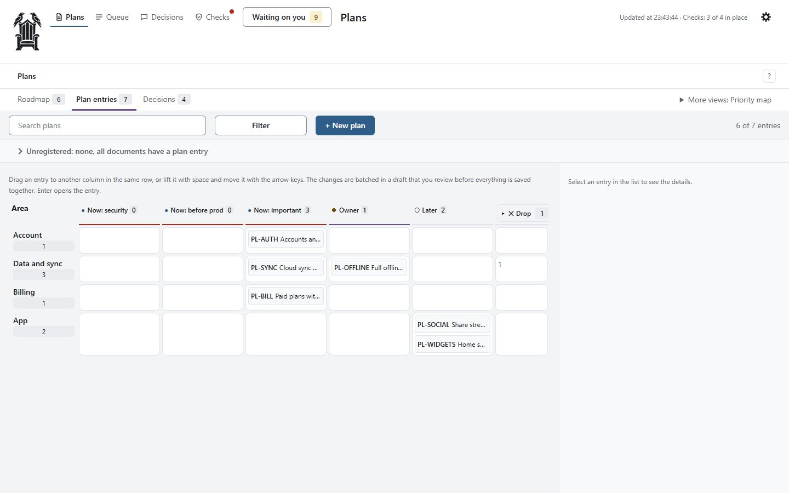
</p>

<p align="center">
  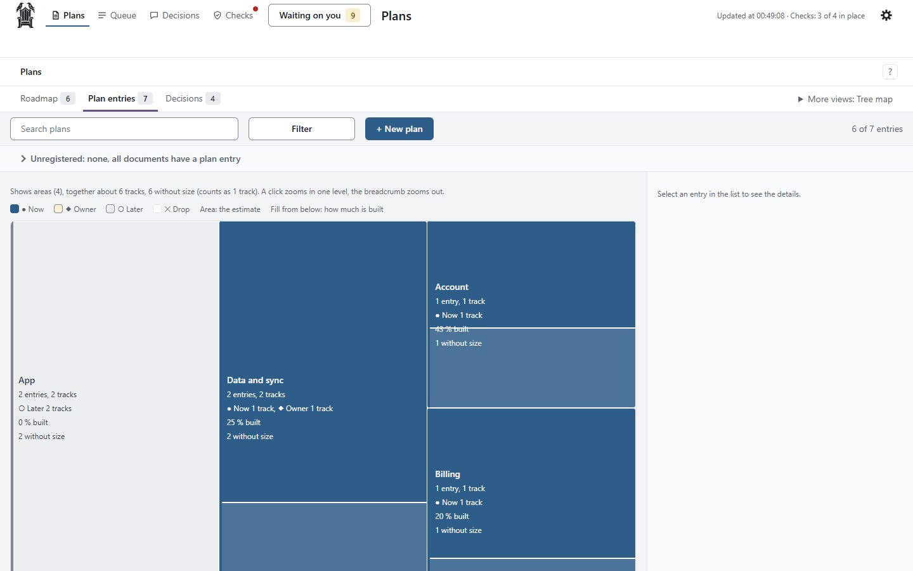
  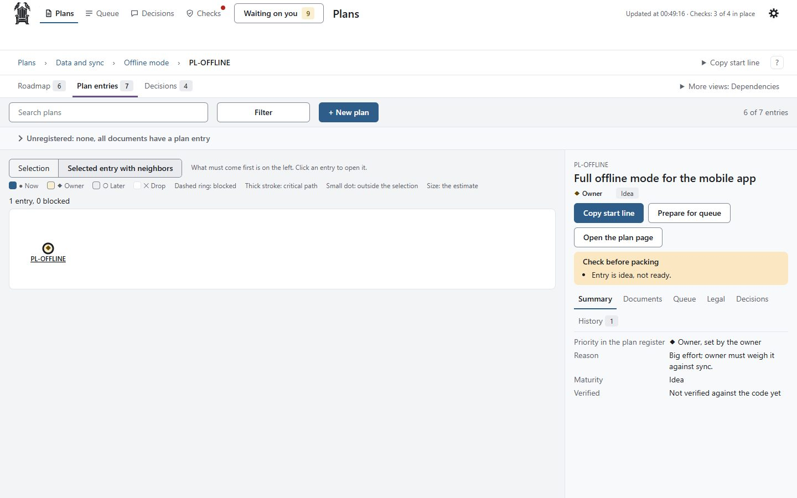
</p>

<p align="center">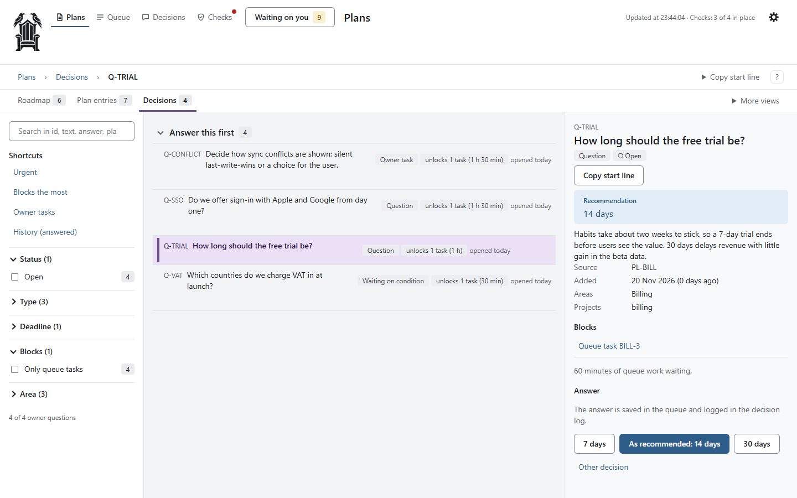</p>

The gear holds the settings and the help. A second click on the gear while Settings is open closes the panel, as
Close does. **How to use the board**, the mode line and the banner for weakened guards
sit at the top, seen from every tab; under them the settings are in six tabs, so no tab is much longer than two
screens:

| Tab | What is in it |
|---|---|
| **Queue and context** | Limits and cost, Machine load, **Auto-accept proposals**, History and storage, **Undo last**. The agents' context settings land here too. |
| **Checks** | Gates, Tests and evidence, the **Show the Checks tab** switch, Checks tab and learning |
| **Guards** | File and read guards, Command and secret guards, Merge and push, Scope and catalog, Private and sharing |
| **Agents** | **Helper agents**, Review and agents, **Add a custom helper** |
| **Project** | Project and git, Plans and focus, the read-only **Modules** (only modules without a row of their own), **Setup** and **Rules from the skill** |
| **Board** | Theme, **Guidance**, **Columns**, Board and advice, **Cloud**, and **Logo and mascot** last, at the very bottom of Settings |

<p align="center">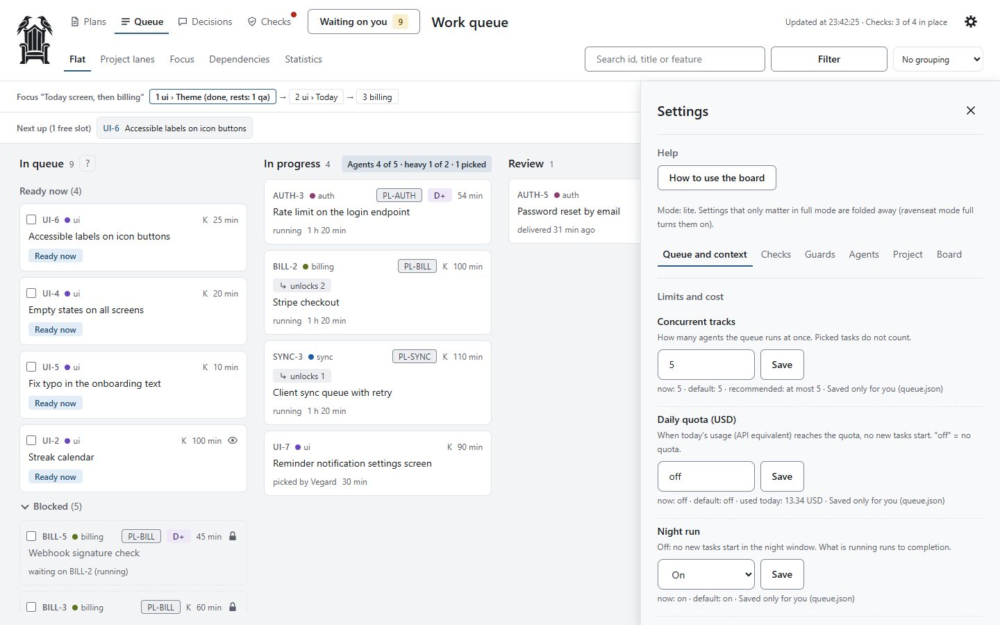</p>

<p align="center">
  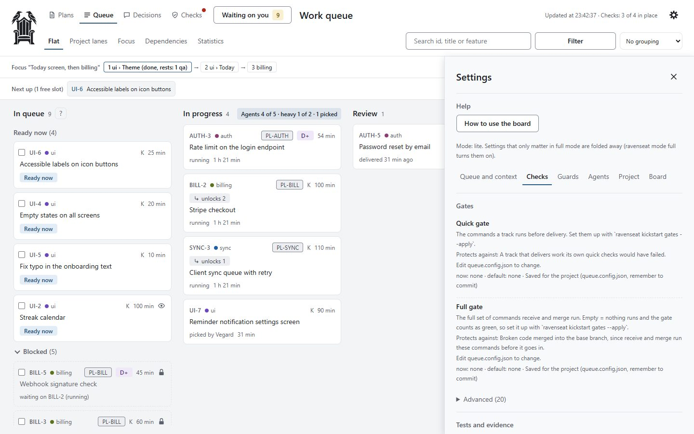
  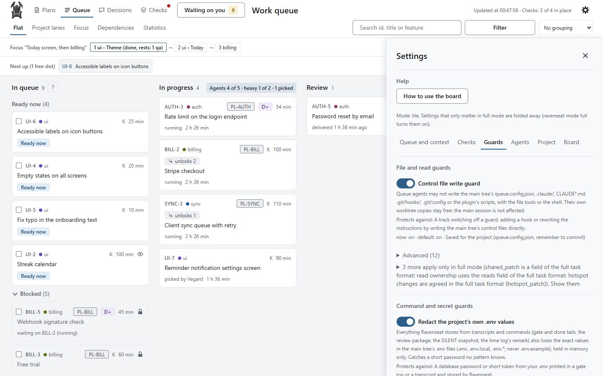
</p>

<p align="center">
  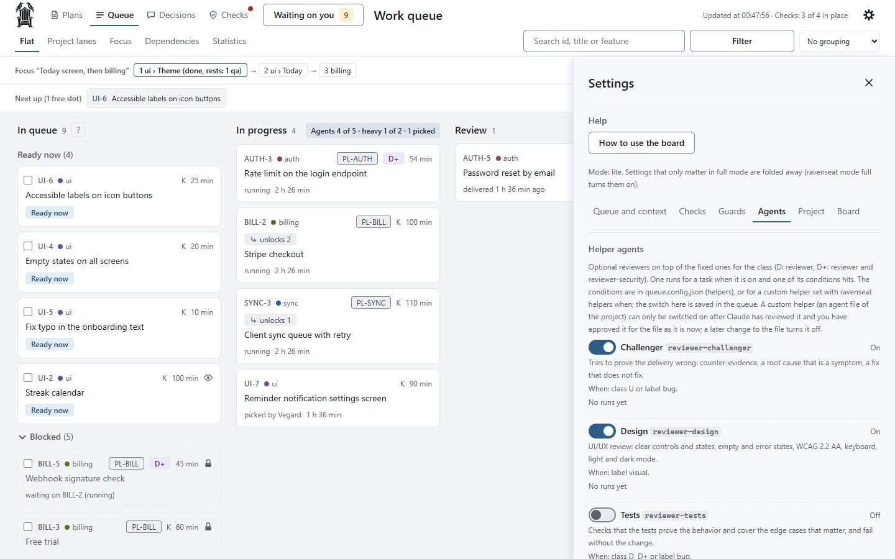
  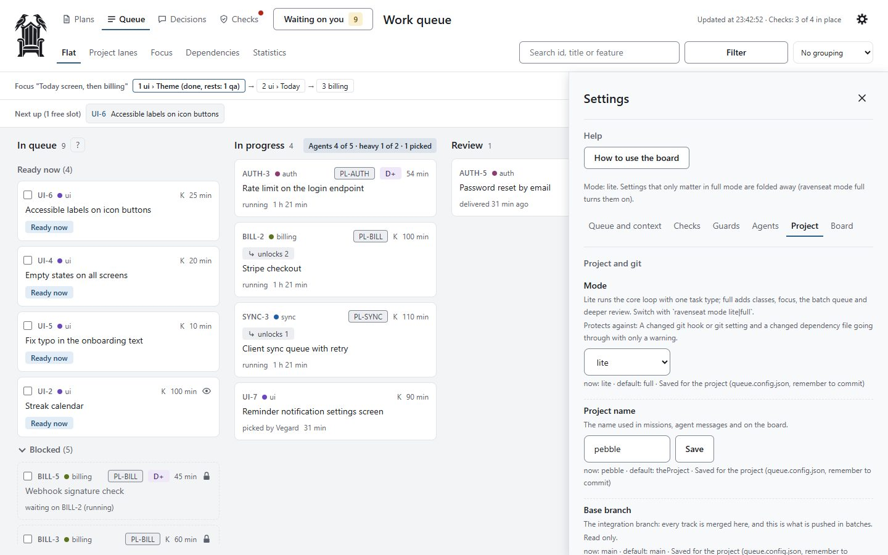
</p>

<p align="center">
  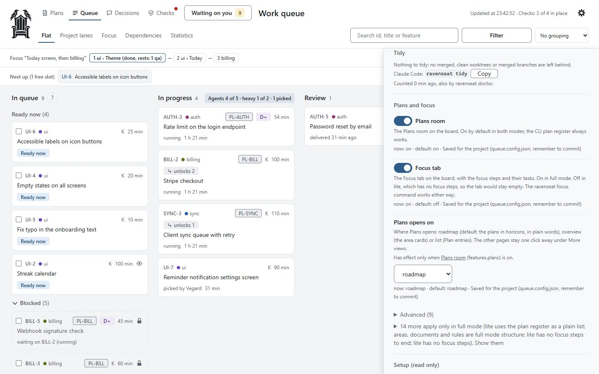
  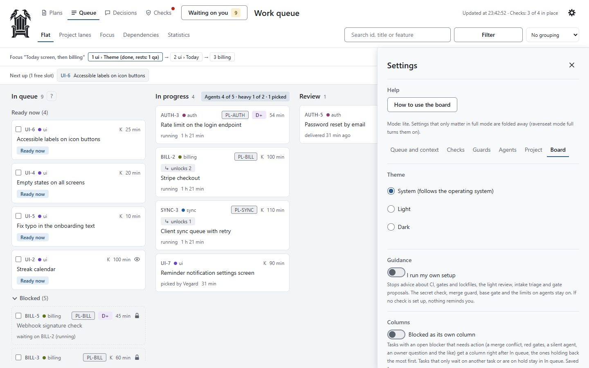
</p>

The tabs are a real tab list: one tab stop, the arrow keys, Home and End move between them, and the board remembers
the last one per browser (an old saved General opens Queue and context, an old Helper agents opens Agents; without
browser storage it opens on the first tab). **Auto-accept proposals** has the switch, the classes K and U, max
estimate and max value, saved together through `ravenseat proposals auto` via `/api/proposals`, and the log of what
was auto-accepted with an Undo button per row, `/api/proposals-undo` = `ravenseat proposals undo <id>`; see
[queue.md](queue.md#auto-accept-of-proposals). **Columns** has the switch **Blocked as its own column** (off by
default; `board.blockedColumn`, the same as `ravenseat board-setting blocked on|off`, see [What it shows](#what-it-shows)).
**Helper agents**: one row per [helper agent](orchestration.md#helper-agents) with what it does, when it runs
(classes, labels, paths in plain text), an on/off switch (a checkbox with role switch; Space toggles it) and what it
has cost: runs, median and total minutes, tokens and USD, its share of the task cost, and H/M/L findings per run ("No
runs yet" until it has run). The switch is saved through `ravenseat helpers on|off <agent>` (the board posts to
`/api/helper` behind the key and the Origin check, like every other write; it never writes files itself).
**Guidance** is `ravenseat guidance quiet`: no advice about CI, gates or lockfiles, and the guards stay on.

A way in to one setting opens its tab first, opens the fold it sits in and focuses its control: **Turn it off in
Settings** at the end of the Checks view lands on **Show the Checks tab**, and a link in the weakened banner or in a
"Has effect only when" line lands on that setting's control, in whichever tab it is.

**How to use the board** opens the help in the same side panel. A contents list at the top links every section and
the legend; a link scrolls there and moves focus to the section's heading without changing the address (the key lives
in the `#` part). The sections come in the order a new user needs them: What the board shows, Waiting on you and
Decisions, Picking and running work, The task panel, Focus, Plans and Queue, Checks and Statistics, then the advanced
parts: Filter, tabs and grouping, Bulk actions, Batch queue, The keyboard on the board, and Areas last, followed by
the legend. Opened from Settings, the help has **Back to menu** first in its header, which goes back to Settings with
focus on **How to use the board**; Esc and Close close the panel and focus goes back to the gear.

<p align="center">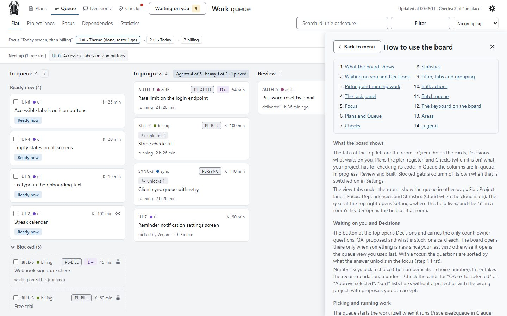</p>

Each room has a small **?** in its own header that opens the help at that room's section, with focus on its heading;
closing the help puts focus back on the **?**. It sits after the heading in Decisions, Checks and Statistics, first in
the Focus toolbar, last in the Plans breadcrumb line, and in the **In queue** column header for Flat and Project lanes
(the queue has no header of its own). Its name for a screen reader is "Help for Decisions" and so on. It is drawn
24 px with a 36 px hit area (44 px on touch), so no header and not the fixed top grows. Settings itself has the
**How to use the board** button instead.

**Every setting by category.** The tabs list every row of the settings registry (`lib/settingsRegistry.js`, the same
list as `ravenseat settings`) in its category: Project and git, Limits and cost, Machine load, Gates, Tests and
evidence, Checks tab and learning, File and read guards, Command and secret guards, Merge and push, Private and
sharing, Review and agents, Scope and catalog, Board and advice, Cloud, Plans and focus, History and storage; the
table above says which tab holds which. A category can have
one line under its title for what its rows share (Checks tab and learning explains the shared cap of three guard
proposals). Each category shows its basic rows first; the advanced ones are marked **Advanced** and
folded (closed) under them. In lite mode a row that only matters in full mode is hidden behind one line per category
("2 more apply only in full mode (why). Show them"), and a category with nothing for lite is one closed line. Each row
shows its value, the default and where it is saved: **Saved only for you (queue.json)** or **Saved for the project
(queue.config.json, remember to commit)**. A guard that is weaker than its default gets a **Weakened** mark and is named
in a banner at the top. A row that guards against something has one line "Protects against: ..." under its
explanation (the same text the weakening dialog shows); an advice row has none. A row that has an effect only while another setting is on says "Has effect only when <that
setting> is on", with a link to its row; while that setting is off the row is dimmed and marked **No effect now** (the
tooltip says which setting is off), but it stays in place and can still be changed. The limits keep their fields and guard rules (`/api/limit`); a setting that has its own section
(Guidance, Checks, Columns, Cloud, Auto-accept, Helper agents, Logo and mascot) is only there, with its real control,
and has no second row in its category (the Cloud category's other rows sit inside the Cloud section); the other rows with a switch,
a choice or a value save through `/api/setting` (= `ravenseat settings set <key> <value>`). The board remembers which
folds you opened, per browser.

**Weakening a guard.** Choosing the weaker option of a row that guards something (for example the secret scan off, git
hooks and config to warn, auto-accept on) does not change it. The control stays as it was, and a dialog opens with what
the guard protects against, why turning it off is not a good idea, what changes and where it is saved. Only a
completed slide at the bottom sends the change: drag the handle to the end, or focus it and hold the right arrow key or
Enter for about a second (a screen reader can also step it with the arrow keys; it is a slider with "Not confirmed" or
"Confirmed"). A single click or one key press does not complete it, and Cancel, Close, Escape or a click outside
change nothing. The server refuses the same change without the dialog's confirmation (422), and the change writes a
`setting-weakened` row to the time log. Going back to the stronger value needs no dialog.

A [custom helper](orchestration.md#custom-helper-agents) has a **custom** badge, its scan level (red, yellow or
green) and its review state: **Approved** (with who approved it and when, in local time), **Needs review** or
**Changed since approval** (the file differs from the approved one, so it is turned off). Its switch is disabled,
with the reason read out to a screen reader, until it is approved for the file as it is now. **Add a custom helper**
takes the path to an agent file (`.md`) and an optional name, and posts to `/api/helper-add`, which runs
`ravenseat helpers add`: the file is copied, scanned and registered, and stays off. The board has no way to approve a
helper: approval is `ravenseat helpers approve`, after Claude has read the file and the owner has said yes (the `add-helper`
skill), and `/api/helper` refuses to switch on a helper that is not approved.

## Keyboard shortcuts

`?` opens an overview of every key on the board (also from the gear: Help, Keyboard shortcuts). `/` goes to the
search, `g` and a letter opens a tab (`d` Decisions, `q` Queue, `c` Checks, `s` Statistics, `p` Plans), and `j`/`k`
move between the cards in Flat and Project lanes; `Enter` opens one. Decisions keeps its own keys. No shortcut fires in a
text field, a dialog or with Ctrl, Alt or Cmd held, so the browser's own keys are untouched. `board.shortcuts` (on by
default) turns them off, as does the button in the overview; the keys on a focused card and in Decisions stay.

## Deep links and the tab title

The view and the open card stand in the address, for example `#view=flat&task=EX-12`, so the back button works and a
link opens the card directly. The board key is never written there: a link with `#key=` is stored for the tab and the key
taken out at once. The tab title starts with the number of decisions waiting on you, `(3) Queue board`
(`board.titleCount`, on by default); running tracks are not counted.

## Since you left

A band under the Decisions head: the window in words ("since 21:40 yesterday (9 h 20 min)"), five numbers (merged,
recovered without you, blocked now, waiting on you, spend) and the latest ten events, newest first. A failure (a red
gate, a red base, a conflict, red CI, a new blocker) says **Failed** in words; an event with a task links to its card.
Hidden when nothing happened in the window; X hides it for the visit, and `board.sinceLast` (on) turns it off. The
numbers come from `lib/awaySummary.js`, the same join `ravenseat since` prints.

The window is a choice on the band (remembered per browser; `board.sinceLastWindow`, default `last-seen`): since last
seen, the last 24 hours or the last 7 days. Last seen is the server-side mark `<dataFolder>/seen.json`, set when
Decisions has shown the band for 5 seconds while the page is visible, by **Mark seen**, or by `ravenseat since --mark`;
never by a hidden tab. Without a mark, or one older than 7 days, the band shows the last 24 hours and says so. The board
keeps the window it opened with for the visit. **Decided** at the bottom follows the band's window, and the **New since
last visit** filter uses the seen mark too (this browser's last visit when there is none).

## Quick filter buttons

A row over the columns with **Changed 24 h** (added, started, delivered, blocked, checked or finished in the last day),
**Older than usual** and **Red gate** (an open task whose gates or done command failed). One click turns a button on or
off; several combine. They filter every column, and the empty state's Clear filters turns them off too. What is pressed is
remembered per browser. `board.quickFilters`: on in full mode, off in lite.

## Empty queue

When the queue has no task that is not done or cancelled, Flat and Project lanes show a first-run card instead of
empty columns: 1. add work (say "add to the queue" in Claude Code, or `ravenseat add --file`), 2. start the queue with
`/ravenseat:queue`, 3. answer questions in **Decisions** (**Waiting on you** at the top), plus a link to the help.

## Stale data

When the board cannot get a fresh state, it says so instead of looking live. One banner below the top says what is
wrong, when the last good update was, and what to do:

- **No server** ("The board lost contact with its server at 18:54."): the server stopped or the network is gone. The
  banner shows `ravenseat board` with a Copy button, and the board keeps trying by itself.
- **The queue file cannot be read** ("The board cannot read the queue file."): the server is up but queue.json is half
  written or broken. It tries again by itself.
- **A server error**: the server answered with an error; restart the board if it keeps happening.
- **Old data** ("The board has not been updated since 18:54."), on the warn tone: no error, but no fetch for over a
  minute, for example after the computer slept. It updates when the tab is in front.
- **The key changed** (the server was restarted): the key banner with the link field, plus the time of the last update.

The first three are on the danger tone (something is broken), old data on the warn tone. Each has **Try again**. While
the data is stale the cards are dimmed (surface and text color, not opacity, so they keep 4.5:1, with a dashed edge),
the running times stop at the last update ("times on the cards are as of then"), and **Changes are paused**: a write,
a drag or a Space lift is refused with a toast that says why, so nobody acts on old data. The status line only says
"Not updated since 18:54" meanwhile. Error text is plain words, never a code like "Failed to fetch" or "HTTP 503", and
never the key. When updates come back, the banner goes by itself and the board is drawn again, without a reload. A
screen reader hears going stale and coming back once each (a polite live region); a retry that fails again is silent.

## Modules

Some parts of the board can be switched off with `features` in `queue.config.json` (see
[configuration](queue.md#configuration)). The board server sends the resolved switches with the state, and the board
hides what is off:

| Key | Default | Hides when off |
|---|---|---|
| `plans` | on | The Plans button (and the room; a `?room=plans` link falls back to Queue) |
| `plans.legal`, `plans.launch`, `plans.documents` | off | The Legal, Launch and Documents and agreements surfaces in Plans, with their counters (an old link shows the Overview) |
| `focus` | on (off in Lite mode) | The Focus tab |
| `statistics` | on | The Statistics tab |
| `cloud` | off | The Cloud tab, the "Suitable for cloud" filter and the Cloud row in the task detail |
| `follow` | off | The `/follow` page and its link in the terminal |

Each module has a row with its switch in the gear's categories (Plans and focus in the Project tab, Board and advice
in the Board tab; `/api/setting`, the same as `ravenseat settings set features.<name> on|off`). The board reads
queue.config.json when it starts, so restart it after a change. A module without such a row (from an older server) is
listed in the read-only **Modules** section of the Project tab instead, never in both.

The cloud is the exception, because the board has its own section for it. The gear's **Cloud** section (Board tab) has one switch for all
of it (the same as `ravenseat cloud on|off`) and needs no restart. Off, nothing about the cloud shows. On, the section also
has the Cloud tab's own switch (`board.showCloud`, on by default; `ravenseat board-setting cloud on|off`, which writes
queue.json and wins over queue.config.json) and the settings from `ravenseat cloud settings`. A saved Cloud view still opens
while the tab is hidden, with a note where to turn it on.

## Update banner

When a newer ravenseat is out, a banner below the top says "ravenseat X is out (you have Y)", links to the CHANGELOG and lists the
steps with a Copy button each: `claude plugin update ravenseat@ravenseat`, then `/reload-plugins` (or a new session),
then `ravenseat setup --settings`. A vendored install gets `git pull` in your Ravenseat folder and
`node scripts/install.mjs <project> --overwrite` instead. Close it with the X: it stays away until a newer version is out.
The X is remembered in this browser and in `<dataFolder>/update-check.json`, so other browsers and the CLI line below
stay quiet about that version too; `ravenseat update dismiss` writes the same field, and the board then hides it as well.

How it checks: the board server (not the browser) fetches the published `plugin.json` from GitHub at start, at most
once per 24 hours (cached in `<dataFolder>/update-check.json`). It is a plain GET with a 3 second timeout that sends
nothing about you or the project; any error just means no banner. Turn it off with `"updates": { "check": false }`
in `queue.config.json` (the old `"board": { "updateCheck": false }` still works); it is also off when `DISABLE_UPDATES` or
`CLAUDE_CODE_DISABLE_NONESSENTIAL_TRAFFIC` is set. Off never stops any work.

Without the board: `ravenseat show` prints one line, `ravenseat X is out (you have Y): claude plugin update
ravenseat@ravenseat, then ravenseat setup --settings`, at most once a day per version, and `ravenseat doctor` prints it as
an INFO row every time. `show` only reads the same cache and never waits on the network: when the cache is older than 24
hours it starts a background refresh (the same check and timeout), so the answer is there next time. `doctor` checks
directly when the cache is old. The line stays out of `--json` output, agents (track worktrees and the agent role), CI
(`CI=true`) and hooks, and out of every other command, so agent output stays clean.

Setup after an update (local, no network, also with the check off): `ravenseat setup --settings` records the plugin version
it set up in `<dataFolder>/setup.json`. When the installed plugin differs from that record, the banner says to run
`ravenseat setup --settings` again (the status line path holds the plugin version). This notice cannot be closed; it goes
away once setup has run. If setup was run for a newer plugin than the running board, it says to restart the board.

## Logo

The picture in the upper-left corner is loaded from `<dataFolder>/logo.webp` if it exists, otherwise from
`scripts/orchestrator/queue-board/logo.webp`. Keeping the picture there is a friendly request, not a license
condition (see "The name and the logo" in the README).

## The mascot

Speech bubbles come only from the mascot: the Ravenseat logo, the default picture, never talks and is not a button.
With **Show the mascot instead of the logo** on (see Logo or mascot below), the mascot in the upper-left corner
spans both rows of the top and now and then says something in a speech bubble: a night line when you work
between 00:00 and 05:00, encouragement, a statistic from the queue (the priciest task today, the oldest card in
Review, proposals waiting, and so on), and events between two polls (merged, queue empty, new owner question, high
finding, weekly quota over 90 %). Click the mascot for a line; five clicks within ten seconds gives another one.
On a phone (720 px or less) the bubble takes its own row under the top, at most three lines, and pushes the board
down while it shows, so it never covers a tab or a button.

Timing rules: a night line at most every 30 minutes, random chat at most every 10 minutes, events at most one per
minute. A line is never repeated within the last 8. The bubble stays 10 seconds (longer while the mouse is over it)
and closes on click. The text is always set as plain text.

**Modes.** The gear menu has a **Mascot** choice: **Chatty** (everything), **Events only** (only events and clicks)
or **Off** (no bubbles at all). The choice is remembered in this browser, like the theme. The default for every
browser comes from `queue.config.json`:

```json
"board": { "port": 2000, "title": "Queue board", "mascot": "chatty" }
```

`ravenseat board --mascot off` overrides it for one run. With `"off"` from the config or
the flag, the mascot is off for every viewer: no bubbles, no click, nothing is computed on the server, and the choice
in the gear is locked.

**Logo or mascot.** The Ravenseat logo is the default picture: as tall as row 1 of the top, quiet, and row 2 runs
from the left edge under it. **Show the mascot instead of the logo** under Logo and mascot (the last section of the
gear's Board tab) switches to the mascot (`/logo`), per browser: it spans both rows (row 2 then starts after it, and
the top keeps its height) and it is the only figure that talks. The modes above decide how much it talks.

**Hiding the picture.** Off keeps the picture. To remove it completely in one browser, click **Hide the picture
completely** in the gear. **Show the picture again** in the same place brings it back.

**Your own phrases.** The board ships the mascot's full built-in repertoire (night owl jabs, encouragement, stats roasts, events and vibe-coding jokes) in `lib/queueMascot.js`. To use your own, put
`mascot-phrases.json` in the queue's data folder (`<dataFolder>`, default `scripts/.queue/`, which the installer adds
to `.gitignore`, so your phrases never end up in git). Categories you leave out keep the built-in phrases; an
invalid file falls back to the built-in set and prints one line in the board's terminal.

```json
{
  "version": 1,
  "night": [{ "text": "It is {time}. Go to bed." }],
  "encouragement": [{ "text": "{done_today} done today.", "weight": 2 }],
  "statistics": [{ "text": "{id} cost ${cost} today.", "source": "priciest" }],
  "events": [{ "text": "Merged {id}!", "event": "merged" }],
  "vibe": [{ "text": "Another round. Onward." }]
}
```

- `weight` (optional, up to 10) makes a phrase more likely within its category.
- Placeholders that every phrase can use: `{time}`, `{done_today}`, `{done_week}`, `{days}` (days without a high
  finding), `{night_cost}`, `{n}` (answers after midnight) and `{p}` (weekly quota in percent, only with a calibrated
  quota). A phrase whose placeholder has no value right now is skipped.
- Statistics phrases take their values from a `source`: `priciest` ({id}, {cost}), `fixRounds` ({id}, {n}), `inbox`
  ({hours}), `review` ({id}, {hours}), `nightShare` ({share}), `proposed` ({n}), `qa` ({n}), `record` ({n}),
  `responseTime` ({min}), `remaining` ({n}, {date}) and `dPlus` ({min}). Without `source` it is guessed from the words
  in the text.
- Events: `merged` ({id}), `queue-empty`, `new-question`, `high-finding` ({id}), `quota-90` ({p}), `click` and
  `click-5`.
- Vibe phrases get a higher chance for 15 minutes after a D/D+ review is merged or a fix round starts.

## Files

The board is plain files under `scripts/orchestrator/queue-board/`, with no build step and no CDN. `queue-board.mjs`
serves only the files in its allow list (`STATIC`), all with the same strict Content-Security-Policy (`script-src
'self'`, no inline script).

- `index.html`, `board.css` and `theme.css` (built by the server): the page.
- `board/`: the board itself, 19 classic scripts that `index.html` loads in this order with `defer`:
  `core.js` (constants, the state, helpers, toasts), `api.js` (key, API calls, fetching, the warning dialog),
  `cards.js` (filters, search, the card), `draw.js` (the columns, the chain, the strip), `views.js` (Focus wiring,
  grouping, saved views), `menus.js` (help, project lanes, the Filter menu), `statistics.js`, `settings.js` (the
  gear), `question.js` (the one renderer for owner questions and answer buttons), `decide.js` (the Decisions tab and the "Waiting on you" button), `checks.js` (the Checks tab), `panel.js` (the detail panel), `edit.js` (cancel, decline, edit, markdown),
  `select.js` (multi-select and the selection menu), `bulk.js` (bulk dialog and undo), `interact.js` (writing, drag, keyboard), `top.js`
  (theme, gear sections, modules, view tabs), `cloud.js` (the Cloud view), `route.js` (deep links and the count in the
  tab title), `keys.js` (the shortcuts and the `?` overview) and `start.js` (update banner, logo and
  the start). They share the page's global scope, so a top-level name in one is visible in the others, as when they
  were one `board.js`. Code that runs while a script loads may only use names from the scripts before it; a new
  file goes into `BOARD_SCRIPTS` in `queue-board.mjs` and into `index.html` in the same place.
- `a11y.js`, `performance.js`, `graph.js`, `plan.js` and `mascot.js`: shared helpers and views with their own
  `window.Queue…` object; the pure rules they use are served from `lib/` (the same files the tests use).
- `plans/`: the Plans room (see [plan register](plan-register.md)).
