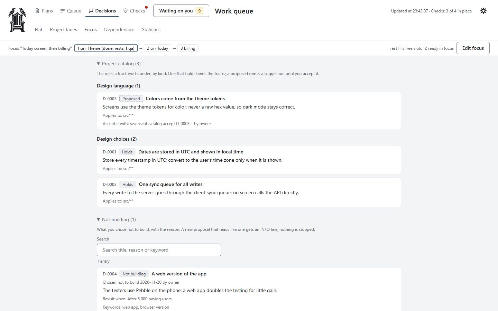

# The project catalog (`ravenseat catalog …`)

Parallel tracks tend to write a helper the project already has, add a second library for a job it already has one
for, and take an architecture choice nobody asked about. The [reuse and scope notes](queue.md#reuse-and-scope-notes)
at `receive` see that after the fact. The project catalog is what the tracks should know before they start: the stack
and what to prefer, the building blocks meant for reuse, and the design choices that hold, each with one invariant
that can be checked.

The catalog is hand-written, short, and tracked in git in `docs/queue/catalog/`. Only the owner accepts a design
choice. A project without the folder loses nothing: every command and check is quiet until it exists.

## The folder

```
docs/queue/catalog/
  stack.md                     the stack and the "Prefer" lines
  reuse.md                     building blocks meant for reuse
  decisions/
    README.md                  the format note (written by catalog init, never read as a choice)
    D-0001-service-layer.md    one design choice per file
```

### stack.md

`ravenseat catalog init` writes a generated block between two marker comments: the languages and runtimes, the
frameworks with a review pack, the checks it found and the libraries by job (dates, HTTP, validation, tests and
more, from the manifests). Write your own text below the block. A later `catalog init` refreshes only the block, and
`catalog check` warns when the block is out of step with the manifests.

Under `## Prefer`, one line per job says what to use and, if you like, what not to add:

```markdown
## Prefer

- dates: dayjs, never moment
- http: the fetch wrapper in lib/http.ts
- validation: zod
```

Keep it to at most 10 lines. They go into every mission's [catalog excerpt](#the-excerpt-in-the-mission-and-the-review-package),
so a track reads them before it writes code.

### reuse.md

A table of building blocks a track would not find by itself. Keep it to at most 40 rows; the
[code index](#the-code-index-and-catalog-find) holds the rest, and a `@shared` tag in the code is often the better
place for a helper's row.

```markdown
| Purpose | Symbol | File |
|---|---|---|
| Format a date for the UI | formatDate | lib/dates.ts |
```

`catalog check` warns when a file in the table does not exist or does not contain the symbol.

### decisions/D-0001-<slug>.md

One design choice per file. The slug is lower-case letters, digits and hyphens.

```markdown
---
id: D-0001
title: Client code goes through the service layer
status: proposed
paths: ["app/**", "components/**"]
invariant: Files under app/ and components/ never import the database client directly.
supersedes: null
plan: PL-SERVICE-LAYER
---
Context, the choice and what follows from it, in at most 30 lines.
```

- `id`: `D-` and four digits, the same as the file name. An id is never reused.
- `title`: at most 120 characters.
- `status`: `proposed`, `accepted` or `superseded`. Anyone may propose.
- `invariant`: one sentence that can be checked, at most 300 characters. It is the only text of a choice a track
  gets, so it must stand on its own.
- `kind`: what sort of entry it is. `decision` (the default when the line is missing), `design` (a rule of the design
  language, see [Design language](#design-language)), `stack` (which tool does a job, see [Stack
  entries](#stack-entries)), `dependency` (a decision about one library) or `not-building` (see [Not
  building](#not-building)). One field, one set of values. `catalog show` and **Project catalog** in Decisions group
  the entries by it.
- `paths`: the files the choice applies to, as globs from the project root. No `..` and no absolute paths.
  `catalog check` warns when they match no tracked file.
- `except`: optional globs inside `paths` the choice does not apply to (the globs have no negation), such as the token
  file of a colour rule. The check rules, `catalog check` and the excerpt all skip them. `catalog check` warns about an
  `except` that matches no tracked file inside `paths`.
- `supersedes`: the id of the choice this one replaces. To change an accepted choice, write a new one with
  `supersedes: D-0001` (`catalog propose --supersedes D-0001` does it). The owner's accept of the new one sets the old
  one to `superseded` in the same step.
- `plan`: the plan entry with the long version, if there is one.
- `check`: an optional rule that receive runs against the delivery's added lines, with examples that prove it:
  see [Check rules](#check-rules).
- `accepted_by` and `accepted`: written by `catalog accept`, never by hand.

A body over 30 lines gives a warning: the plan register holds the long text. `kind` and `except` bind like the
invariant: changing either after the accept needs a new accept. An entry without them keeps the fingerprint it had.

## Design language

A `design` entry is one rule of the project's design language: colours only from the tokens, the type scale, the
surface roles. It names where the tokens live in `source` (a path, or a list of paths, each with an optional `#name`
inside the file, such as `lib/theme.js#PALETTE`) and never holds a copy of them, so the catalog cannot drift from the
tokens. Put the token file in `except` when it is inside `paths`, so a colour rule does not hit the place the colours
are defined.

```markdown
---
id: D-0001
title: Colours only from the tokens
status: proposed
kind: design
source: ["ui/tokens.css"]
paths: ["ui/**"]
except: ["ui/tokens.css"]
invariant: UI code takes its colours from the tokens in ui/tokens.css; a hex colour or rgb() stands only in the token file.
check:
  forbid: "..."
  hit: ["  color: #1a73e8;"]
  miss: ["color: var(--color-primary);", "see issue #123 in the tracker"]
---
```

The first `catalog init` looks for a token file (a CSS file with `:root` and `--color-` properties,
`tailwind.config.*`, a `tokens.json`, or a `theme.ts` or `theme.js`) and, when it finds one and the catalog has no
design entry, writes a proposed entry like the one above with a colour rule. The rule hits a hex colour or `rgb()` and
`hsl()` in a value, and not an issue number, an anchor (`href="#add"`), an HTML entity, a CSS id selector or
`color-mix(in srgb, ...)`. Narrow its paths, run `catalog check` to see what it already hits, then accept it or delete
the file: init does not write it again.

A design entry goes into the mission and the review package under **Design language** (see the excerpt below), and
`reviewer-design` checks the delivery against those lines. The board shows the entries in Decisions, **Project
catalog**, with the token files. No setting of its own: the rules follow `catalog.checks`, and the excerpt follows
`catalog.missionExcerpt` and `catalog.reviewExcerpt`.

## Stack entries

A `stack` entry says which tool does a job and why, with the owner lock a Prefer line does not have. Its fields:

- `uses: {"job": "dates", "tool": "dayjs"}`: the job in a few words and the tool as its package name.
- `alternatives: ["moment", "luxon"]`: the tools it was chosen against. They also make a group for a job the purpose
  table of the dependency notes does not know.
- `stack: ["pnpm"]`: words it declares for the checks (lower case). An entry needs `uses` or `stack`.

The three fields are JSON (`{"job": ...}` with quotes) or the indented form (`uses:` and `  job: dates` under it).
They bind like the invariant: a change needs a new accept. `catalog propose --kind stack --uses dates:dayjs
--alternatives moment,luxon --stack pnpm` writes one.

Once the owner has accepted it:

- **The Checks tab** (`catalog.stackFacts`, on): the tool and the `stack` words join the stack the tab sees, so a
  recipe's `stack:pnpm` holds and the dependency audit card names its command (`pnpm audit`, `npm audit`,
  `pip-audit`, `cargo audit`, `govulncheck ./...`). A proposed entry declares nothing: a track cannot turn a card on or
  off.
- **The dependency notes at receive**: a package the delivery adds that the entry chose against (an alternative, or
  another package in the tool's purpose group) gives a `CATALOG <task>:` line first, naming the entry and the tool. It
  asks for something and stops nothing. Against a proposed entry the note is the usual `NOTE dependency` with the
  entry's id. The review package names the entry either way.
- **`catalog check`** warns when an alternative is in a manifest, when the tool is in none of the manifests the
  entry's `paths` name, and when a Prefer line for the same job says another tool.

A Prefer line stays the short form for small things. `catalog check` only asks that the two agree.

## Commands

| Command | What it does |
|---|---|
| `catalog init` | Creates `stack.md` with the generated block, `reuse.md` and `decisions/README.md` where they are missing, in the main tree. On the first init it also proposes one design entry from the project's token file, when it finds one (see [Design language](#design-language)). Never writes over a file that is there, except the generated block in `stack.md`. Refused from a track worktree |
| `catalog show [<D-id>] [--json]` | The prefer lines, the reuse rows and the entries with the status that counts, grouped by `kind` (Design language, Stack, Dependencies, Design choices, Not building). With an id: that entry in full, and the plan entries that link to it |
| `catalog check [--json]` | Shape, ids, status, the owner lock, `supersedes`, the paths, the reuse rows and the generated block. Exit 1 on an error, 0 on warnings only, 0 without a catalog. Read only |
| `catalog accept <D-id> --by owner` | The owner accepts a design choice: `status: accepted`, `accepted_by` and `accepted` in the file, and the owner's record in the data folder. A choice with `supersedes` sets the old one to `superseded` in the same step (refused, with nothing changed, when the old one is not there). Refused from a track worktree whatever `--by` says |
| `catalog propose --title "..." --invariant "..." --paths "<glob>[,<glob>]" [--kind design\|stack\|dependency] [--except "<glob>"] [--uses <job>:<tool>] [--alternatives a,b] [--stack a,b] [--supersedes <D-id>] [--plan <PL-id>] [--why "..."] [--from-answer <question>] [--json]` | Writes the next free id (one above the highest in the file names and the owner's record) as `status: proposed` in the main tree, then runs `catalog check` and prints what it says about the new choice. `--kind` and `--except` write those fields; with `--kind stack`, `--uses`, `--alternatives` and `--stack` write a [stack entry](#stack-entries). With `--supersedes` and no `--paths` or `--plan`, it takes them from the old choice. Writes nothing when the choice would be broken, never over a file. Refused from a track worktree |
| `catalog find <word...> [--json]` | Searches the code index, the reuse rows, the design choices and the prefer lines. Every word must match; at most ten short lines. Builds the code index first (from the cache) |
| `catalog index [--json]` | Builds or refreshes the code index and says how many files it read and how many came from the cache. Names a `@shared` tag that is not on an export |

A queue agent may run `catalog show`, `catalog check` and `catalog find` (the push guard allows them), and nothing
else. All four read commands read the tree the command runs in, so a track sees its own branch's catalog and code.

`catalog check` is not a gate by default. A project that wants it can add `ravenseat catalog check` to its `gates`.

## The owner lock

Only the owner decides which design choices hold. `status: accepted` counts only when the owner accepted exactly this
version with `ravenseat catalog accept <id> --by owner` (or from the board) in the main tree.

The accept writes two things: the status lines in the choice's file, and a record in
`<dataFolder>/catalog-accepted.json` with a fingerprint of what binds (the id, the invariant, the paths and the
`check` rules, and `kind` and `except` when the entry has them). The record file is gitignored and written by the queue only: the write guard keeps queue agents' file
writes off it, and the push guard denies a queue agent's shell command that names it.

A choice that says `accepted` without a matching record reads as `unconfirmed`. That covers a track that set the line
by hand and an invariant, paths or check changed after the accept. `catalog check` names it as an error, `catalog show`
prints `unconfirmed`, and it counts as proposed until the owner accepts it again. The title and the body text may change
without a new accept.

The lock is not a setting: turning it off would let a track decide an architecture choice.

## The excerpt in the mission and the review package

A track gets only the part of the catalog that meets its task, never the whole folder, and never through the
instructions file (which every session loads, task or not). The queue picks it when it writes the mission, from the
task's `owned_files`, `shared_patch` and `reads`:

- **Design choices** whose `paths` meet those files: a file a glob matches, or a folder a glob can reach into. At
  most five, the binding ones first, by id. Only a choice the owner accepted (with the record, see the owner lock) is
  under "Design choices that hold" and binding. A proposed choice, and one that says accepted without the owner's
  record (unconfirmed, so marked), is under "Proposed design choices" as a suggestion. A superseded choice never comes.
- **Design language**: the `design` entries whose `paths` meet those files, holding or proposed, under their own
  heading right after the choices that hold. Each line says its status (holds, proposed, unconfirmed) and where the
  tokens live (`source`). At most three, the ones that hold first.
- **Prefer lines** from `stack.md`, at most ten: they hold for the whole project.
- **Reuse rows** from `reuse.md` in the task's folders (the folder of an owned or read file, or inside an owned
  folder), at most 15.
- One line on how to look for a helper before writing one, and `catalog show <D-id>` for a choice in full.

A task that names no files gets every choice that holds and no proposed one (nothing says which proposals concern it),
the prefer lines and the first reuse rows. Nothing that meets the task, or no catalog, gives no block at all.

**The cap and the measurement.** The excerpt stays within `catalog.excerptTokens` (default 1500, a token counted as four
characters). Items go in in the order binding choices, prefer lines, proposed choices, reuse rows while the whole text
still fits, so the reuse rows are cut first. The heading says what it used and what was cut:

```
**From the project catalog** (`docs/queue/catalog/`, chosen for this task's files; about 209 of at most 1500 tokens; nothing cut):
- **Design choices that hold** (accepted by the owner, binding: a change that would break one is an owner question, never your call):
  - D-0001 (plugin/scripts/orchestrator/lib/**): A lib module never starts a process or writes a file; the I/O lives in cli/ and the scripts.
- **Prefer** (stack.md: a second library for one of these jobs is an owner question):
  - tests: vitest
- **Building blocks for reuse in these folders** (reuse.md: use them before you write a new helper):
  - Match a path against a glob: `globMatch` in `plugin/scripts/orchestrator/lib/mergeGuard.js`
- Before you write a new helper, look for one: `ravenseat catalog find <word>` searches the catalog and the code's exports (or `git grep -n -w <name>`); `ravenseat catalog show <D-id>` prints a choice in full.
```

`fill` prints the size per track (`Catalog excerpt in the mission (tokens, cap 1500): K-7 209`), and `ravenseat cost` shows
what the tracks cost, so the price of the excerpt can be measured on the first tracks. A fix round's short mission
leaves the excerpt out; the whole mission it points to has it.

**The review package.** `receive` puts the same excerpt in `00-package.md` under "From the project catalog", read from
the main tree, right after "Reuse and scope". The reviewer and the gap reviewer check the delivery against it: a helper
or rule written again where a reuse row, a prefer line or a reuse note shows one is a `duplication` finding, and a
change that breaks the invariant of a choice that holds is a `scope-drift` finding, MEDIUM at least, since it was an
owner question. A proposed choice binds nothing, so not following it is no finding.

The text names no client and no client's tools, so a cloud session and any other client get the same excerpt.

## The code index and catalog find

Most helpers are only in the code. Tag the ones meant for reuse where they are, in the JSDoc right above the
definition, and the queue collects them:

```js
/**
 * Match a repo path against a glob.
 * @shared match a path against a glob pattern
 */
function globMatch(pattern, file) { ... }
module.exports = { globMatch };
```

The text after `@shared` is the purpose; with none, the first line of the doc is used. The tag travels with the
function when the file moves and goes when the function goes, which a hand-written row cannot do.

**What is indexed.** JS and TS files (`.js`, `.mjs`, `.cjs`, `.ts`, `.tsx`, `.jsx` and the like) the tree tracks or has
as new files, never node_modules, tests, declaration files or minified files, nor a file over 512 KB. The scan is a
light tokenizer, no parser: it follows strings, template literals, comments and regex literals and reads only the top
level of a file: `export function`, `export const`, `export class`, `export { a as b }`, `exports.x =`, and the
entries of a `module.exports = { ... }` block. A re-export (`export { x } from`) is left out (the helper lives in the
other file), and so is a form it does not know. It would rather miss an export than invent one. A `@shared` tag on a
name that is not exported, or not right above a definition, is named by `catalog index`, never indexed.

**The cache.** The index is in `<dataFolder>/catalog-index.json` (gitignored). Per file it holds git's blob sha and what
the scan found, so a file whose sha did not change is not read again, also after a move. The file list always comes
from git, so the index follows the tree it was built for, and a track's tree and the main tree share the cache without
mixing. The queue writes the file; the write guard and the push guard keep queue agents off it, since a forged entry
would reach other missions.

**`catalog find`.** `ravenseat catalog find date` searches the index (exports and tagged blocks), the reuse rows, the
design choices and the prefer lines. A hit in a name ranks above a hit in a text; a tagged block or a reuse row ranks
above a plain export. At most ten lines:

```
catalog find date: 3 hits (index: 212 code files, 9 tagged @shared):
  shared   parseDate       lib/dates.js:5  parse a date from user input
  prefer   dates: dayjs, never moment
  decision D-0001 (accepted)  Dates through one library: Code under lib/ handles dates with dayjs only.
```

**With `catalog.index` on** (off by default), the index is built at `receive` and when the missions are made, from the
cache, and:

- the excerpt in the mission and the review package gets the blocks tagged `@shared` in the task's folders (the same
  folder rule as the reuse rows; a reuse row for the same symbol wins), at most 15, under "Tagged for reuse in these
  folders". They are cut first under the cap.
- the review package's excerpt gets the **near names** (V1b): a name the delivery defines that is close to one the
  code exports in another file. Close means the same words in another order or style (`normPath`, `pathNorm`), or one
  small edit in one word with the same first word (`readFile`, `readFiles`). A different first word never counts, so
  `getUser` and `setUser` are no hit. The same name is the reuse note's job at receive, so it is not repeated. At most
  five, and only for the reviewer: a near name is context to weigh, never a finding by itself.

A project without `catalog.index`, or without any `@shared` tag, gets the excerpt byte for byte as before.

## Check rules

A design choice can carry one plain rule that the queue checks mechanically, so a broken invariant is seen at
receive and not only when a reviewer happens to notice it:

```markdown
check:
  forbid: "from ['\"]@db/client['\"]"
  hit: ["import { db } from '@db/client'"]
  miss: ["import { db } from '@services/factory'"]
  mode: warn
```

- `forbid`: a regular expression (JSON string) that an added line must not match. It is matched case-sensitively,
  one line at a time, against at most the first 2000 characters of a line. The same lookahead check as the review
  packs applies.
- `hit` and `miss`: at least one line each that the rule must and must not match. `catalog check` runs them, so a
  rule that is broken (a typo, too wide, too narrow) is an error before it ever reaches a delivery. They can also be
  written as `examples: { "hit": [...], "miss": [...] }`.
- `mode`: `warn` (the default) or `stop`.

What the rule looks at: the lines a delivery adds, in files that match the choice's `paths`, test files and comment
lines left out (the same engine as the review signals). `catalog check` also warns when the rule already matches
lines in the tree: receive only looks at added lines, so old hits are not counted against a track.

Who can enforce: only a choice the owner accepted (the owner lock, so `check` is part of the fingerprint and a changed
rule needs a new `catalog accept`). A proposed or unconfirmed choice gives one `NOTE` line and a package line marked
"binds nothing", never more.

| Level | When | What happens |
|---|---|---|
| info | The choice is proposed or unconfirmed | `NOTE catalog` line at receive (two or more such choices share one line with their ids; `receive <id> --all` prints one each), a package line; nothing is counted |
| warn | The choice is accepted (and `mode: warn`, or `mode: stop` with `catalog.checkStop` off) | `CATALOG` line at receive with the places, the invariant and the way forward (a fix round, or the owner changes the choice); a line in the review package; the hit is recorded on the task (`catalog_checks`) |
| stop | The choice is accepted, `mode: stop` and `catalog.checkStop` on | As warn, and `merge` stops (exit 1). Only on the owner's word: `merge <id> --allow-catalog`, logged as `catalog-overridden` |

### Where the rules run (receive, merge or both)

At receive, always while `catalog.checks` is on: that is where the delivery's diff is read anyway, where a fix round
is cheap, and where the reviewer gets the package line. At merge only the stop is checked again, and only when
`catalog.checkStop` is on, on the merge's own diff (base to the track's tip), so a commit after receive cannot slip
past a stop. A warn rule is not run twice: the second run would add only noise. The catalog is always read from the
main tree, never from the track's branch, so a track cannot turn its own rule off.

### A rule broken again and again

Each task keeps the ids of the accepted rules it ever broke (`catalog_checks.ever`). When the same rule has been broken
in `catalog.gateAfter` separate tasks (3 by default) and `learning.proposals` is on, receive proposes a GATE task:
make the rule a real lint or check in the project's own tooling (for an import ban, for example, ESLint
`no-restricted-imports`). It goes through the shared proposal cap of the known-bug gates, so it never adds a fourth
open proposal and never a second one for the same rule (a later hit extends the open one). The task is `proposed`:
the owner approves or cancels it. With `learning.proposals` off nothing is proposed.

## Protected path

`docs/queue/catalog/` is in the default `protectedPaths`. A track may change it only when its task owns the files
(`owned_files` or `shared_patch`); otherwise `merge` stops with exit 4. That keeps a track from rewriting the rules it
is measured against. A task that is meant to update the catalog names the files it owns. To drop the protection, put
the folder in `protectedPaths.remove` (doctor then gives an INFO line, as for any removed default).

## Plan entries link to design choices

A plan entry in the [plan register](plan-register.md) can name the choices it builds on or changes:

```json
{ "id": "PL-SERVICE-LAYER", "decisions": ["D-0001"] }
```

`ravenseat plan new` and `plan edit` take the field like any other. The shape (a list of `D-0001` ids) is always
checked. While `catalog.planLinks` is on, an id the catalog does not have gives a warning, never a stop. `plan get`
prints the links, and `catalog show D-0001` lists the plan entries that link to that choice. The other way round, a
choice's `plan` field names its plan entry, and `catalog check` warns when that entry is not in the register.

## The Checks tab

For a project with a known stack and no `docs/queue/catalog/`, the Checks tab offers the card "Write down the stack and
the design choices" (low priority). Its "Ask Claude" text has Claude run `catalog init`, read the code and propose the
prefer lines, a few reuse rows and at most five design choices as `proposed`, and show you the diff. Claude never sets a
choice to accepted. The card turns important only when the finding log shows duplication or scope drift three times in
one area within 30 days, and it goes away once the folder exists.

Two more cards offer the opt-in scope drift guards (see [Reuse and scope notes](queue.md#reuse-and-scope-notes)): "Add
the gap review when a change drifts far" (`scopeNotes.driftGap`, V6) and "Warn a track when it writes outside its
files" (`scopeNotes.driftWarn`, V7). Both are low while off and turn important by the same rule: scope drift three
times in one area within 30 days in the finding log, with the count on the card. In lite mode none of these cards turns
important, and the two guard cards are not shown, since a lite task names no files. Every card, and the rule
behind "three times in one area within 30 days": [The Checks tab](checks.md#three-thresholds-for-repeats).

## From an owner answer to a design choice

An answer to an owner question is stored in the decision log and is gone from view once the task is done. When the
answer is a rule that should hold later too, it can become a proposed design choice in the same step:

- **CLI:** `ravenseat resolve <id> --choice <n> --keep --by owner` (or `--answer "..." --keep`). The answer is stored
  as before, then a draft is written with `catalog propose`: the question as the title, the answer as the invariant,
  the files of the tasks that wait on the question as the paths (`**` when they name none), and the plan entry when
  they share one. The line `KEEP: proposed D-000N ...` names the file. When the draft cannot be written, the answer
  still stands and the line says how to try again.
- **Board:** in Decisions, a plain owner question has a **Keep as design choice** toggle under its answers (a button
  with `aria-pressed`). Pressed, the next answer goes with `keep: true`, and the undo toast says it will be kept.
  Conditions, the lawyer's word and owner tasks have no toggle.
- **Later:** `ravenseat catalog propose --from-answer <id>` writes the same draft from a stored answer. Other flags
  (`--title`, `--invariant`, `--paths`, `--plan`, `--why`) replace the draft's fields.

The draft is `proposed` and binds nothing. Sharpen the invariant into one sentence that can be checked, narrow the
paths, commit the file, then run `catalog accept <D-id> --by owner`. Nothing accepts it by itself.

`catalog.captureAnswers` sets this: `explicit` (the default) offers the flag and the toggle and does nothing unless
asked; `suggest` also prints a `KEEP?:` line after `resolve` and shows "Reads like a lasting rule" beside the toggle
when the question or answer uses words such as always, never, from now on or by default (and none such as this time
or for now). It never presses the toggle. `off` hides the toggle and refuses `--keep` and `catalog propose`.

## Not building

A "no" to an idea is a decision too. Without a record, the same idea comes back as a new proposal, and the reason is
gone. A **not-building entry** is a file in `decisions/` like a design choice, with `kind: not-building`: what, why,
who decided and when, where it came from, keywords and when to look at it again. It gets no file or folder of its own.

<p align="center"></p>

```
---
id: D-0004
title: Keepalive ping for the board
kind: not-building
status: not-building
keywords: ["keepalive", "ping"]
revisit: when the board polls less than once a minute
source: declined proposal A-12
---
Why: the 15 s poll already keeps the connection warm.
```

- **The way in:** `ravenseat cancel <id> --remark "declined: <reason>" --keep --by owner` (or **Keep as not building**
  on a proposal in Decisions, then Decline), `ravenseat checks dismiss <key> --keep [--why "..."]` (or **Set aside, keep
  as not building** on a Checks card), and by hand `ravenseat catalog propose --not-building --title "..." [--why]
  [--keywords a,b] [--revisit "..."] [--source "..."]`. Each writes a `proposed` draft with the reason as its text and
  keywords taken from the title. The decline or the set aside stands even when the draft cannot be written. These
  follow `catalog.captureAnswers`: `off` refuses `--keep`, and a track cannot write a draft.
- **The owner accepts it:** `catalog accept <D-id> --by owner` writes `status: not-building` under the owner lock, the
  same record as for a design choice. A hand edit to `status: not-building` is unconfirmed until then.
- **New proposals meet it:** a new task at `add`, a track's proposals at `receive` and a captured plan at `plan
  capture` that contain one of an accepted entry's keywords (a whole word or phrase) get one line: `INFO not-building:
  T-7 looks like D-0004 "Keepalive ping for the board" (keyword keepalive): chosen not to build 2026-11-20 because ...`.
  At most three lines. It never stops anything and sets no exit code (`notBuilding.match`, on).
- **Doctor:** one INFO row names the entries whose `revisit` names a date that has passed (always shown) and the ones
  decided over 180 days ago (only with `doctor --all`). Quiet guidance hides it.
- **Reopening:** propose the new design choice with `--supersedes <D-id>`. When the owner accepts it, the entry is set
  `superseded` and stops matching.
- **Board:** **Not building (n)** at the bottom of Decisions lists the drafts first, then the decided entries, newest
  first, with a search over the title, reason, keywords and revisit line. It only shows; the writes go through the
  commands above.

`catalog show` lists the entries apart from the design choices. They never go into the excerpt in a mission or a review
package, and they have no `check` rule.

### What belongs in the catalog

A design choice is a **lasting rule** about the code or the product: it should still hold for the next task that
touches the same files, and someone can check a change against it ("Buttons in the board use the shared button
classes"). Ask: would I want a track that never saw this answer to follow it?

Not a design choice:

- **A one-time requirement:** "Use vendor B for this release", "Skip the migration this time". It belongs to the task
  or the answer in the decision log, and is done when the task is done.
- **A loose idea or a vague displeasure:** "This feels slow", "Maybe a darker header". Make it a plan entry or a task
  first; it can become a rule once it is decided.
- **A quote:** store the rule in your own short words, never conversation excerpts, and never secrets or personal
  data. The files are committed and read by every track.

**The catalog or Claude's memory.** Preferences about how you work (how Claude reports, when to push, which words to
avoid) belong in Claude's memory or in `queue.config.json`, not here. The catalog holds code and product choices that
the tracks and reviewers check against, in the repository, under your accept.

## Friction

Anything that can stop work is off by default, with one deliberate exception: the protected path, by owner decision.

| Part | Friction | Default and setting |
|---|---|---|
| Catalog files | None without the folder | No setting: nothing reads a folder that is not there |
| Protected path | Stops `merge` (exit 4) for a track that changes the catalog without owning the files | On by owner decision; `protectedPaths: { "remove": ["docs/queue/catalog/"] }` |
| Owner lock | Never stops work; it only decides what counts as accepted | No setting, on purpose |
| `catalog check` | Exit 1 only when someone runs it or a project makes it a gate | Not a gate by default |
| Doctor row | One WARN row, only when `catalog check` finds an error | `catalog.doctor`, on |
| Plan link warning | A warning at `plan new` and `plan edit` only | `catalog.planLinks`, on |
| Checks card | Low priority, can be set aside | No setting: it only proposes |
| Design entries and the init draft | One proposed file on the first init when a token file is found; a Design language part in the excerpt, inside the same cap. Stops nothing | No setting of its own: the rules follow `catalog.checks`, the excerpt `catalog.missionExcerpt` and `catalog.reviewExcerpt`; a deleted draft is not written again |
| Stack words in the Checks tab | Can change which cards show; stops nothing; only accepted stack entries count | `catalog.stackFacts`, on; off gives the cards from the manifests alone |
| Stack choice in the dependency notes | A CATALOG line at receive for a package an accepted stack entry chose against; never a stop | Follows `scopeNotes.dependencies` |
| Agent access | `catalog show`, `catalog check` and `catalog find` allowed for queue agents | No setting |
| Code index at receive and in the missions | One git listing per tree and a read of each changed file (the first build of about 300 files took under half a second here); a file in the data folder; more lines in the excerpt, inside the same cap. It stops nothing | `catalog.index`, off: the plan puts it on the opt-in list, since it builds and stores a file and its worth grows with the project |
| `catalog propose` | Only when someone runs it; writes a `proposed` file that binds nothing until the owner accepts it | No own setting: a write on request that decides nothing. `catalog.captureAnswers` `off` refuses it too (one switch) |
| Owner answer into the catalog | Only on request: one toggle per question on the board, `--keep` on `resolve`. The draft binds nothing until the owner accepts it. `suggest` adds a hint line, which can be noisy | `catalog.captureAnswers`, `explicit`: offered but never done unasked; `suggest` is opt-in, `off` turns it off |
| Not building: `--keep` drafts | Only on request: `--keep` on `cancel` and `checks dismiss`, one toggle and one button on the board. The draft binds nothing until the owner accepts it | Follows `catalog.captureAnswers` (`explicit`) |
| Not building: INFO line | One line at `add`, `receive` and `plan capture` when a new item has an accepted entry's keyword; at most three. Never a stop or an exit code | `notBuilding.match`, on in lite and full: advice only, and off weakens no guard |
| Not building: doctor row | One INFO row: a passed revisit date always, an old entry only with `--all` | Follows `notBuilding.match` |
| Not building on the board | None: a list with a search, display only | No setting: it only shows what the catalog holds |
| `catalog find` | Only when someone runs it; it builds the index from the cache first | No setting: it is a read on request, and works with `catalog.index` off |
| Near names (V1b) | Up to five lines for the reviewer, which may lead to a `duplication` finding after the reviewer weighs the code. Never to the owner alone, never a stop | Follows `catalog.index` and `catalog.reviewExcerpt` |
| `@shared` problems | Printed by `catalog index` only; no gate, no doctor row | No setting |
| Index cache guard | A queue agent cannot write `catalog-index.json` (write guard) or name it in a shell command (push guard) | No setting, on purpose: a forged entry would reach other missions |
| Excerpt in the mission | Text only: up to `catalog.excerptTokens` more context in every turn of the track (1500 tokens over about 100 turns is about 150,000 cached input tokens). It stops nothing, and a project without a catalog pays nothing | `catalog.missionExcerpt`, on by owner decision: the track needs it to reuse, and the heading measures its cost |
| Excerpt in the review package | Text only, read once per reviewer; it can lead to a `duplication` or `scope-drift` finding, which is the point | `catalog.reviewExcerpt`, on: the reviewer judges against what the track was given |
| Excerpt cap | None; it only narrows. Too low cuts the reuse rows first, and the heading says so | `catalog.excerptTokens`, 1500 (200 to 6000) |
| Check rules at receive | One line per broken rule (accepted: `CATALOG`, proposed: `NOTE`), a package line and a small record on the task. Stops nothing. A project without `check` fields pays nothing: the output is byte for byte the same | `catalog.checks`, on: it only shows what an accepted choice already says, and off weakens the protection |
| Rule at merge (`mode: stop`) | Stops `merge` (exit 1) when an accepted choice's stop rule matches the merge's diff; `--allow-catalog` on the owner's word, logged | `catalog.checkStop`, off: it can stop work, so the owner turns it on |
| Rule examples | `catalog check` exits 1 when a `hit` example does not match or a `miss` example does, or when examples are missing. Only when someone runs it or a project makes it a gate | No setting: a rule without proven examples is never run |
| Tree hit warning | One warning in `catalog check` when a rule already matches lines in the tree (it reads at most 3000 tracked files, skipping large and binary ones) | No setting: a warning only |
| Gate proposal from repeats | At most one proposed task per rule, inside the shared proposal cap; the owner approves or cancels | `catalog.gateAfter`, 3 (2 to 20); only with `learning.proposals` on (off by default) |
| Reviewer point (V9) | No new reviewer and no new turn: one point in `reviewer.md` and `reviewer-gap.md` that acts only on the package section | Follows `catalog.reviewExcerpt`: without the section the point has nothing to check |
| Gap review on large drift (V6) | One more reviewer run when at least 4 changed files, and over 40 % of them, lie outside the task's files and reads | `scopeNotes.driftGap`, off: it costs a reviewer run; the thresholds are `scopeNotes.driftGapFiles` and `driftGapShare` |
| Write warning for drift (V7) | One note per file while a track writes outside its files and reads, never a denial; a track may still stop and ask | `scopeNotes.driftWarn`, off: it can slow a track down when the task's files were a rough guess |
| Red marker from the finding log | The scope drift cards turn important at three incidents of a class in one area within 30 days; never in lite; a card set aside stays aside | No setting: follows `learning.repeats` (no counting, no marker) |

Turning any of the catalog settings off weakens no guard, so `ravenseat settings` does not flag it.
