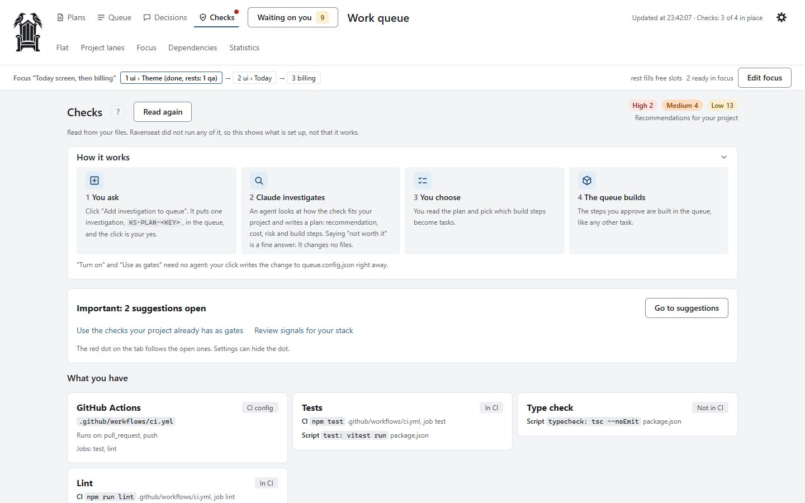
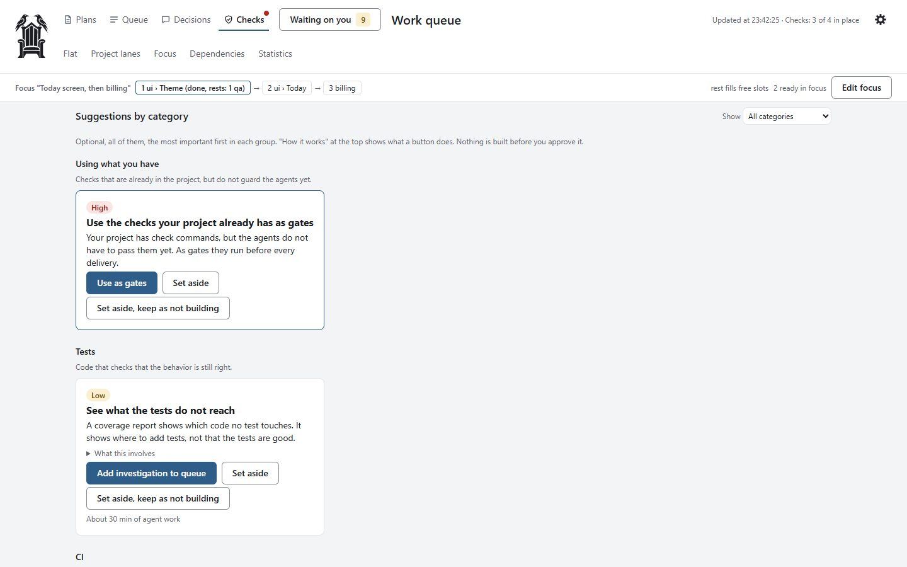
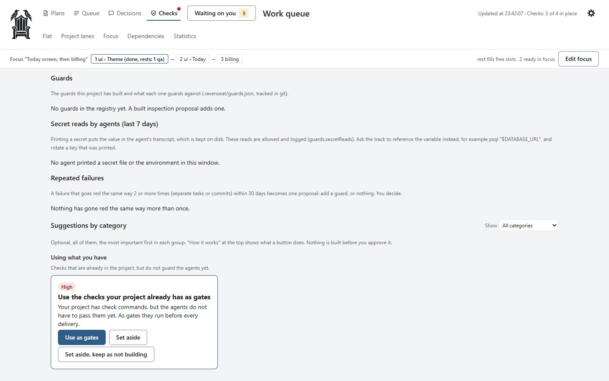

# The Checks tab (`ravenseat checks`)

The Checks tab on the board, and `ravenseat checks` in the terminal, answer two questions about your project: what does
it already have for checking its code, and what would be worth adding? The answer is a set of cards. The suggestions
are sorted by priority, and each one has a button that does the next step for you, or hands it to an agent as an
investigation.

<p align="center"></p>

## Contents

- [What it is, and what it is not](#what-it-is-and-what-it-is-not)
- [How to read the tab](#how-to-read-the-tab)
- [Priority and the red dot](#priority-and-the-red-dot)
- [Set aside and Bring back](#set-aside-and-bring-back)
- [The buttons](#the-buttons)
- [Nothing changes without you](#nothing-changes-without-you)
- [Every card](#every-card)
- [Three thresholds for repeats](#three-thresholds-for-repeats)
- [The guard registry and repeated failures](#the-guard-registry-and-repeated-failures)
- [CI parity for a built gate](#ci-parity-for-a-built-gate)
- [Lite mode](#lite-mode)
- [Turning the tab off](#turning-the-tab-off)
- [Your own cards](#your-own-cards)
- [Commands](#commands)
- [FAQ](#faq)
- [Where it lives in the code](#where-it-lives-in-the-code)

## What it is, and what it is not

**It reads files. It runs nothing.** Ravenseat reads your CI config, `package.json`, `pyproject.toml`, the gates in
`queue.config.json`, marker files such as `.husky/` or `biome.json`, the time log and the finding log. It never runs a
test, a script or a workflow. That makes it safe in a repo someone else wrote, and it also means a card says "the files
say this is set up", never "this works". A test script that always passes still shows as a test.

**It shows, it does not guard.** The tab is advice. Your gates, the push guard, the merge checks and every other guard
run the same whether the tab is on or off, and whether you follow a suggestion or not.

**Every suggestion is optional.** A suggestion that does not fit your project is fine to set aside. Saying no costs
nothing, and a card you set aside stays away.

**It works before `ravenseat init`.** `ravenseat checks` reads the project even without a queue. It saves its picture as
`checks-report.json` in the queue's data folder (ignored by git) once there is one; before that it only prints.

## How to read the tab

From the top down:

1. **The header.** "Read again" reads the files once more (the board keeps an answer for a minute otherwise), and the
   "?" opens the help at Checks. Under them, the reminder that nothing was run. The tab is turned off in Settings (the
   line at the end of the tab opens it) or with `ravenseat checks off`.
2. **How it works**, a box that is open until you close it (the board remembers that in this browser). Four steps, as
   the code runs them: clicking "Add investigation to queue" puts one investigation, a class U task `KS-PLAN-<KEY>`, in
   the queue, and the click is your yes; an agent investigates how the check fits your project and writes a plan
   (recommendation, cost, risk and build steps; "not worth it" is a fine answer) and changes no files; you choose which
   build steps become tasks; the ones you approve are built in the queue. One line says that "Turn on" and "Use as
   gates" need no agent. While the first read runs, placeholders in the cards' shape stand under it, so the view does
   not jump when the cards come.
3. **The summary**, only when there is something to say: the important (high) suggestions that are open, each as a
   button that scrolls to its card and puts focus on it (also when the category filter hid it), with "Go to
   suggestions" for the list, and under "Skipped" the important ones you set aside, each with "Bring back".
4. **What you have.** One card per CI config file (the host, the file, what it runs on and its jobs), and one card per
   kind of check found, with every place it was found and a badge "In CI" or "Not in CI". The places are:
   - **CI**: a command in GitHub Actions (`.github/workflows/*.yml`), GitLab CI, Bitbucket Pipelines, Azure
     Pipelines, CircleCI or a Jenkinsfile, with the file and the job.
   - **Gate**: a command in `gates.quick` or `gates.full`.
   - **Script**: a `package.json` script, or a check command Ravenseat found for your stack.
   - **Git hook**: `.pre-commit-config.yaml`, `.husky/` or `lefthook.yml`.
   - **Config**: a file or a dependency that shows the tool is there (a Prettier or Biome config, `knip`, `jscpd` and
     so on).

   A command that runs a `package.json` script counts as what the script does: `npm run check` with
   `"check": "tsc && eslint ."` is a type check and a lint.
5. **Gates from known bugs**, one line, when there are any: how many wait for your yes, how many are approved and how
   many are done (see [Known bugs become gates](queue.md#known-bugs-become-gates)).
6. **Guards** and **Repeated failures**: the guard registry and the failures that went red the same way more than once
   (see [below](#the-guard-registry-and-repeated-failures)).
7. **Suggestions by category.** One card per suggestion that applies to the project now, in one group per category
   with a heading and the category's one line, in the order of the categories below; a category with no card has no
   group. A card shows its priority, a title, why it is suggested and sometimes a line read from your project (the
   stacks, how many `uses:` lines are not pinned, the test command Ravenseat found). With two or more categories, a
   "Show" list filters by category.
   **More ideas (n)**, folded and closed: the low cards that observe nothing in the project, only its setup (it has
   gates and tests, CI, a stack, or an opt-in check is off). They fit most projects, so they wait here instead of
   filling the list. A card leaves the fold by itself once something is found (its `medium_when` or `important_when`
   holds), and a card in the queue stays in the list. Nothing is removed and no priority changes; `ravenseat checks
   --json` marks such a card `"quiet": true`. Any condition other than the setup ones in `lib/checksCatalog.js`
   (`CONTEXT`) counts as something found, so a new kind of gap is never folded.
8. **Set aside (n)**, folded: every card you set aside, each with "Bring back", also one that does not apply to the
   project now (marked "does not apply now").
9. **A suggestion file has a mistake**, in red, when a card file cannot be read. That card is left out; the rest show.

<p align="center"></p>

The order of the suggestions: one group per category, in the order of the categories (Using what you have, Tests, CI,
Code quality, Security, Dependencies, Database, Claude's instructions, Claude Code); inside a group high first, then
medium, then low, then by key. `ravenseat checks` in the terminal and `--json` keep the flat order: high first, then
medium, then low, within a priority by category.

A card is in one of four states:

| State | Means | On the card |
| --- | --- | --- |
| open | Nothing is done about it yet | The button and "Set aside" |
| queued | Its investigation task (or the task named in `also_task`) is in the queue and not done | "In the queue: `<id>`" in place of the buttons |
| planned | That task is done: the plan is delivered | "Plan delivered: `<id>`" in place of the buttons |
| set aside | You set it aside | Only under "Set aside", with "Bring back" |

A cancelled task does not count, so the card is open again and can be asked for again (the next id gets `-2`, `-3`).

## Priority and the red dot

Each card file has a priority: high, medium or low. Two fields can raise it while a condition holds:

- `important_when` raises the card to **high** while it holds, for example "Check the project's own .gitignore" while a
  quiet look finds a tracked file that should be local. When the condition no longer holds, the card goes back to its
  own priority.
- `medium_when` raises a **low** card to **medium**, never to high. Only "Find flaky tests" uses it: medium once the
  time log has seen a gate command red and then green on the same commit.
- `lift_when` puts a card **first within its own priority** while it holds, and never changes the priority, so it never
  lights the red dot. "Run your tests in CI" and "Run lint and type check in CI" use it when a gate guard runs that kind
  of check and CI does not ([CI parity](#ci-parity-for-a-built-gate)).

**The red dot** on the tab is lit when all of these hold:

1. The Checks tab is on (see [Turning the tab off](#turning-the-tab-off)).
2. The dot is not switched off (`checksPanel.marker`, on by default).
3. At least one card applies to the project now, is high (its own priority, or raised by `important_when`), and is
   **open**: not set aside, and no investigation for it queued or delivered.

So a high card lights the dot whether it is high by itself (seven cards are, such as "Run your tests in CI" or "Keep
secret files out of git") or raised for a while. Setting it aside, or adding its investigation, puts the dot out for
that card. The board reads the overview in the background at most every two minutes, so the dot can lag behind a change
in the files by that much; "Read again" on the tab updates the tab itself at once. `ravenseat checks marker off` hides
only the dot: the cards stay as they are.

## Set aside and Bring back

"Set aside" (`ravenseat checks dismiss <key>`) moves a card out of the suggestions into the folded "Set aside" list. It
stays there until you bring it back: a set-aside card never returns by itself, also when its condition goes away and
comes back. It does not light the red dot. An important card you set aside is also listed in the summary at the top
under "Skipped", so it is not forgotten.

A card you set aside stays in the "Set aside" list also when its condition no longer holds, marked "does not apply
now", so you can still bring it back. Such a card never counts for the red dot and is not in the summary. Brought back,
it shows among the suggestions again once it applies. In `ravenseat checks --json` it has `"applies": false`; every
other card has `"applies": true`.

"Bring back" (`ravenseat checks restore <key>`) puts it back among the suggestions. Adding the card's investigation with
`ravenseat checks plan <key>` also brings it back.

Saying no to a setup tip for an [opt-in check](#the-buttons) sets its card aside too: the tip names
`ravenseat checks dismiss <key>`, the same as the button.

## The buttons

What a card's button does depends on its kind (the `action` in the card file). The full list per card is in the
[table](#every-card).

| Button | Kind | What happens | The command |
| --- | --- | --- | --- |
| **Add investigation to queue** | no action (most cards) | Adds one class U task, `KS-PLAN-<KEY>`, built from the card's "Investigate" and "Plan and build" sections and what was found in your files. The agent finds out and writes a plan in `track-result.md`: its recommendation (that it is not worth doing is a fine answer), the cost in agent time and CI minutes, the risks, and the build steps it recommends. It changes no project files and never pushes. You pick which steps become tasks | `ravenseat checks plan <key>` |
| **Turn on** | `action: setting` | Turns one opt-in check on in `queue.config.json`, and the card goes. Off again with `ravenseat settings set <setting> off` or in Settings | `ravenseat checks turn-on <key>` |
| **Turn on** | `action: packs` | Writes the stack packs for the stacks in your manifests to `review.packs`, so the review signals know your stack's risky calls ([stack packs](orchestration.md#stack-packs)) | `ravenseat checks packs --apply` |
| **Use as gates** | `action: gates` | Writes the check commands found to `gates.quick` and `gates.full`. It never writes over gates you have set | `ravenseat kickstart gates --apply` |
| **Add to gates.quick** | `action: quick-gate` | One button per gate guard on the card, with its exact command. Adds that command at the end of `gates.quick` in `queue.config.json`. Nothing runs, and no command is removed or replaced ([CI parity](#ci-parity-for-a-built-gate)) | `ravenseat checks quick-add <G-n>` |
| **Copy the text for Claude** | `action: ask` | Copies the card's text, shown on the card under "Ask Claude in your session", for you to paste to Claude in your own session. It is for a step a queue agent cannot take (a first commit, branch protection on the host). Where the browser refuses the clipboard, select the text on the card | none: you give it to Claude |

Some details:

- An investigation is about the card's `content_min` minutes of agent work (shown on the card) and uses tokens like any
  task. Its value follows the priority (high 8, medium 6, low 4). In full mode it goes in the project `cicd`.
- The board's "Add investigation to queue" passes `--approved`, because your click is the yes, so it can start when the
  queue gets to it. From the terminal, `ravenseat checks plan <key>` adds it as a proposal: `ravenseat approve <id>`, or
  Approve on the board, lets it run.
- `ravenseat checks plan` on a card that needs no agent adds nothing and prints the command to use instead.
- Three cards share their work with a kickstart step (`also_task`): "Add a first automatic test" with `KS-CHECK`, "Run
  your checks on every push" with `KS-CI` and "Keep secret files out of git" with `KS-SECRETS`. While that task is in
  the queue, the card shows it as under way.
- The opt-in checks are all off by default, so an update never brings new warnings to an existing project. Each is
  offered in three quiet places from one list (`lib/optInChecks.js`): one setup question for all of them, once per
  check; a card here, low unless a quiet look found a reason; and for some an INFO line in `ravenseat doctor`, only
  while that reason is there, also when the card is set aside, since setting a suggestion aside must not hide a key in
  a tracked file (`ravenseat doctor --all` shows every one). "Turn on" writes only a key from that list, so a card file
  of your own cannot switch anything else, and it is refused from inside a track's worktree.
- "Keep the queue's files in git as a backup" is offered only in a repo known to be private (the cached answer of the
  last visibility check). Its "Turn on" goes through the same steps as `ravenseat share on --yes`, with the `.gitignore`
  change and an audit row, never as a plain setting write.

## Nothing changes without you

- Reading the tab, and `ravenseat checks`, change nothing in the project.
- An investigation delivers a plan, never code. Each build step it recommends is listed for you, and becomes a task only
  when you add it.
- "Turn on", "Use as gates" and the packs' "Turn on" write `queue.config.json`, and only on your click or your command.
  Each tells you how to turn it off again.
- Nothing on the tab weakens a guard: turning an opt-in check on only adds a check, and the tab's own switches (the tab,
  the dot) are advice, not guards.
- An agent cannot change the checks: `ravenseat checks turn-on` is refused in a track's worktree.

## Every card

One row per card in the plugin. "Shows when" is the card's `when`: every part must hold. "Priority" is the card's own
priority and what raises it. The categories are those of
[categories.json](../scripts/orchestrator/checks-catalog/categories.json). A project can add, change or remove cards
([Your own cards](#your-own-cards)); those are not in this table.

<!-- checks-table:start -->
Generated by `npm run docs:checks` from `plugin/scripts/orchestrator/checks-catalog/` (49 cards). Do not edit by hand.

| Card | Category | Shows when | Priority | Button | Setting |
| --- | --- | --- | --- | --- | --- |
| Put the project under git with a first commit (`first-commit`) | Using what you have | there is no commit yet (no git, or git with no commit) | High | Copy the text for Claude (no agent) | none |
| Use the checks your project already has as gates (`use-gates`) | Using what you have | the project has check commands of its own and no gates are set | High | Use as gates (`kickstart gates --apply`) | none |
| Add a first automatic test (`first-test`) | Tests | no tests found | High | Add investigation to queue (`checks plan first-test`); shows as under way while KS-CHECK is in the queue | none |
| A guard did not hold: a failure came back (`guard-failed`) | Tests | the finding log shows a failure class back where a guard for it was in place | Medium; high (red dot) while the finding log shows a failure class back where a guard for it was in place and `learning.guardFailedMarker` is on | Copy the text for Claude (no agent) | none |
| A kind of failure keeps coming back: what would guard it (`ledger-recipes`) | Tests | the inspection queue is on (`inspection.mode`) and the finding log has a failure class due for a guard, not declined and with no gate yet for that place | Medium | Copy the text for Claude (no agent) | none |
| Run a built gate guard on every merge (`quick-gate-add`) | Tests | a gate guard in the registry has a command that is not in `gates.quick` (`learning.quickGateCard`) | Medium | Add to gates.quick, one per guard (`checks quick-add <G-n>`; nothing runs) | none |
| Run only the changed tests in the quick gates (`changed-tests-in-quick`) | Tests | gates are set in `queue.config.json` and tests found | Low | Add investigation to queue (`checks plan changed-tests-in-quick`) | none |
| See what the tests do not reach (`coverage`) | Tests | tests found and no test coverage found | Low | Add investigation to queue (`checks plan coverage`) | none |
| Check the environment before a long test run (`env-precheck`) | Tests | gates are set in `queue.config.json` and tests found | Low | Add investigation to queue (`checks plan env-precheck`) | none |
| Find flaky tests (`flaky-tests`) | Tests | gates are set in `queue.config.json` and tests found | Low; medium while the time log shows a gate command red and then green on the same commit | Add investigation to queue (`checks plan flaky-tests`) | none |
| Propose a guard when the same kind of failure keeps coming back (`learning-proposals`) | Tests | `learning.proposals` is off and the finding log has a failure class due for a guard, not declined and with no gate yet for that place | Low | Turn on (`checks turn-on learning-proposals`) | `learning.proposals` |
| Check that a fix's new test fails without the fix (`red-on-base`) | Tests | `gates.redOnBase` is not set and tests found | Low | Copy the text for Claude (no agent) | none |
| Keep tests stable when several runs share the machine (`test-timeouts-under-load`) | Tests | gates are set in `queue.config.json` and tests found | Low | Add investigation to queue (`checks plan test-timeouts-under-load`) | none |
| Put a cap on the test workers (`test-workers-cap`) | Tests | gates are set in `queue.config.json` and tests found | Low | Add investigation to queue (`checks plan test-workers-cap`) | none |
| Run your checks on every push (CI) (`ci-on-push`) | CI | no CI config file is found and the repo has a remote | High | Add investigation to queue (`checks plan ci-on-push`); shows as under way while KS-CI is in the queue | none |
| Run your tests in CI (`tests-in-ci`) | CI | a CI config file is found and tests found but not in CI | High; first in its priority while a gate guard runs tests but CI does not (learning.ciParityLift) | Add investigation to queue (`checks plan tests-in-ci`) | none |
| Check that the project builds in CI (`build-in-ci`) | CI | a CI config file is found and build found but not in CI | Medium | Add investigation to queue (`checks plan build-in-ci`) | none |
| Run lint and type check in CI (`quality-in-ci`) | CI | a CI config file is found and type check found but not in CI or lint found but not in CI | Medium; first in its priority while a gate guard runs type check but CI does not or a gate guard runs lint but CI does not (learning.ciParityLift) | Add investigation to queue (`checks plan quality-in-ci`) | none |
| Add a linter (`lint`) | Code quality | the project's stack is known and no lint found | Medium | Add investigation to queue (`checks plan lint`) | none |
| Add a type check (`type-check`) | Code quality | the project's stack is known and no type check found | Medium | Add investigation to queue (`checks plan type-check`) | none |
| Add the gap review when a change drifts far (`drift-gap-review`) | Code quality | `scopeNotes.driftGap` is off and the project is not in lite mode | Low; high (red dot) while the finding log shows scope drift 3 times in one area within 30 days (never in lite mode) | Turn on (`checks turn-on drift-gap-review`) | `scopeNotes.driftGap` |
| Warn a track when it writes outside its files (`drift-write-warn`) | Code quality | `scopeNotes.driftWarn` is off and the project is not in lite mode | Low; high (red dot) while the finding log shows scope drift 3 times in one area within 30 days (never in lite mode) | Turn on (`checks turn-on drift-write-warn`) | `scopeNotes.driftWarn` |
| Find copied code in CI (`duplication-tool`) | Code quality | the project's stack is known, a CI config file is found and no copy detector in CI | Low; high (red dot) while the finding log shows duplication 3 times in one area within 30 days (never in lite mode) | Add investigation to queue (`checks plan duplication-tool`) | none |
| Add a formatter (`formatter`) | Code quality | the project's stack is known and no formatter found | Low | Add investigation to queue (`checks plan formatter`) | none |
| Run the fast checks before each commit (`git-hooks`) | Code quality | the project uses git, lint or type check found and no git hooks found | Low | Add investigation to queue (`checks plan git-hooks`) | none |
| Write down the stack and the design choices (`project-catalog`) | Code quality | the project's stack is known and there is no `docs/queue/catalog/` folder | Low; high (red dot) while the finding log shows duplication or scope drift 3 times in one area within 30 days (never in lite mode) | Copy the text for Claude (no agent) | none |
| Find unused code and dependencies (`unused-code`) | Code quality | the project's stack is known and no unused code found | Low | Add investigation to queue (`checks plan unused-code`) | none |
| Keep secret files out of git (`secret-files`) | Security | the project uses git and a secret file is not kept out of git | High | Add investigation to queue (`checks plan secret-files`); shows as under way while KS-SECRETS is in the queue | none |
| Review signals for your stack (`stack-review-signals`) | Security | a stack pack for the project's stack is not on in `review.packs` | High | Turn on (`checks packs --apply`) | none |
| Protect the main branch on the remote (`branch-protection`) | Security | the repo has a remote and the base branch is not known to be protected on the host | Medium | Copy the text for Claude (no agent) | none |
| Pin GitHub Actions to a commit SHA (`pin-actions`) | Security | a CI config file is found and a `uses:` line in `.github/workflows` points at a tag or a branch | Medium | Add investigation to queue (`checks plan pin-actions`) | none |
| Look for keys in the commands Claude Code approved and in .mcp.json (`allowlist-scan`) | Security | `secretScan.allowlist` is off | Low; high (red dot) while a key is found in a tracked approved command or a tracked `.mcp.json` | Turn on (`checks turn-on allowlist-scan`) | `secretScan.allowlist` |
| Look for broad permissions in the shared settings (`broad-permissions`) | Security | `permissionsCheck.enabled` is off and a tracked `.claude/settings.json` exists | Low; high (red dot) while the tracked `.claude/settings.json` has `bypassPermissions` | Turn on (`checks turn-on broad-permissions`) | `permissionsCheck.enabled` |
| Scan the code for known security mistakes (`code-scan`) | Security | a CI config file is found and no code scanning found | Low | Add investigation to queue (`checks plan code-scan`) | none |
| Add a .env.example (`env-example`) | Security | an ignored `.env` has no `.env.example` beside it | Low | Add investigation to queue (`checks plan env-example`) | none |
| Check the project's own .gitignore (`gitignore-own-rules`) | Security | `gitignoreCheck.enabled` is off | Low; high (red dot) while the project's own `.gitignore` does not ignore `.claude/settings.local.json`, or git tracks a file Ravenseat keeps local | Turn on (`checks turn-on gitignore-own-rules`) | `gitignoreCheck.enabled` |
| Scan for secrets in CI (`secret-scan-ci`) | Security | a CI config file is found and no secret scan found | Low | Add investigation to queue (`checks plan secret-scan-ci`) | none |
| Scan each track's commits for keys at receive (`secret-scan-receive`) | Security | `secretScan.atReceive` is off | Low; medium while a secret file is not kept out of git | Turn on (`checks turn-on secret-scan-receive`) | `secretScan.atReceive` |
| Keep the queue's files in git as a backup (`share-backup`) | Security | `share.queueData` is off and the repo is known to be private | Low | Turn on (`checks turn-on share-backup`) | `share.queueData` |
| Research review signals for a stack without a pack (`stack-pack-research`) | Security | a known stack has no pack yet | Low | Add investigation to queue (`checks plan stack-pack-research`) | none |
| Check your libraries for known holes (`dep-audit`) | Dependencies | the project's stack is known and no dependency audit found | Medium | Add investigation to queue (`checks plan dep-audit`) | none |
| Put the lockfile in git (`lockfile-in-git`) | Dependencies | a tracked manifest has no tracked lockfile | Medium | Add investigation to queue (`checks plan lockfile-in-git`) | none |
| Get proposals when libraries have updates (`dep-updates`) | Dependencies | the repo has a remote, the project's stack is known and no dependency updates found | Low | Add investigation to queue (`checks plan dep-updates`) | none |
| Pin the runtime version (`runtime-version`) | Dependencies | the project's stack is known and no runtime version is written down | Low | Add investigation to queue (`checks plan runtime-version`) | none |
| Run the migrations from an empty database in CI (`db-migrations-ci`) | Database | migrations are set up, a CI config file is found and no migrations from empty in CI | Medium | Add investigation to queue (`checks plan db-migrations-ci`) | none |
| Test your database rules (`db-rules-probes`) | Database | the project has a database and no database probes found | Medium | Add investigation to queue (`checks plan db-rules-probes`) | none |
| Never run probes against a shared database (`db-shared-guard`) | Database | `dbGuard.localOnly` is off and the project has a database | Medium | Turn on (`checks turn-on db-shared-guard`) | `dbGuard.localOnly` |
| Make Claude's instructions smaller (`slim-instructions`) | Claude's instructions | Claude's instruction files are over the size limit | Medium | Copy the text for Claude (no agent) | none |
| Claude Code writes rows Ravenseat does not know yet (`client-format`) | Claude Code | the newest Claude Code transcript has rows Ravenseat reads differently than expected (the format canary, `client.canary`) | Medium | Copy the text for Claude (no agent) | none |
<!-- checks-table:end -->

What some of the facts mean:

- **Tests, lint and the other kinds "found"**: found anywhere (CI, a gate, a script, a git hook, a config file). "In CI"
  means a command in a CI config file. See [How to read the tab](#how-to-read-the-tab), point 3.
- **A database**: `migrations.folder` is set, or a `supabase/`, `prisma/` or `migrations/` folder exists. **Migrations
  set up**: that folder, or `supabase/migrations`, `prisma/migrations`, `migrations/` or `db/migrations`.
- **Database probes** are tests that run SQL against a real database (`pg_prove`, pgTAP, `supabase test db`,
  `sqlx test`) or a probe folder (`supabase/tests`, `db/tests`, `tests/sql`).
- **A runtime version written down**: `.nvmrc`, `.node-version`, `.tool-versions`, `.python-version`, `mise.toml`,
  `rust-toolchain(.toml)`, `.ruby-version`, `.java-version`, `.sdkmanrc`, `engines` in `package.json`,
  `requires-python` in `pyproject.toml`, or the `go` line in `go.mod`.
- **The base branch protected**: asked from GitHub with `gh` at most once a day. Only a clear "protected" hides the card;
  an unknown answer shows it.
- **Unknown is never a gap.** Each fact is read on its own, and one that cannot be read (no git, an error, no time log)
  counts as unknown. An unknown fact never shows a card that needs it, and never makes a card important. The one
  exception is branch protection, where unknown shows the card.

## Three thresholds for repeats

Three parts of Ravenseat count failures that come back. They count different things over different windows, because
they do different jobs. Only the first one is part of the Checks cards; the other two make proposals.

| What | Counts | Threshold | Window | What it does | Settings |
| --- | --- | --- | --- | --- | --- |
| The cards' "3 in one area" | Incidents of one failure class (`duplication`, `scope-drift`) in one area, from the finding log | 3 | 30 days | Raises a card to high, with the red dot. It proposes nothing | None: fixed in the code (`lib/checksCatalog.js`, `lib/findingRepeats.js`) |
| The finding log's repeats | Incidents of one failure class in one area, or across the project | 2 in one area, or 3 across the project | 90 days | Marks the class due. With `learning.proposals` on, it becomes one gate task proposed to you. A class back where a guard was gives "A guard did not hold" | `learning.repeats`, `learning.areaRepeats`, `learning.projectRepeats`, `learning.windowDays` |
| The inspection queue | Incidents of the same failure signature: the same red command with the same first error line, or the same failed CI job and step | 2 | 30 days | One proposal `INSP-<n>` per signature: add a guard, or nothing | `inspection.minRepeats`, `inspection.windowDays`, `inspection.mode` |

An incident is one task (or one finding without a task): a red-fix-red loop in one track is one incident, not three. The
finding log counts only rows with `counts: true`, never `confidence: low` and never the class `other`.

**Why they differ.** The card threshold asks for quick, cheap action now: three times in a month in one place is a
cluster that is happening at the moment, and the answer is to switch on a guard that already exists (the gap review,
the write warning) or to write the catalog. It only raises a card, so a short window that forgets fast is right. The
finding log is the long memory: the same kind of mistake twice in one area over three months is a pattern a single
quick window would miss, and the answer is a new gate, which costs your time to approve, so it goes through you. In
that count an untested fix weighs twice, but one untested fix alone is never a repeat. The inspection queue matches
the exact same failure, so two separate incidents are already a clear signal.

Two consequences:

- With `learning.repeats` off, the finding log gives no facts at all, so the scope drift, duplication and catalog cards
  never turn important, and "A guard did not hold" and "Propose a guard ..." never show.
- The finding log is read only when there is a queue. Before `ravenseat init` none of these cards shows.

More in [Repeats on class and area](queue.md#repeats-on-class-and-area) and
[Repeated failures and the guard registry](orchestration.md#repeated-failures-and-the-guard-registry).

## The guard registry and repeated failures

Two sections of the tab show what the project has learned from its own failures.

**Guards** lists the guard registry, a tracked file (`inspection.registryFile`, by default `.ravenseat/guards.json`):
one card per guard, with its kind (gate, instruction, review point, or none), what it guards against, the command for a
gate, the task that built it and the date. For a gate with a command the card says "Caught N times since built (M
runs)" and the last red, counted from the gate rows in the time log when the tab is read. A retired guard has a badge.
With no entries the section says so; a built inspection proposal adds one.

<p align="center"></p>

**Repeated failures** lists the entries of the inspection queue that are more than "watching": due, proposed, approved,
built, rejected or snoozed, each with the error line, how many red runs and incidents, where (gates or CI) and when it
was last seen. When a failure reaches the threshold, the inspection scan (`ravenseat inspection`, and the pulse at most
once an hour) makes it one proposal `INSP-<n>`:

- `ravenseat approve <id>`: an agent picks the cheapest guard that works: a gate (red first), an instruction line, a
  review point, or nothing. It is never built without your yes, and never auto-accepted.
- `ravenseat cancel <id>`: rejected, until its incidents in the window double.
- `ravenseat inspection snooze <id> [--days 14]`: held until the date, then proposed again if it still repeats.

A built proposal that has no registry entry yet is listed with the command that adds one
(`ravenseat guards add --from-task <id> --kind ...`). At most three proposals wait for you at a time, shared between
the inspection queue, the GATE lines from tracks and the finding log's proposals. With `inspection.mode off` the section
says the queue is off.

Three cards come from the same finding log:

- **"A guard did not hold"**: a failure class came back in an area where a guard for it was already in place (an active
  registry entry for the class, a done gate task proposed from the log, a fix with a test that failed without it, or an
  untested fix when one of them was high severity). It is high, with the red dot, while `learning.guardFailedMarker` is
  on (the default); off, it stays at medium. It goes away when a newer guard, or a fix with a proven red test, is in
  place there. Its button gives you the text to look into it with Claude.
- **"Propose a guard when the same kind of failure keeps coming back"**: shows while `learning.proposals` is off and a
  class is due. "Turn on" turns the proposals on.
- **"A kind of failure keeps coming back: what would guard it"**: shows while the inspection queue is on
  (`inspection.mode`) and a class is due. For at most three classes it names the class, how often, where (paths only,
  never a line of code or an error text), your stack and the recipe for a guard in that stack, with the card that
  already does that work. It is medium and never lights the red dot. A class and area you declined as a gate proposal
  (`ravenseat cancel GATE-<n>`), or one that already has a gate, is left out, and an open proposal is named. When the
  three open proposals are full, the card says so. Its button gives you the text to look into it with Claude.
  Each class with nothing proposed yet has a **Build as gate** button (`ravenseat checks build-gate <class>@<area>`):
  it adds one proposed gate task (`GATE-<n>`, in the shared cap of three with the inspection and gate proposals) whose
  mission names your gate commands, the CI file, the test runner, the recipe and the places (paths only). The
  criteria: the new check red on a reproduction and green on the fixed code, both runs shown; without a red
  reproduction the report says "no gate" and the guard registry gets the decision `none` with its reason. Nothing
  runs before you approve it. While the cap is full the line says it waits; an open one is named instead.
  A recipe that is [damped by its precision](#recipe-precision) is named on the line, not offered.

A class is due, here and in `ledger-due`, only while it is open: a declined class and area, or one with a gate, no
longer counts. The class `other` and findings with low confidence never count at all.

## CI parity for a built gate

A gate guard in the registry (`kind: gate` with a `command`) only guards when something runs that command. The queue
runs `gates.quick` on every merge; CI runs what its workflow says. Three quiet signals close the gap, all on by default
because none of them stops work or runs a command:

- **The card "Run a built gate guard on every merge"** (`learning.quickGateCard`): shows while an active gate guard's
  command is not in `gates.quick`. Each guard has an **Add to gates.quick** button with the exact command
  (`ravenseat checks quick-add <G-n>`). The command is read from the registry, never from the board: the board sends only
  the guard's id. The write only adds the command at the end of `gates.quick` and keeps the rest of `queue.config.json`
  as it is; it never removes, replaces or reorders a command, refuses a `gates.quick` that is not a list of commands,
  refuses a deploy command (`deployCommands`) or a push, and is refused from inside a track's worktree. Nothing runs from
  the card: the next merge runs it as a gate. Commit `queue.config.json` afterwards. Off, the card is gone and
  `checks quick-add` still works.
- **The CI cards first** (`learning.ciParityLift`): when a gate guard runs tests, a type check or lint and CI does not
  run that kind, "Run your tests in CI" or "Run lint and type check in CI" is put first in its priority and names the
  guard. It is never raised to high: the red dot is for a guard that did not hold, not for a gap to look at.
- **An INFO line for a guard that has not run** (`learning.idleGuardDays` 7, `0` = off): `ravenseat guards`
  and `ravenseat doctor` name a gate guard with 0 runs in the time log since it was built, once it is that many days old.
  It is INFO only, and says how to add the command when it is not in `gates.quick`.

## Lite mode

In lite mode a task usually names no files, so the guards that compare a change with the task's files do not fit:

- "Add the gap review when a change drifts far" and "Warn a track when it writes outside its files" are not shown.
- No card turns important from "3 in one area within 30 days" (the scope drift, duplication and catalog cards stay low).
- An investigation is added without the project `cicd`.

Everything else is the same as in full mode.

## Turning the tab off

`ravenseat checks off`, or "Show the Checks tab" in Settings (`checksPanel.mode`, stored in `queue.json`). The tab
itself keeps only **Read again** in its header; a quiet line at the end of the tab, **Turn it off in Settings**, opens
Settings at that switch. Off removes the tab, the overview of `ravenseat checks` and the
suggestions in setup. It changes no gates and no guards. `ravenseat checks on` brings it back.

Without its own setting, the tab follows `ravenseat guidance`: in `quiet` it is off, so someone who runs their own setup
gets no suggestions. `ravenseat checks on` then turns it on anyway.

The red dot alone: `ravenseat checks marker off`, or "Red dot on the Checks tab" in Settings (`checksPanel.marker`).

The other commands (`show`, `plan`, `dismiss`, `turn-on`, `packs`) keep working while the tab is off.

## Your own cards

Every card is a file, and no card is written in code. The plugin's cards are in
`plugin/scripts/orchestrator/checks-catalog/`: `categories.json` (the categories, in the order they show) and
`suggestions/<key>.md` (one card; the file name is its key). To change them for one project, without touching the
plugin, use the same layout in `docs/queue/checks/` in your project:

| You want to | Do this |
| --- | --- |
| Add a card | Add `docs/queue/checks/suggestions/<key>.md` |
| Change one | Add a file with the same name; it replaces the plugin's |
| Remove one | Add a file with the same name holding only a header with `off: true` |
| Add or change a category | List it in `docs/queue/checks/categories.json` with the same or a new `key` |
| Remove a category and its cards | List its key with `"off": true` |

A card in a category nobody listed still shows, under its key. Give a card a key of lowercase letters, digits and
hyphens (at most 60 characters): the board refuses other keys for its buttons.

A card file:

```markdown
---
title: What you read on the card
category: tests
priority: medium
when: has-gates, found:test
important_when: flaky-observed
content_min: 30
why: One or two sentences, in plain words, on why this is worth doing.
---

## Investigate

What the agent finds out before anyone decides.

## Plan and build

What the plan covers, and what the build steps should and should not do.
```

| Field | Means |
| --- | --- |
| `title`, `category`, `why` | Required. What the card shows |
| `priority` | Required: `high`, `medium` or `low` |
| `when` | When the card applies. Comma: all parts must hold. Empty: always |
| `important_when` | Raises the card to high, with the red dot, while it holds |
| `medium_when` | Raises a low card to medium while it holds |
| `lift_when` | Puts the card first in its own priority while it holds (never higher, so never the red dot) |
| `content_min` | The investigation's size in minutes (60 when left out) |
| `also_task` | A task that does the same work, so the card shows as under way while it is in the queue |
| `action` | `gates`, `packs`, `setting`, `quick-gate` or `ask`: the kinds that need no agent ([The buttons](#the-buttons)). Without it, the card needs the two sections "Investigate" and "Plan and build" |
| `setting` | With `action: setting`: the opt-in check it turns on. Only the keys in `lib/optInChecks.js` work |
| `off` | `true` removes the plugin's card of the same name |

An `ask` card needs one section, `## Ask Claude`, with the text you give Claude. A file with a mistake (a missing field,
an unknown priority or condition, a missing section) is left out, and both the tab and `ravenseat checks` say what is
wrong with it.

### Recipes

The recipes the card "A kind of failure keeps coming back" shows are data too: `recipes.json` in the same folder as the
cards (`checks-catalog/recipes.json`), one recipe per failure class and stack. The first recipe for a class whose
`when` holds is the one shown, and `when` uses the same conditions as a card, so `stack:typescript, missing:types` says
both the stack and what the project lacks. A recipe points to the cards that already do the work instead of saying it
again. The plugin ships recipes for unchecked errors, type drift, leaked secrets and flaky or weakened tests in Node,
TypeScript and Python, and [database probe recipes](#database-probe-recipes) for access rules and migrations.

```json
{
  "recipes": [
    {
      "id": "our-result-type",
      "class": "unchecked-error",
      "when": "stack:typescript",
      "title": "Our Result type",
      "text": "Every service call returns Result, and a lint rule forbids a call whose result is not read.",
      "cards": ["lint"],
      "examples": { "hit": [{ "stacks": ["Node/TypeScript"] }], "miss": [{ "stacks": ["Python"] }] }
    }
  ]
}
```

In `docs/queue/checks/recipes.json` a recipe with a new id comes before the plugin's, so your own choice wins for its
class; the same id replaces the plugin's, and `{ "id": "...", "off": true }` removes it. `examples` are facts the
recipe must hold for (`hit`) and must not hold for (`miss`), and they are checked when the catalog is read: a recipe
whose examples do not behave, with an unknown condition, or naming a card that does not exist is left out, and the tab
says why. A card your project turned off only drops the link. `text` is at most 400 characters, `cards` at most three.

#### Database probe recipes

For the classes access control and migration, the plugin ships recipes marked `"db": true`: pgTAP probes with
`supabase test db` for Supabase, with `pg_prove` for another Postgres, and tests in your own test runner against a
throwaway database (testcontainers or a compose service) for the rest. They point to the cards "Test your database
rules", "Run the migrations from an empty database in CI" and "Never run probes against a shared database".

- **Off by default** (`learning.dbProbes`). A probe gate is heavy, needs a running database, and is the one kind of
  gate that can change data elsewhere when it points at the wrong host. With it off, the card says how to turn the
  recipes on, and only where a local database is found.
- **Only with a local database.** The recipe shows when the files show a database on this machine or one thrown away
  after the run: `supabase/config.toml`, a database image (postgres, mysql, mariadb, mongo) in `docker-compose.yml`,
  `compose.yaml` and the like, or testcontainers in `package.json`, `pyproject.toml` or a requirements file. A database
  only named by a `DATABASE_URL` is not local. The conditions are `has-local-database` and `local-db:<engine>`.
- **The shared database guard is part of the recipe.** Each text says it: writing probes roll back, and the gate checks
  that the host is localhost, 127.0.0.1, ::1 or the container it started before anything writes, and stops otherwise.
  "Build as gate" for a database class in a project with a database adds that as criteria to the mission, with a stop
  shown once on a made-up host, and says whether `dbGuard.localOnly` is on (the agent recommends it, never changes it).
- A recipe of your own marked `"db": true` must have `db-probes-on` and `has-local-database` or `local-db:<engine>` in
  its `when`, or it is left out and the tab says why.

#### Recipe precision

Ravenseat counts what became of each recipe's gate proposals, so a recipe you keep declining steps back by itself.
Nothing new is stored for it: the gate tasks already say it. A proposal is a gate task from the finding log ("Build as
gate", or the log's own proposal with `learning.proposals` on), and it keeps the recipe's id in its own field
`recipe`. The log's own proposal takes the recipe the last Checks read showed for that class and area; without one it
counts for its class only, and so does a class with a hint but no recipe.

- **Accepted** is approved or later (built included), **declined** is cancelled, and a proposal still waiting for you
  counts for nothing yet. The share is accepted out of the decided ones.
- **Damped**: a recipe below 30 percent accepted after at least 5 decided proposals is listed under "Recipe
  precision" on the tab (and in `ravenseat checks`), with its numbers, but no longer offered on the card. The card
  then shows the next recipe for the class whose `when` holds, or names the damped one. It stops nothing: the class
  still shows, Build as gate still works, and the proposals from the log still come.
- **A database recipe** (`"db": true`) is counted on its own rows and needs 10 decided proposals before it can be
  damped: it is shown only with `learning.dbProbes` on and a local database, so it gets few, and a probe gate is often
  declined for its cost rather than for being the wrong guard.
- **Your choice wins**: `ravenseat checks recipe <id> show` offers a recipe whatever its numbers, `damp` keeps it off
  the card, and `auto` lets its numbers decide again (stored in `queue.json`, like the cards set aside).
- The settings are `learning.recipeDamping` (on by default, since it only hides a suggestion), `learning.recipeMinProposals`
  (5), `learning.recipeMinProposalsDb` (10) and `learning.recipeMinAccepted` (30, a percent). Only recipe ids, class
  ids and counts are read, never a mission or a finding's text.

### Conditions

A condition in `when`, `important_when`, `medium_when` or `lift_when` is one of these. In `name:a|b`, the `|` means one of them is
enough.

<!-- checks-conditions:start -->
Generated by `npm run docs:checks` from `lib/checksCatalog.js` and `lib/checksScan.js`. Do not edit by hand.

| Condition | Holds when |
| --- | --- |
| `has-git` | the project uses git |
| `no-git` | the folder is known to have no git |
| `no-commit` | there is no commit yet (no git, or git with no commit) |
| `has-remote` | the repo has a remote |
| `has-ci` | a CI config file is found |
| `no-ci` | no CI config file is found |
| `has-gates` | gates are set in `queue.config.json` |
| `no-gates` | no gates are set |
| `checks-found` | the project has check commands of its own |
| `secrets-open` | a secret file is not kept out of git |
| `known-stack` | the project's stack is known |
| `instructions-large` | Claude's instruction files are over the size limit |
| `packs-missing` | a stack pack for the project's stack is not on in `review.packs` |
| `stack-unpacked` | a known stack has no pack yet |
| `allowlist-tracked-hit` | a key is found in a tracked approved command or a tracked `.mcp.json` |
| `gitignore-gap` | the project's own `.gitignore` does not ignore `.claude/settings.local.json`, or git tracks a file Ravenseat keeps local |
| `repo-private` | the repo is known to be private |
| `catalog-missing` | there is no `docs/queue/catalog/` folder |
| `has-database` | the project has a database |
| `has-migrations` | migrations are set up |
| `has-local-database` | a local or throwaway database is found (`supabase/config.toml`, a database image in a compose file, or testcontainers); a database only named by a URL is not local |
| `db-probes-on` | the database probe recipes are on (`learning.dbProbes`) |
| `shared-settings` | a tracked `.claude/settings.json` exists |
| `bypass-tracked` | the tracked `.claude/settings.json` has `bypassPermissions` |
| `branch-unprotected` | the base branch is not known to be protected on the host |
| `actions-unpinned` | a `uses:` line in `.github/workflows` points at a tag or a branch |
| `lockfile-missing` | a tracked manifest has no tracked lockfile |
| `runtime-unpinned` | no runtime version is written down |
| `env-no-example` | an ignored `.env` has no `.env.example` beside it |
| `flaky-observed` | the time log shows a gate command red and then green on the same commit |
| `red-on-base-off` | `gates.redOnBase` is not set |
| `ledger-due` | the finding log has a failure class due for a guard, not declined and with no gate yet for that place |
| `ledger-guard-failed` | the finding log shows a failure class back where a guard for it was in place |
| `ledger-marker` | `learning.guardFailedMarker` is on |
| `inspection-on` | the inspection queue is on (`inspection.mode`) |
| `not-lite` | the project is not in lite mode |
| `client-format-changed` | the newest Claude Code transcript has rows Ravenseat reads differently than expected (the format canary, `client.canary`) |
| `guard-not-in-quick` | a gate guard in the registry has a command that is not in `gates.quick` (`learning.quickGateCard`) |
| `missing:<kinds>` | no tests found or no lint found (example: `missing:test|lint`) |
| `found:<kinds>` | tests found (example: `found:test`) |
| `not-in-ci:<kinds>` | type check found but not in CI or lint found but not in CI (example: `not-in-ci:types|lint`) |
| `none-in-ci:<kinds>` | no migrations from empty in CI (example: `none-in-ci:migrate`) |
| `off:<setting>` | `secretScan.atReceive` is off (example: `off:secretScan.atReceive`) |
| `ledger-due:<classes>` | the finding log has access control due for a guard (example: `ledger-due:access-control`) |
| `ledger-guard-failed:<classes>` | the finding log shows access control back where a guard was in place (example: `ledger-guard-failed:access-control`) |
| `ledger-recent:<classes>` | the finding log shows duplication or scope drift 3 times in one area within 30 days (never in lite mode) (example: `ledger-recent:duplication|scope-drift`) |
| `stack:<stacks>` | the project's stack is typescript or python (a word of a stack found, such as typescript in Node/TypeScript, or a stack pack found, or a word an accepted [stack entry](catalog.md#stack-entries) in the catalog declares, with `catalog.stackFacts` on) (example: `stack:typescript|python`) |

The kinds for `missing`, `found`, `not-in-ci` and `none-in-ci`: `test` (tests), `types` (type check), `lint` (lint), `build` (build), `coverage` (test coverage), `secret-scan` (secret scan), `audit` (dependency audit), `security` (code scanning), `db` (database probes), `migrate` (migrations from empty), `format` (formatter), `unused` (unused code), `duplication` (copy detector), `dep-updates` (dependency updates), `hooks` (git hooks).
<!-- checks-conditions:end -->

## Commands

| Command | What it does | Needs a queue |
| --- | --- | --- |
| `ravenseat checks` | Reads the project and prints what it has and the open suggestions, most important first. Saves `checks-report.json` | No |
| `ravenseat checks --json` | The same picture as JSON (also the cards set aside). It is what the board reads | No |
| `ravenseat checks show <key>` | What a card covers: why, and its investigation and plan, or the command it needs | No |
| `ravenseat checks plan <key> [--approved]` | Adds the card's investigation as a task: a proposal, or approved with `--approved` (the board's button) | Yes |
| `ravenseat checks dismiss <key>` | Sets a card aside | Yes |
| `ravenseat checks restore <key>` | Brings it back | Yes |
| `ravenseat checks turn-on <key>` | Turns on the opt-in check of an `action: setting` card. Never from a track's worktree | No |
| `ravenseat checks packs` | Which stacks the manifests show and which packs are not on yet. Writes nothing | No |
| `ravenseat checks packs --apply` | Writes the missing packs to `review.packs` | No |
| `ravenseat checks build-gate <class>@<area>` | Build as gate: one proposed gate task for a class and area the finding log keeps seeing | Yes |
| `ravenseat checks quick-add <G-n>` | Add to gates.quick: adds that gate guard's command (read from the registry) at the end of `gates.quick`. Never removes or replaces a command, never runs it, never from a track's worktree | No |
| `ravenseat checks recipe <id> show\|damp\|auto` | Your choice for one recipe: offered whatever its numbers, kept off the card, or back to its [precision](#recipe-precision). Never from a track's worktree | Yes |
| `ravenseat checks marker on\|off` | The red dot on the tab | Yes |
| `ravenseat checks on\|off` | The tab, the overview and the setup suggestions | Yes |
| `ravenseat kickstart gates --apply` | The "Use as gates" button: the checks found become gates | No |
| `ravenseat inspection [--json]` | Scans for repeated failures, proposes a guard over the threshold, lists the entries | No (the proposals need one) |
| `ravenseat inspection snooze <id> [--days 14]` | Holds an entry until a date and cancels its proposal | No |
| `ravenseat guards [--json]` | The guard registry with its measures, and an INFO line for a gate guard with 0 runs after 7 days | No |
| `ravenseat guards add ...` / `guards retire <id>` | Adds an entry to the registry, or marks one retired | No |
| `ravenseat settings set <key> off` | Turns an opt-in check off again | No |

`<key>` is the card's key, the name of its file (the table above lists them). `show`, `plan`, `dismiss`, `restore` and
`turn-on` take only a card that applies to the project now; for another key they say so and change nothing. One
exception: a card you set aside that no longer applies can still be shown and brought back with `restore` (it then shows
again once it applies), but `plan` and `turn-on` refuse it.

## FAQ

### Why is the red dot on?

At least one open card is high. Look at the summary at the top of the tab: it names them. A card is high by itself (for
example "Run your tests in CI") or raised by its `important_when` while a gap lasts (a key in a tracked file, scope
drift three times in one area, a guard that did not hold). The dot goes out when you fix the gap, set the card aside,
or add its investigation. `ravenseat checks marker off` hides the dot for good.

### I fixed it, but the dot is still on.

The board reads the overview in the background at most every two minutes, so wait a moment. Check also that the fix is
in the files Ravenseat reads: a check you run by hand, or one only in a CI system it does not know, is not seen.

### Why do I not see the card X?

One of these:

- Its `when` does not hold for your project. The [table](#every-card) says what it needs: "Add a type check" needs a
  known stack and no type check found anywhere, for example.
- You set it aside: it is under "Set aside" at the bottom of the tab (or `ravenseat checks --json` lists it with state
  `dismissed`).
- Its investigation is queued or delivered: the card then shows the task id instead of a button.
- A fact it needs is unknown: no git, no queue yet, or the time log or finding log is empty. An unknown fact never shows
  a card.
- Lite mode hides the two scope drift cards.
- `docs/queue/checks/` in your project removes or replaces it.

### Why does the card say I have tests, when they do not run?

The tab reads files and runs nothing. A `test` script or a `vitest` line in a workflow counts as tests, also when they
fail or test nothing. The tab shows what is set up; your gates and CI show whether it works.

### Does an investigation change my code?

No. It is a class U task that ends in `track-result.md`: what it found, a recommendation, the cost and a plan of build
steps. You decide which steps become tasks.

### I set a card aside a long time ago. Will it come back?

No, not by itself, also when the gap it was about comes back. Look under "Set aside" on the tab and click "Bring back",
or run `ravenseat checks restore <key>`. This also works for a card that does not apply now: it is listed there as
"does not apply now", and shows again once it applies.

### Why did "Turn on" fail?

It is refused from inside a track's worktree: run it from your main checkout. The backup card also needs the repo to
be known to be private; `ravenseat share on` explains and asks first otherwise.

### Can I turn the whole thing off?

Yes: `ravenseat checks off`. Nothing else changes: the guards and gates run as before.

## Where it lives in the code

| Part | File |
| --- | --- |
| The cards, categories and recipes | `plugin/scripts/orchestrator/checks-catalog/` |
| The finding log's repeats behind the ledger cards | `lib/findingRepeats.js` (read by `cli/inspection.mjs` `ledgerScan`) |
| Recipe precision and damping | `lib/recipePrecision.js` (read by `cli/checks.mjs`) |
| Reading the cards, the conditions, priority, state and the report | `lib/checksCatalog.js` |
| What the project has, read from its files | `lib/checksScan.js` |
| The opt-in checks and how each is offered | `lib/optInChecks.js` |
| The command `ravenseat checks` and the facts that need git, the host or the logs | `cli/checks.mjs` |
| The tab on the board | `queue-board/board/checks.js` |
| The settings `checksPanel.mode` and `checksPanel.marker` | `lib/settingsRegistry.js` |
| The table and the conditions on this page | `scripts/checks-doc-table.mjs` (`npm run docs:checks`) |
