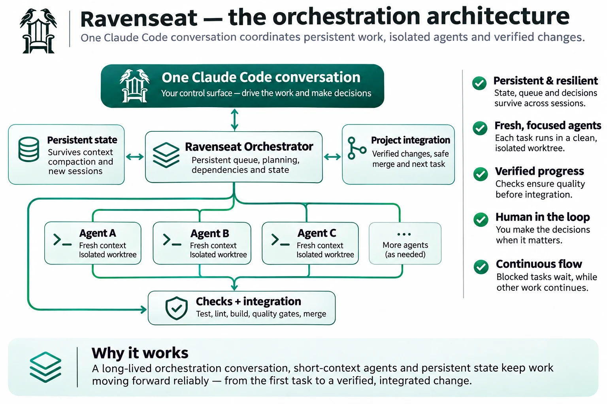

# Full mode

Lite is the loop. Full mode is the same loop plus answers to the problems that show up once a project and its queue
grow. Switch with `ravenseat mode full` (`ravenseat mode lite` goes back), and run `/ravenseat:setup` to fill in your checks and areas
([first run in full mode](guide.md#first-run-in-full-mode)). The [README](../../README.md) has the short version.

## Lite and full side by side

| | Lite mode | Full mode |
|---|---|---|
| Persistent task queue | Yes | Yes |
| Agents in isolated worktrees | Yes | Yes |
| Checks and fix rounds | Yes | Yes |
| Decisions, `/ravenseat:decide` and the board | Yes | Yes |
| Risk classes and task sizing | No | Yes |
| Focus and value-based priority | The Focus tab is on by default (`features.focus`); every task gets value 5, and `--priority 1-10` on `ravenseat add` moves one up or down | Yes, with focus stages from the plan register and the value set per task |
| Plan register | On by default (`features.plans`; set it to `false` to hide the Plans room) | Yes |
| Helper agents and deeper review | Only `reviewer-light`, for class K tasks when the project has no CI config or no gates | Yes |

Lite gets work moving with minimal setup. Full adds structure for larger projects; switch when you need it. Every
setting, with what is full mode only and what is advanced, is in the [configuration tables](queue.md#configuration).

## The pieces

The name says how it works: you sit in the Ravenseat, and the ravens (your agents) fly out into their worktrees and
come back with the work.

- **Plan register:** a list of ideas, plans and investigations, each with a priority and a maturity (idea,
  investigated, planned, ready, then in the queue, built and verified). It points to your documents instead of
  copying them. See [plan register](plan-register.md).
- **Work queue:** concrete tasks. Each has a class (risk level), an estimate, a value, dependencies, the files it
  owns, and any open questions for you. The queue picks the next task by value per minute. When several waiting
  tasks own the same file, only one can run at a time, so a short one (60 min or less) is moved up and a long one
  (above 120 min) moved down, 10 % per contender (the card's Placement shows it).
- **Orchestrator:** one Claude Code chat that runs the loop. It starts tasks, reviews results, merges them and asks
  you what only a human can decide. It does not write the code itself.
- **Tracks:** each task runs as a subagent in its own git worktree, on its own branch. It gets a short mission file,
  does the work, runs your checks, commits on its branch and answers with one line. The long report goes to a file,
  not into the orchestrator's context.
- **Board:** a local web page (kanban, plans, dependencies, cost, and "Waiting on you"). It is optional: everything
  works from Claude Code, and `/ravenseat:decide` is the main loop for what waits on you.

Worktrees do not reinstall your dependencies: `prepare-track.mjs` links the folders in `sharedLinks` (default
`["node_modules"]`) from the main tree into each worktree, as a junction on Windows and a symlink otherwise, and the
cleanup removes them as links.

How the loop runs step by step, the hooks, and the daily commands: [how it works](guide.md#how-it-works).

## "Agents skip security and edge cases"

Task classes decide size and review:

| Class | Meaning | Size of one task | Review |
|---|---|---|---|
| K | Ordinary code | 90 to 120 min of work | your gates; a light review agent when gates or CI are missing |
| U | Investigation | about 60 min | the challenger (a helper agent) |
| D | Database or contract change | about 40 min | one reviewer agent |
| D+ | High-risk database or security | 25 to 30 min | two reviewer agents |

The letters come from the project Ravenseat was built in: K for ordinary code, U for investigation (Norwegian
*utredning*), D for database. A K task is checked by your own gates. With no gates or no CI config set up, a light
review agent (`reviewer-light`) looks at it for plain misses, secrets, access and injection, and `ravenseat receive`, `ravenseat merge`
and the push guard say what is missing. A review is not a check: such a task shows as audited, never verified, and
`/ravenseat:setup` adds real checks. `ravenseat helpers off reviewer-light` turns the review off, and `ravenseat helpers` shows what it has
cost.

On top of that come **helper agents**: optional reviewers you switch on and off (`ravenseat helpers`, or the Helper agents
tab in the board's settings). By default the challenger runs for U and `bug` tasks and the design reviewer for
`visual` tasks; the tests, gap and docs reviewers are off. The board shows what each one costs in minutes, tokens and
dollars, and how many findings it gives. See [orchestration](orchestration.md#helper-agents).
You can add your own agent file as a **custom helper** (`ravenseat helpers add <file.md>`, or "add this as a helper
agent"): it is copied, scanned, read by Claude and approved by you against its hash before it can be switched on,
and it turns off again if the file changes. See [custom helper agents](orchestration.md#custom-helper-agents).

`/ravenseat:review <area> [<lens>]` reviews a path or feature (security, logic, ux, architecture) and turns its findings into
fix tasks, gate tasks and questions.

## "Half-done features everywhere"

- **Focus:** you choose the areas to work on now (`ravenseat focus set`, or the Focus tab). The queue finishes the connected
  tasks in that focus, fixes and follow-ups included, before it picks up new feature work. When the focus is done,
  the queue pauses and asks whether to set a new focus or continue the regular queue (`focus.continueWhenEmpty`, off
  by default). `ravenseat forecast` says when the rest of the focus is done.
- **Dependency graph:** each task says what it waits for, whether another task or a decision only you can make, so
  you see what is blocked and what can start right now.
- **Plan register:** what is not ready yet lives as plan entries (`ravenseat plan show`, `/ravenseat:plans`) and moves into the
  queue when it is ready.

## "Agents cheat on tests"

A track cannot grade its own work:
- **Gate evidence bound to the commit.** A track cannot report its own checks as green: `ravenseat receive` needs a clean,
  green gate run on exactly the delivered commit, recorded by the orchestrator, and otherwise runs the gate itself. A
  push needs a green full gate on the commit being pushed.
- **Locked acceptance criteria.** `done_when` and the acceptance criteria are fixed once a task starts, and a gap
  reviewer answers MET or NOT MET per criterion.
- **Guards on the guards.** Test, lint and type configs are protected paths (`protectedPaths` in
  `queue.config.json`), and `ravenseat receive` warns about deleted tests and added skip markers. The merge stops (exit 4)
  when a branch changes hooks, settings, agents, the orchestrator scripts or the queue config without owning them
  (`ravenseat merge <ID> --allow-guard` overrides).
- **The queue-agent guard.** Tracks, reviewers and helpers cannot push in any form and may run only an allow-list of
  queue commands (no merge, set, edit, approve or resolve). They treat what they read as data, not instructions, and
  cannot run `curl`, `wget`, `iwr` or a pipe into a shell
  ([hardening against prompt injection](orchestration.md#hardening-against-prompt-injection)).
- **Every repeatable mistake becomes a check.** After a defect, the orchestrator proposes a `Gate:` task that adds a
  check to your own CI, shown red on the original bug before the fix and green after.

## "My PC chokes on parallel builds"

With many parallel tracks the machine, not the token quota, is often the limit: gates slow down and go red from
memory and timeouts, and reruns eat the gain. So the **load guard** makes `ravenseat fill` open fewer slots than
`maxConcurrent` while free memory is low (all slots from 40 % free, one at the hard limit of 10 %, linear in between;
CPU optional) and says why: `LOAD: 2 of 5 slots: free memory 18 % (all slots from 40 %)`. Below the hard limit no new
tracks start (exit 7). Settings: `loadGuard` in `queue.config.json`
([queue reference](queue.md#limits-and-safety)).

The guard only looks when a track starts. Two more things cover the time after that:

- **The gate queue.** Heavy `--quick` and `--full` runs (at least 120 s last time) take turns, one at a time by default,
  across worktrees and projects on the machine. A run says who it waits for, and its time budget starts when it starts.
  Settings: `gateQueue` ([queue reference](queue.md#the-queue-for-heavy-gates)).
- **Memory during the check.** Every gate row in the time log has the lowest free memory of the run
  (`min_free_memory_pct`). A red run below the guard's limit says it is probably load and not the code. It stays red.

`ravenseat machine` shows cores, memory, free memory now and a suggested `maxConcurrent`. `ravenseat machine --measure`
times one full check and gives a suggestion for this project. Both only suggest; nothing changes by itself.

| Symptom | Try |
| --- | --- |
| Gates go red with timeouts, and green when run alone | Lower `maxConcurrent`; look at `min_free_memory_pct` |
| `LOAD: free memory fell to ...` on a red run | Rerun when calmer; close apps; fewer tracks |
| Many runs wait in `GATE QUEUE`, and the machine has room | Raise `gateQueue.slots`, then measure again |
| One test run eats the machine | A cap on the test workers (suggestion in the Checks tab) |
| Tracks spend their time on the whole test suite | Only changed tests in quick gates (suggestion in the Checks tab) |

A starting point for `maxConcurrent`. These are **estimates from one machine and one large project**, not limits; a small
project fits far more. In that project, on a laptop with 8 cores and 32 GB, five parallel tracks first broke the gates
(free memory fell to 0-2 % during full runs). The gate queue and a cap on test workers then spread the heavy runs out;
after that, five tracks no longer broke the gates but still took free memory down to about 8 % and made tracks slow, so
four was chosen. The default of 5 can be too many on such a machine. Only those points are measured; `ravenseat machine --measure` gives a suggestion for your project. The load guard's limits (10 % and
40 %) are judgment-based starting points as well, not measured; that project runs with
four tracks, a 15 % memory limit and at most four gate runs at a time.

| Memory | Tracks (estimate) |
| --- | --- |
| Under 16 GB | 1 |
| 16 GB | 1-2 |
| 32 GB | 3-4 |
| 64 GB | 6-10 |

**Measure the peaks, not the average.** A machine can look fine on average and still have almost nothing free for the
minute that turns a gate red, so compare the longest runs and the lowest free memory. Change one thing at a time.

Things that often help: close apps you do not use (browsers and other editors hold gigabytes); make lint skip local folders
it should not read (agent worktrees, build output), since those also give false errors; remove old worktrees.

Outside Ravenseat, and your own choice: the memory limit in `.wslconfig` if you use WSL or Docker on Windows, antivirus
exclusions for project folders (Defender and others; a security trade-off), and a laptop's charge limit. Heavy runs on
battery can drain it. Ravenseat changes none of these.

**Cloud sessions** move ordinary code tasks to Claude Code's cloud sessions on claude.ai instead (off by default,
`"features": { "cloud": true }`). See [cloud sessions](guide.md#cloud-sessions).

## "Something breaks and the queue stops"

The queue keeps working when something stops. A task that waits on you is parked, and everything else goes on. A red
check gives a fix round with a fresh agent, and a red base gets its own fix task while other merges wait. A gate that
fails once and passes on a rerun is recorded as flaky instead of freezing the base.
- **Fewer surprises at merge.** `ravenseat conflicts` predicts which running tracks will conflict with each other or with
  the base (`git merge-tree`, nothing written) and suggests a merge order. At the merge a trial merge of the checked
  tip runs first, so a conflict that needs a hand fix stops with nothing merged and nothing left open, and the fix goes
  on the track branch.
- **Optional CI watch after a push** (`push.ciWatch`, off by default). Local first is the rule: push only when the
  local checks are green. The watch is a second net that turns a red CI run into one fix task.
- **Merges that survive interruptions.** One merge runs at a time (`merge.lock`, a stale lock is taken over), a merge
  refuses while git has a merge or rebase in progress, and after Ctrl-C, a crash or a stop `ravenseat merge <ID> --resume`
  finishes the remaining steps. `queue.json.prev` keeps the previous good queue state, and `<dataFolder>/snapshots/` keeps copies at a
  few ages (one hour up to a week, `stateSnapshots` in the config).
- **Ask an earlier track.** `ravenseat ask <id> "why X?"` answers from the track's mission, report, commits and transcript
  tail, without resuming a large agent. The helper starts without your `CLAUDE.md`, since it needs none of your rules.

## You only make the decisions

**The goal is that your only contact surface is a decision list.** Once your project has checks you trust (tests,
type check, lint, a database run before push), the routine needs no human: agents build, the gates check, the
orchestrator merges. What is left for you is what a machine should not decide alone:
- unclear product requirements, hard-to-reverse choices (data model, public API, new dependencies, deletions),
  architecture (a new module boundary, a pattern other modules will follow, moving responsibility between layers) and
  security or legal tradeoffs. Tracks fix technical failures themselves and ask you only about these; other
  assumptions are written down in the report;
- approving tasks agents propose, visual QA, and work that is stuck.

`/ravenseat:decide` walks the list one decision at a time, the recommendation first, and tells you what each answer
unlocks. The board's Decisions tab shows the same list with one-click answers and undo. `ravenseat cost` shows the flow
numbers behind this: right first time, defects after merge, and how many tasks were verified per owner intervention.
Every change the board makes to the queue has a command behind it ([CLI parity](cli-parity.md) lists the one
remaining gap, a draft-file export).
