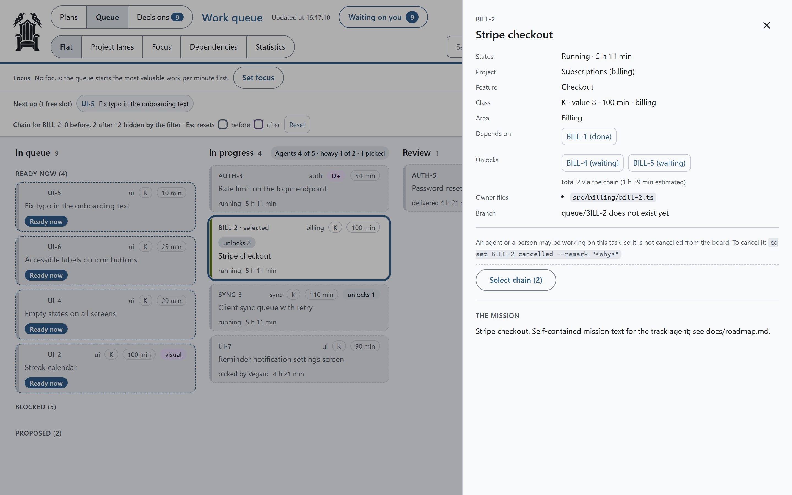
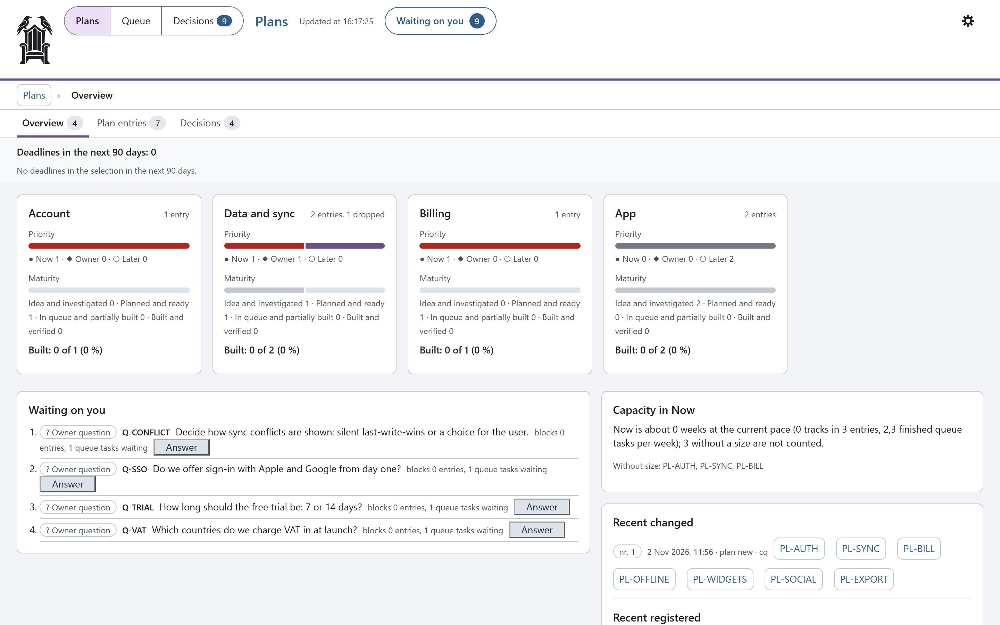
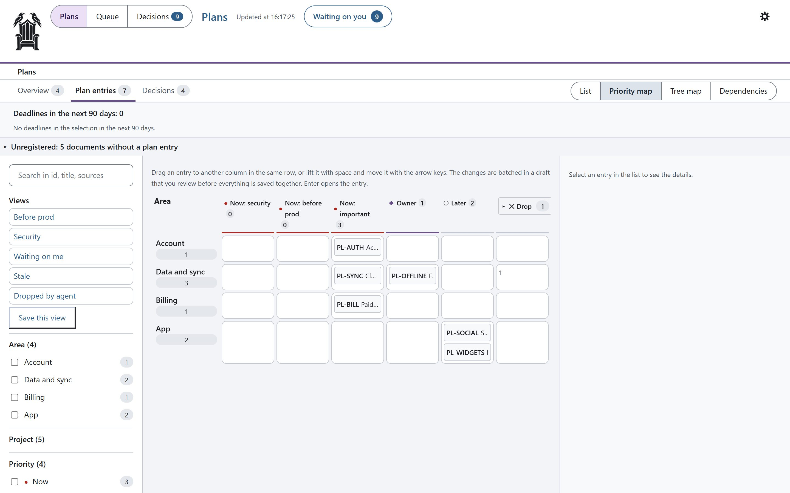
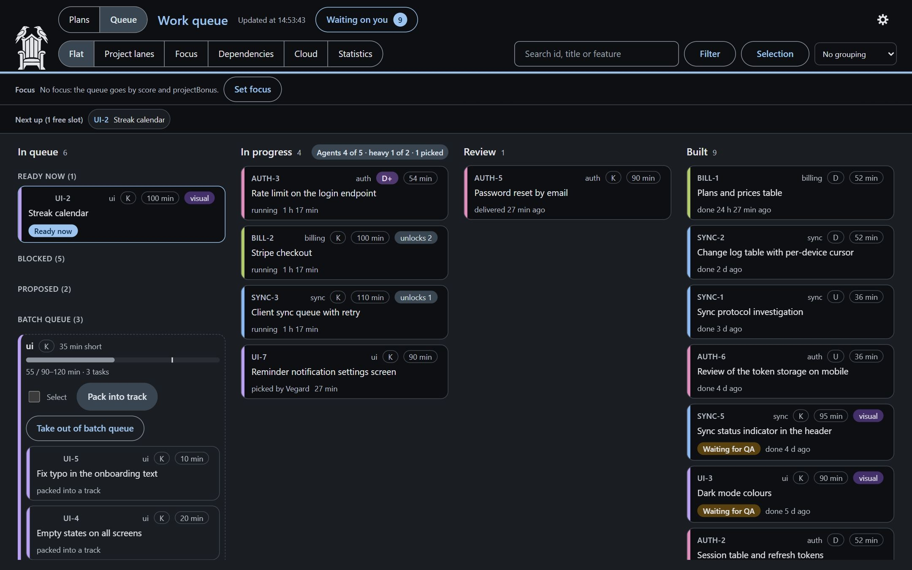
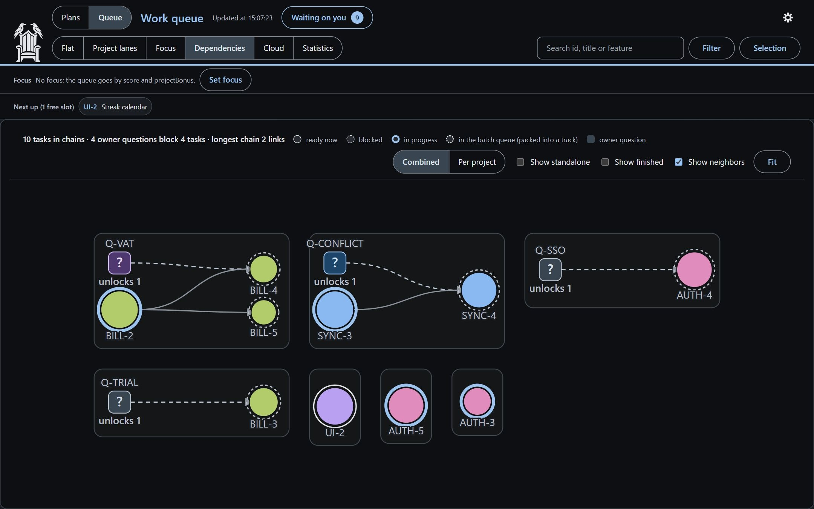
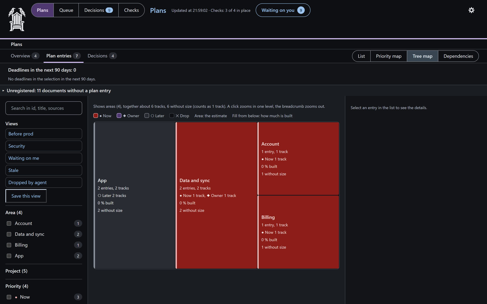
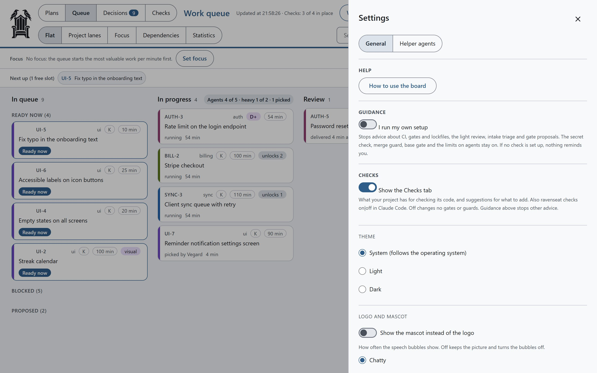

# Full-mode guide

The parts of the old README that are too detailed for the front page: install options, the full first run, daily
use, how the loop works, cloud sessions, the board's detail panel and settings, the full safety baseline, and what
is not included. The [README](../../README.md) has the short version and links here.

## Install

As a Claude Code plugin (recommended). In Claude Code:

```
/plugin marketplace add vegardjorg/ravenseat
/plugin install cq@ravenseat
```

Installed it as claude-code-queue before? Run `/plugin marketplace remove claude-code-queue` first, then the two
lines above. The plugin is still `cq`, and your queue data stays as it is.

Then open your own project and run `/cq:setup`. It:
- creates `queue.config.json`, `docs/queue/` and `CLAUDE.queue.md`, and adds two lines to `.gitignore`;
- asks before it changes `CLAUDE.md` or `.claude/settings.json`;
- fills in your checks (type check, lint, tests) and your project's areas with you;
- creates the empty queue and runs a short smoke test;
- offers to turn your existing notes, TODOs and issues into plan entries and tasks.

The plugin's hooks do nothing in projects without a `queue.config.json`, so it is safe to keep installed.

Update with `/plugin update`; the board shows a banner when a new version is out, with the steps (turn the check off
with `"board": { "updateCheck": false }`, see [board](board.md#update-banner)). To try it without installing:
`claude --plugin-dir <path-to-this-repo>/plugin`.

Without the plugin system you can copy everything into the project instead ("vendored" install): open Claude Code in
your project and say *Install Ravenseat from `<path-to-this-repo>`; follow its INSTALL.md*. See
[INSTALL.md](../../INSTALL.md).

Requirements: Node.js 20 or newer, git and Claude Code. No npm packages are needed at run time.

## Lite mode in more detail

- **Init:** `cq init --lite` (a fresh `cq init` is lite too) writes `"mode": "lite"` to `queue.config.json` and an
  empty queue in `scripts/.queue/`. In a git repo it adds that folder to `.gitignore` unless git already ignores it.
- **A mission:** add one when the title is not enough:
  `cq add "Fix the login bug" --mission "Users with a + in the email cannot log in; add a test"`.
- **Priority:** `--priority 1-10` moves a task up (5 is normal); otherwise tasks run in the order you added them.
- **Questions:** `cq question` lists them and `cq resolve <id> --answer "..."` answers one. A question can come with
  2-4 answer options (`cq question <id> --text "..." --choice "Yes" --choice "No"`): pick one with
  `cq resolve <id> --choice 1`, or with one click on the board.
- **Under the hood** `/cq:queue` runs `cq fill` (start one agent per task in its own worktree), `cq receive` (take in
  what it delivered) and `cq merge`.

## First run in full mode

1. **Install** (above).
2. **Set up the project:** open your project and run `/cq:setup` (it asks first), or do it by hand with
   `cq setup --settings` and `cq init --full` (the config, the docs, the recommended settings and the empty queue).
3. **Add a task:** say "add to the queue: <what you want done>", or write a JSON file and run `cq add --file task.json`.
4. **Start the queue:** `/cq:queue`. It shows the state and asks before it starts any agent.
5. **Open the board:** `/cq:board` gives you a local link. Answer questions under "Waiting on you"; an empty queue
   shows the same three steps.

Cloud sessions and follow-up entries are off by default, and so are the Legal, Launch and Documents surfaces in
Plans. Turn them on with `features` in `queue.config.json` (see [configuration](queue.md#configuration)).

## Daily use

You do not need the commands. Talk to Claude Code as usual: "add this to the queue", "what's next", "start the
queue", "show the board". The skills pick that up, in any language, and when you have planned a task together,
Claude offers to queue it. The slash commands below are the explicit way to do the same.

1. **Add work.** Say "add it to the queue" (or `/cq:add-to-queue` followed by what you want done), or `/cq:plans`
   to work on a plan. Tasks you add can start at once; tasks that agents propose wait for your approval.
2. **Start the loop.** Open a chat and run `/cq:queue`. It reports the state and asks before it starts. Then it fills
   the free slots with track agents, reviews and merges what they deliver, and starts the next tasks, until the queue
   is empty, the daily budget is used, or everything left waits on you.
3. **Make the decisions.** Run `/cq:decide` (or say "what is waiting on me?") to answer them in the chat, one at a
   time. Or run `/cq:board` for the board and use the Decisions tab; the orchestrator picks the answers up either way.
4. **Push when you are ready.** Merges stay local. Nothing is pushed until you say "push", and then in one batch.
   `cq push-check` counts the merged tasks since the last push and says READY, NOT YET, BLOCKED or LARGE; with
   `push.mode: "threshold"` the orchestrator pushes by itself when the batch is ready (see
   [Batch push](orchestration.md#batch-push-the-push-threshold)).

Other skills: `/cq:pick` to take one task and do it yourself in the current chat, `/cq:parallel-wave` for the full
orchestration rules, and `/cq:start` to open a session cheaply before you paste a task (it only answers "ready";
`cq show` gives the queue state).

## How it works

```
 you ──> orchestrator chat (/cq:queue) ──> cq fill ──> track agents in worktrees (queue/<ID> branches)
                 ^                                            │
                 │                                   RESULT line + report.md
                 │                                            v
          questions for you <── review (reviewer agents) <── cq receive
                 │
                 └──> cq merge ──> base branch ──> batch push when you say "push"
```

1. Each task gets a mission file: the shared rules from `docs/queue/mission-template.md`, filtered for its class,
   plus the task's own description.
2. The track works in its own worktree and branch, runs the checks (`gates` in `queue.config.json`), and ends with
   one machine-readable `RESULT` line. A fail-fast precheck (`cq gates --precheck`: syntax, type check, lint and the
   related tests, only on the changed files, stopping at the first red one) runs before the full gate, so a red
   error shows up in minutes.
3. The orchestrator builds a review package, runs the reviewer agents the class needs, and starts a fresh agent for
   any fix round. A task can name a done command (`done_when`, e.g. `npm test -- src/x.test.ts`): `cq receive` runs
   it in the track's worktree first, and a red one gives a fix round instead of a review. After `maxFixRounds` (default
   3) fix rounds the task becomes a question for you instead of another round.
4. When the review is clean, it merges the branch, runs the quick checks and fills the free slot. The base gate
   records whether the base branch itself is green after each merge: two tracks that are green alone can break it
   together, and then `cq merge` refuses other tracks and adds a high-priority fix task until it is green again.

Hooks support the loop: they warn the orchestrator and the tracks when their context gets large, block force pushes,
pushes of branches other than the base branch and migration pushes to the wrong environment, put the queue state
back into the chat after compaction, and log the time and tokens of every subagent. The hooks run in exec form (node
is spawned directly, no shell), which matters on Windows, where a shell-form hook starts Git Bash on every tool call.

**Context limit in every chat.** In a project with the queue, every chat gets a notice at 250k tokens of context.
With `"contextGuard": { "blockOtherChats": true }` in `queue.config.json` (off by default), the message is also
stopped at 400k so a long chat does not keep paying for its whole history; compact the chat (`/compact`), or start
the message with `continue:` to send it anyway. The limits can be changed with environment
variables ([orchestration](orchestration.md)).

**Status line and handover.** `cq setup --settings` adds a status line with context, cost, quota and running
tracks (run it again after a plugin update). The orchestrator keeps a handover note; after compaction it reads only
the "Now" part, and a new orchestrator chat can adopt tracks that are still running (`cq deliveries`, `cq resume`).

**Follow-ups and QA evidence.** `cq follow add` tracks something over a period (board page `/follow`; off by
default, turn it on with `"features": { "follow": true }`), and tracks write an `EVIDENCE` line that `cq qa auto --run`
uses to close QA entries that are green.

**Local time.** The night pause, the daily budget and the statistics per day use the machine's time zone. Set the
`TZ` environment variable to use another.

## Cloud sessions

Tracks can also run in Claude Code's cloud sessions on claude.ai instead of on your machine. I built this to use the
$250 in cloud credits I got from Anthropic, but it works just as well with pay-as-you-go: the cloud gives you more
parallel tracks without more load on your own computer. Cloud is off by default: turn it on with
`"features": { "cloud": true }` in `queue.config.json`.

- **What can go to the cloud:** ordinary code tasks (K and U) without migrations or database changes. The queue
  decides which tasks fit, and the board's **Cloud** tab lists them, grouped into bundles of up to 4 tasks per session.
- **Start:** copy the package from the Cloud tab into a cloud session, or run
  `node "<plugin folder>/scripts/orchestrator/cq.mjs" cloud-start <id> [<id> …]` in your own terminal from the
  project folder (ask Claude for the full path). It opens `claude --cloud`, which draws from the cloud session credits.
  At most 3 cloud sessions run at once.
- **Back home:** when the cloud session reports it is done, the orchestrator fetches the branch and reviews and merges
  it like any other track (`cq cloud done <id>`).
- **Push first:** a cloud session starts from your base branch on GitHub, so it only sees what is pushed.
- **Keep track of the credits:** `cq capacity --cloud-credit <usd left>` records the cloud pot separately from your
  plan's weekly quota.

## The board in detail

### Task detail

<p align="center"></p>

Click a card to open it: the mission, the files it owns, what it waits on, cost and time so far, and the actions
for its status. The chain of tasks before and after it is highlighted on the board.

- **Waiting:** *To the top of the queue*, *Pick* (a person takes it), *Put on hold* / *Take off hold*, *Add to
  batch queue* / *Take out of batch queue*, *Edit* (value 1-10, content minutes and class) and *Cancel task* (you
  confirm first, with an optional reason saved as a remark). Cloud-suitable tasks also get *Copy cloud package* and
  *Started in cloud*.
- **Proposed** (added by an agent): *Edit*, *Decline* (cancels the proposal, with an optional reason), on hold and
  batch queue. Approve proposals in **Waiting on you**, where each one also has *Decline*.
- **Running and review:** nothing that stops the work, since an agent may be working on it. The panel shows the
  command to cancel it from the CLI (`cq set <id> cancelled --remark "<why>"`).
- **Picked:** *Release*. **In a cloud session:** *Completed in cloud* and *Cancel cloud*. **Built with a visual
  check:** *QA ok* and *QA deviation*.

Edit, cancel, decline and the bulk actions show **Undo** for 30 seconds afterwards (and *Undo last* in the gear).
Change the priority by dragging cards (or with the keyboard), or select several cards and move them together.

### Plans

<p align="center"></p>

The **Plans** room is the plan register: one card per area with priority (now, owner, later) and maturity (from
idea to built and verified), open questions, legal points and stale plans, plus what is being worked on right now.

<p align="center"></p>

The **priority map** puts every plan entry in a grid of area by priority. Drag an entry to another column (or use
the keyboard); changes are collected in a draft you review before anything is saved. **Tree map** and
**Dependencies** show the same entries by size and by order.

### Dark mode

<p align="center">
  
  
</p>
<p align="center"></p>

### Settings

<p align="center"></p>

The gear holds the help, the theme and the queue's limits (how many tracks run at once, how many heavy
D+ tracks, tracks per domain, daily budget, night pause, automatic compaction). Each setting shows its current
value, the default and, for the track limits, the recommended ceiling that keeps the weekly quota from running out
early.

More about every tab: [board](board.md).

## Safety baseline in full

Agents write and merge a lot of code quickly, so the usual mistakes (a leaked key, a red build on the live site, lost
data) get cheaper to make. These eleven rules work in any stack; take the ones that fit your project:

1. Keep secrets out of git: `.env*` and key files in `.gitignore`, a committed `.env.example` with names only.
2. Scan for secrets before you push and in CI.
3. Run your own checks (build, type check, lint, tests) on every push, and keep them green.
4. Protect the release branch on your git host: no force push, no deletion, changes only with green checks.
5. Agents never deploy and never see production credentials.
6. Staging first; production is a separate, deliberate step.
7. Database changes go forward only, are tried on staging first, with a backup before production.
8. Have backups you have restored once, and know how to revert a merge (`git revert -m 1 <merge>`).
9. Commit the lockfile and audit your dependencies now and then.
10. Keep large and binary files (dumps, exports, builds) out of git.
11. Keep CI cheap: cancel superseded runs, skip docs-only pushes, push in batches.

What Ravenseat checks for you:
- `cq doctor` (offline, read-only): secret files in git or not ignored (a tracked `.env` or private key is a FAIL;
  an ignored local `.env` is fine), empty gates, no CI config, a manifest without its lockfile, `productionBranch`
  equal to `baseBranch`, tracked files over `largeFileMb`, and CI workflows that run on push without cancel or a path
  filter.
- The push guard: no force push and no other branch than `baseBranch` from Claude Code; before a plain push of the
  base branch it scans what is about to be pushed for secrets (gitleaks when it is on your PATH, otherwise a few
  built-in patterns) and asks, naming file and line, never the value. It also asks before any of your
  `deployCommands`. It only sees commands run inside Claude Code, not your own terminal.
- The gates (`gates.quick`, `gates.full`), with results bound to the commit and run by the orchestrator, the base
  gate that stops merges on a red base, and the batch push threshold.
- `/cq:setup` can write a GitHub Actions workflow that runs your `gates.quick` on push and pull requests (opt-in,
  never over an existing file). On GitLab, Bitbucket and others, add a job that runs the same commands.

## Guarantees and limits

What Ravenseat does, and what you need outside it. The guards are Claude Code hooks: guard rails, not a sandbox.

| Ravenseat checks (within Claude Code hooks and its own CLI) | Needs a boundary outside Ravenseat |
| --- | --- |
| Gate results recorded by the orchestrator, bound to the commit | A sandbox or separate machine user, if agents must not read your files or env |
| Locked `done_when` and acceptance, locked file ownership after start | Branch protection and required checks on GitHub, so nothing reaches `main` unreviewed |
| Merge stop on protected paths, deleted tests and skip markers | Secrets kept off the machine (a scan finds known patterns, not every secret) |
| Queue agents cannot push or run queue commands outside an allow-list | Network rules, if agents must not reach the internet at all |
| Secret scan of every pushed commit, ask before `deployCommands` | Separate credentials per environment, so a dev machine cannot deploy to production |

Known gaps in the command guard: it does not read the contents of script files an agent runs (`bash x.sh`, an
`npm run` script), or commands built from string pieces inside an interpreter. Treat it as a strong default, not
as isolation.

## Not included

This is the queue system only. My own project has more around it, which was too project-specific to include. You
will want your own versions of these:
- **Screenshots and visual checks.** Tasks can carry the label `visual` and land on a manual QA list (`cq qa`), but
  nothing takes screenshots. Either write a small script of your own that opens the app in a headless browser and
  saves screenshots, or use an end-to-end test tool such as Playwright, which can click through flows and take
  screenshots at the same time.
- **Project-specific database tooling** (local database pools, probe runners, migration dry runs). Migration
  numbering is optional and set in `queue.config.json`.
