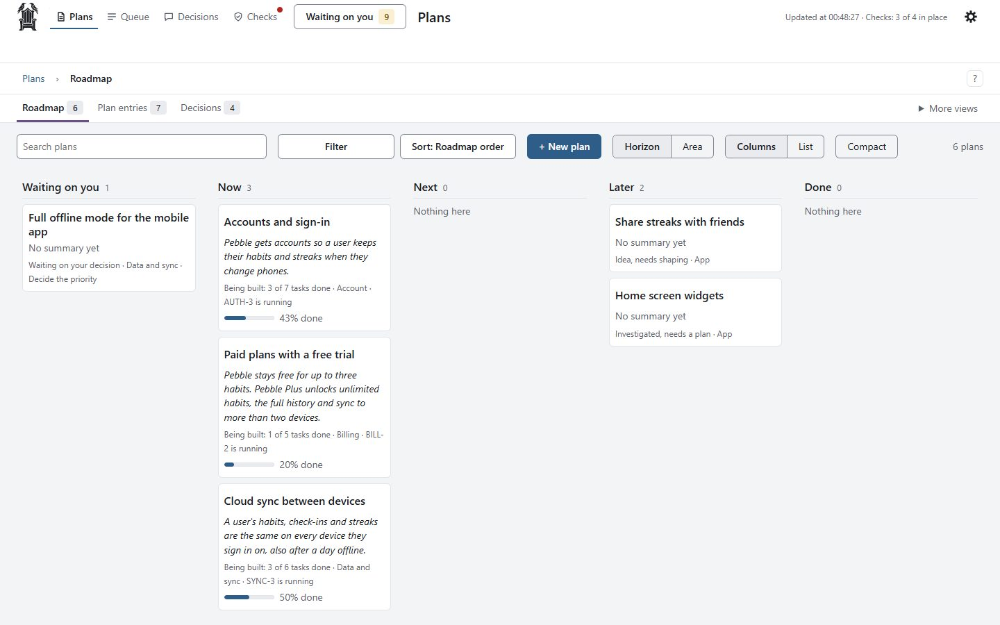
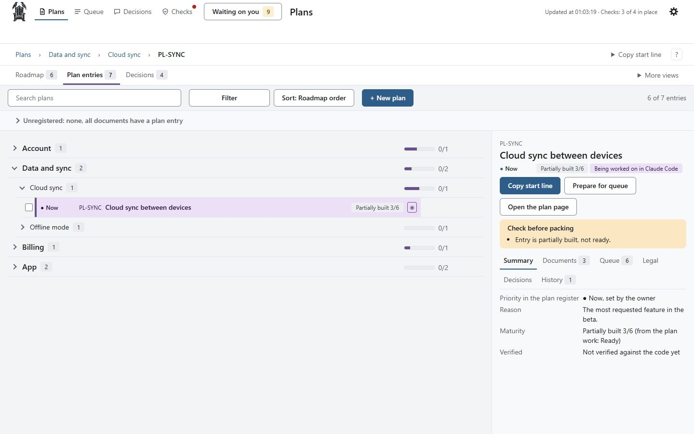
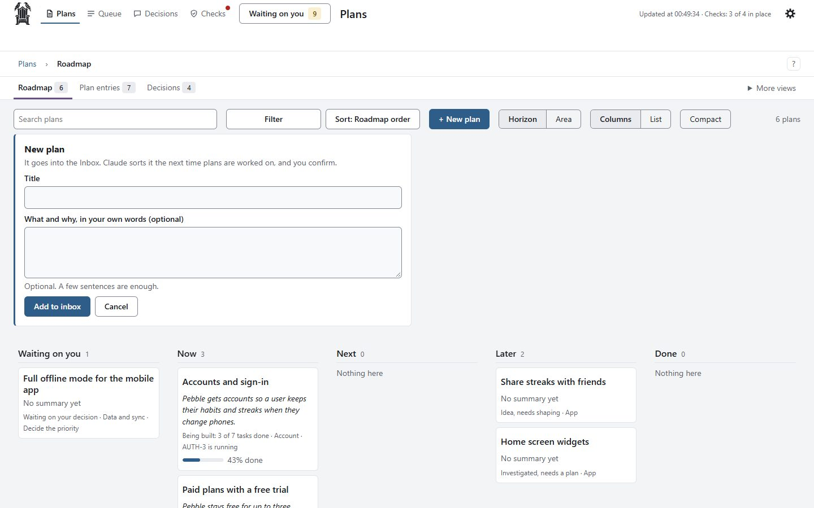

# The plan register (`ravenseat plan …`)

The queue holds work that is ready to run. The plan register holds everything before that: ideas, plans,
investigations and decisions, with priority and maturity, and links to the documents where the details live. It is
stored in `scripts/.queue/plans.json` (gitignored) and only written through `ravenseat plan …`, with a change log and
undo.

<p align="center"></p>

## A plan entry

```json
{
  "id": "PL-OFFLINE",
  "title": "Offline sync for the mobile app",
  "project": "offline",
  "priority": "owner",
  "priority_reason": "No owner decision yet",
  "priority_set_by": "agent",
  "maturity": "idea",
  "sources": [{ "path": "docs/offline-plan.md", "anchor": "## Sync" }]
}
```

- `project` (required): must exist (`ravenseat projects`; create with `ravenseat project <pid> --title "…"`). It links
  the entry to queue tasks in the same project. The area comes from the project: `ravenseat project <pid>
  --area <oid>`, with the areas from `modules` in `queue.config.json` (`ravenseat plan modules` creates them).
- `priority`: `now`, `owner` (the owner must decide), `later` or `drop` (dropped). Categories such as
  `security`, `for-prod` (before production) and `important` explain why.
- `maturity`: from `idea` to a plan that is ready to become queue tasks.
- `sources`: list of `{ path, anchor?, role? }` pointing to the documents. The entry points to them, it never copies
  them.
- `priority_reason`: one sentence (which priority rule, and why). Required when an agent sets the priority.
- `decisions` (optional): list of design choice ids from the [project catalog](catalog.md), such as
  `["D-0001"]`, for the choices the plan builds on or changes. The shape is always checked; while
  `catalog.planLinks` is on, an id the catalog does not have gives a warning. `plan get` prints them, and `ravenseat
  catalog show D-0001` lists the plan entries that link to a choice.

<p align="center"></p>

## Commands

| Command | What it does |
|---|---|
| `plan show [--module m] [--project p] [--priority …] [--search "…"]` | List entries |
| `plan get <id\|project\|module>` | Entries with sources, queue status and owner questions |
| `plan new --file entry.json` | New entry or list of entries |
| `plan edit <id> --field name=value` / `--set '{…}'` | Change fields (`sources` is replaced as a whole list) |
| `plan prioritize <id…> <now\|owner\|later\|drop>` | Set priority |
| `plan combine <to-id> <from-id…>` | Merge entries (the others go to the archive) |
| `plan verify <id> --findings "…"` | Record that a plan was checked against the code |
| `plan rules` | The priority rules |
| `plan active <id>` | "Working now" marker shown on the board |
| `plan check` | Unregistered documents, dead paths, anchors without a heading (the file exists, but the source's `anchor` finds no heading, with the same lookup as the mission; `anchor_misses` in `--json`), stale entries |
| `plan capture "<title>" [--text "…"]` / `--file f.json` | Quick capture into the Inbox (see Inbox) |
| `plan inbox` | The captured plans nobody has sorted yet |
| `plan propose <id> --file f.json` | Claude's proposal for an Inbox item; applies nothing (see Inbox) |
| `plan accept <id> [--file edits.json] --set-by owner` | The owner accepts the proposal, optionally with edits |
| `plan decline <id> [--reason "…"] --set-by owner` | The owner drops an Inbox item |
| `plan merge <id> --into <to-id> --set-by owner` | The owner merges an Inbox item into an existing plan |
| `plan undo` | Undo |
| `plan backup` | Runs the script in `planBackup` (optional; for example a private backup repo) |
| `plan doc …` | Optional register of controlled documents (versions, revisions, links) |
| `finding "<title>" [--detail "…"] [--task <id>] [--cause <id>] [--files a,b]` | A track reports something outside its scope as an idea (see Findings); `--cause` names the merged task it is a defect of |
| `finding list [--all]` | The findings nobody has triaged yet (`--all`: every one) |
| `plan edit <id> --skip-decision "<reason>"` | Record that a large plan skips its decision section (see Decide before you build) |
| `plan shape --tasks <n> [--zones D-0001,…]` | The shape-first question for a request of n tasks, or "no question" (read-only) |
| `plan checkpoint [--plan <id>] [--smallest] [--stage a,b] [--success "…"] [--json]` | The staging offer and the checkpoint question (see Staged queueing; read-only) |

## Decide before you build

A light gate that asks WHETHER and HOW MUCH before a large build. None of it stops work by default.

- **Shape large requests first** (`shape.nudge` `offer`, `shape.threshold` `5`). When a request with no plan entry
  would split into more than 5 tasks, or touches an accepted [sensitive zone](catalog.md), `/add-to-queue` asks once:
  shape it first (recommended: up to three questions and a one-page note as a plan entry), the smallest version first,
  or build it all now. "All now" is fine and is recorded on the tasks (`shaped: skipped`; `smallest` for the second
  answer). `always-shape` shapes without asking first; `off` is as before. `plan shape --tasks <n>` prints the question.
- **Decision section for large plans** (`plans.decisionNote` on). A plan of size L or XL, or in a zone, gets a one-page
  section in its investigation document from `/plans`: need and evidence, success measure, non-goals, alternatives,
  cost, stop criteria, the strongest case against, the cheapest test, and reversibility for a zone. Template:
  [decision-note.md](decision-note.md). Link it as a source with role `decision`; `plan get` prints `Decision: missing`,
  `incomplete (missing …)`, `skipped (reason)` or `done`, and the plan's detail panel on the board shows the same.
- **Check at ready** (`plans.readyCheck` `advisory`). `plan edit <id> --field maturity=ready` (and the board's maturity
  menu) on such a plan without a complete section prints one WARNING naming what is missing. `block` refuses the edit
  (off by default: for a solo owner a block they lift alone becomes a self-stamp); `off` says nothing. A skip recorded
  with `--skip-decision "<reason>"` lets it through in every mode and stays visible on the plan.
- **Large batch line at add** (`add.largeBatchWarn` `5`). An `add` of 5 or more tasks with no plan entry and no
  shaping answer, or of fewer whose estimate is over a week at the pace of the last 28 days, prints one WARNING line
  with the estimate in hours. Nothing is refused; `0` turns the line off.

### Staged queueing

`plans.checkpoint` `offer`. For a large plan (L or XL, or in a zone), and for "the smallest version first",
`/add-to-queue` queues stage 1 now and the rest waiting on one question, `CP-<plan>` (or `CP-<first task>` without a
plan): "The first part is done. Success measure: … Continue, adjust or stop?". The question lists stage 1 in `after` and stays
out of the inbox until those tasks are done or cancelled; `resolve` refuses it earlier unless `--early`. Continue lets
the rest start, Adjust parks the rest for a mission rewrite, Stop parks them (cancelling stays your call). The board
shows "Waiting on checkpoint" on those cards. `offer` asks before staging, `always` stages without asking, `off` queues
everything at once (the smallest version then registers the rest as a plan entry, as before). `plan checkpoint` prints
the offer and the question.

## Findings

A track that notices a bug or a smell outside its own files runs `ravenseat finding "<title>"` instead of fixing it. In a project with no projects registered yet, the first finding creates one called `general`. The
finding lands here, not in the batch queue: the batch queue holds small tasks someone has decided to do (class,
estimate, owned files), while a finding is an observation nobody has looked at yet, which is what an idea is.

- The entry is `PL-FINDING-<n>` with `maturity: idea` and `priority: later` set by the agent. It is not `owner`
  (rule 2 below), so a busy track does not open an owner question for every observation; the orchestrator triages.
- `--task` defaults to the task whose queue branch the worktree is on, and the project to that task's project.
  The tool-owned field `finding` keeps the reporting tasks, the files, the time and a count.
- The same title again (case, punctuation and spacing ignored) adds the task and the files to the existing entry.
  A title that matches an entry that is not a finding changes nothing.
- A finding is new until it is triaged: a new priority or maturity, a drop, or a queue task with `--plan <id>`.
  `orchestrator pulse` and `ravenseat show` print a `FINDINGS:` line with the count, and `ravenseat state` has `findings`.

## Inbox (quick capture)

`ravenseat plan capture "<title>" [--text "…"]` and the board's **+ New plan** write down an idea in one step: a title (up to 160 characters) and, if wanted, a text in the owner's own words (up to 4000). Nothing else is asked.

<p align="center"></p>

- The entry is a normal plan entry: an id from the title (`PL-DARK-MODE-1`), `summary` = the text, project `general` (created on first use), `priority: later` and `maturity: idea` set by the owner.
- The tool-owned field `inbox: { at, by }` marks it as captured. It is removed when the entry is sorted: a new priority or maturity, or `plan edit <id> --field inbox=null`. A queue task with `--plan <id>` or a drop also takes it out of the Inbox.
- The same title again while it still waits in the Inbox writes nothing. A sorted plan with the same title gives a warning.
- `orchestrator pulse` and `ravenseat show` print an `INBOX:` line with the count; `plan inbox` lists them. `plan undo` takes a capture back.
- Off with `features.plans.inbox` (the board then has no **+ New plan**, and `POST /api/plan-capture` answers 403).

### Proposals (sorting the Inbox)

`/plans inbox` has Claude write one proposal per Inbox item with `plan propose <id> --file f.json`: suggested
`project`, `priority` (anything but `later` needs a one-sentence `priority_reason`), `now_category`, `maturity`, `size`,
`summary` and `sources`, plus `merge` (plan ids it looks like) and `outline` (shown only). The title is never proposed
and neither is drop. The proposal is stored in the tool-owned field `proposal: { at, by, fields, merge?, outline? }`
and changes nothing else; `plan undo` takes it back.

- The owner decides each item: `plan accept` (with optional edits in a file), `plan decline` (a drop with a reason,
  default "Declined in the inbox.") or `plan merge --into <id>`, each with `--set-by owner`, one change and one undo.
  On the board these are **Accept**, **Edit**, **Decline** and **Merge** on the row (keys 1 to 4).
- Accept writes the fields as the owner's choice and clears the inbox marker; an accepted finding gets
  `priority_set_by: owner`. A changed summary keeps the owner's own text in the tool-owned field `original_text`.
- A new priority or maturity set another way, or the item leaving the Inbox, removes the proposal.
- `plans.inboxTriage` (`on-request`): when Claude sorts. `idle` adds a hint to the `INBOX:` line to sort when a slot is
  free; `off` refuses `plan propose`.
- `plans.inboxAutoApply` (`false`): on, `plan propose` applies a proposal at once for a captured plan that stays at
  `later` and has no merge (never a finding, never a priority). Off by default because it changes plans without the
  owner.

## Rules that keep it useful

1. A new plan or investigation document is registered in the SAME session it is written, either as a new entry or as
   a source on an existing one (`plan show --search "…"` first).
2. An entry created by an agent without the owner's decision gets `"priority": "owner"`, `"maturity": "idea"`,
   `"priority_set_by": "agent"` and a reason, and an owner question (`ravenseat question`).
3. Plan work and building are separate: the skill `/plans` works on plans only and turns a mature plan into queue
   proposals; the queue builds.
